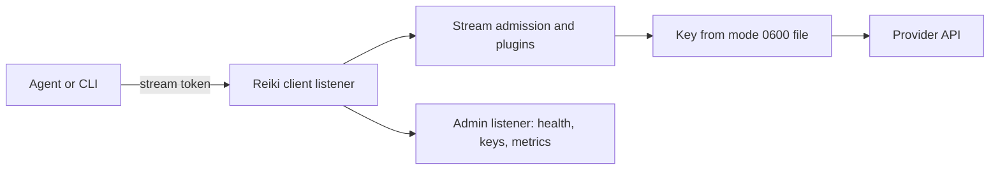

<p align="center">
  <picture>
    <source media="(prefers-color-scheme: dark)" srcset="docs/assets/logo-dark.png">
    
  </picture>
</p>

# Reiki

[](https://github.com/ddproxy/reiki/actions/workflows/ci.yml)
[](https://github.com/ddproxy/reiki/actions/workflows/codeql.yml)
[](https://scorecard.dev/viewer/?uri=github.com/ddproxy/reiki)
[](https://github.com/ddproxy/reiki/releases/latest)
[](LICENSE)

Reiki is a security proxy that keeps upstream API keys on the Reiki host and gives each client a revocable stream token, so agent and LLM traffic passes one inspectable point.

**Status:** stable at 0.14.0. Dynamic streams (`[stream_admin]`), runtime Wasm plugins (`plugin-wasm`) and cost accounting (`plugin-cost`) are preview: they are opt-in and have their own pages.

## What and why

An agent that holds a provider API key can use that key from anywhere it can reach the network. Reiki moves the key into a mode-`0600` file, gives the client a stream token instead, and sets the credential on each upstream request. One place then handles failover, outbound filtering, limits and audit: rotate or revoke a token without touching the client's provider settings, and see what left the host in the request log and metrics. Reiki is one binary and one TOML file; plugins are chosen at build time.



Reiki does not make a client use the proxy. Traffic that never reaches a Reiki listener is outside its control; see [limits and non-goals](#limits-and-non-goals).

## Install

One line, once published with tuishou:

```sh
curl -fsSL https://raw.githubusercontent.com/ddproxy/tuishou/main/install.sh | bash -s -- --components reiki
```

**Coming with tuishou.** The installer script may not exist yet. Until it does, use the manual path below, which works today. Read any installer before running it:

```sh
curl -fsSL https://raw.githubusercontent.com/ddproxy/tuishou/main/install.sh -o install.sh
less install.sh
bash install.sh --components reiki
```

Manual install from a checkout (Rust 1.99 or newer) or a release archive:

```sh
git clone https://github.com/ddproxy/reiki.git
cd reiki
make install
```

`make install` builds with `reiki top` and installs one binary to `~/.local/bin` (`/usr/local/bin` as root; `PREFIX=/opt/reiki make install` picks another prefix). Alternatively download a prebuilt archive from the [releases page](https://github.com/ddproxy/reiki/releases), check it against its `.sha256` file, and copy `reiki` onto your `PATH`. See [install](docs/install.md) and [deploy](docs/deploy.md).

## Quickstart (10 minutes)

This sets up one upstream, one key, one stream and an admin listener. The full walkthrough with timings is [docs/quickstart.md](docs/quickstart.md); the commands below are the same path. The `example` upstream is a placeholder: use a real `base_url` and model from [providers](docs/providers.md) for a successful upstream response.

1. Create key and token files. Config stores hashes; only the client and admin CLIs use raw tokens.

   ```sh
   umask 077
   printf '%s' "$PROVIDER_KEY" > /etc/reiki/keys/example-a
   chmod 0600 /etc/reiki/keys/example-a
   ADMIN_TOKEN=$(openssl rand -hex 32)
   CLIENT_TOKEN=$(openssl rand -hex 32)
   printf '%s' "$CLIENT_TOKEN" | reiki hash-token
   printf '%s' "$ADMIN_TOKEN"  | reiki hash-token
   ```

   Each `hash-token` prints 64 hex characters. Put the client hash and the admin hash in the config.

2. Write `/etc/reiki/reiki.toml` with those hashes.

   ```toml
   listen = "127.0.0.1:4097"

   [admin]
   listen = "127.0.0.1:4098"
   token_sha256 = "<64 hex from the admin token>"

   [upstream.example]
   base_url = "https://api.example.com/v1"

   [keys.example-a]
   upstream = "example"
   file = "/etc/reiki/keys/example-a"

   [streams.client-a]
   token_sha256 = "<64 hex from the client token>"
   chain = ["example-a"]
   ```

3. Validate, then start in the foreground.

   ```sh
   reiki --config /etc/reiki/reiki.toml check
   reiki --config /etc/reiki/reiki.toml
   ```

   Expected `check` output with peers off:

   ```text
   caps: client 1024 (256 per address), admin 64 (16 per address); loopback exempt from the per-address caps
   peers: disabled
   ok: 1 upstream(s), 1 key(s), 1 stream(s), listening on 127.0.0.1:4097, admin on 127.0.0.1:4098
   ```

4. Prove the listener checks tokens, and that the live admin API answers.

   ```sh
   code=$(curl -s -o /dev/null -w '%{http_code}' http://127.0.0.1:4097/example/chat/completions \
     -H 'Authorization: Bearer $STREAM_ADMIN_TOKEN' -H 'Content-Type: application/json' \
     -d '{"model":"example-model","messages":[{"role":"user","content":"ping"}]}')
   REIKI_ADMIN_TOKEN="$ADMIN_TOKEN" reiki --config /etc/reiki/reiki.toml keys
   REIKI_ADMIN_TOKEN="$ADMIN_TOKEN" reiki --config /etc/reiki/reiki.toml failures --limit 5
   test "$code" = 401 && echo "PASS: wrong token rejected, live state answered"
   ```

   Expected proof line and key table:

   ```text
   PASS: wrong token rejected, live state answered
   KEY        UPSTREAM  STATE  COOLDOWN  LAST  STREAMS
   example-a  example   ok     -         -     client-a
   ```

   `failures` prints `no failures` before the first upstream attempt. The proof shows that the request reached Reiki and was checked against a stream hash; it does not prove the upstream works. Use `SIGTERM` to stop the foreground process. See [quickstart](docs/quickstart.md) for the health probe and a negative-test body.

## How it works

A request arrives on the client listener, is matched to a stream token, is admitted under that stream's limits and plugin chain, and then tries the keys in the stream's chain against the configured upstream. Reiki rewrites the credential on each attempt, classifies the answer, cools a bad key, and records the outcome without writing key material. The admin listener exposes health, metrics and reload; peers publish a read-only health document. Full detail: [architecture](docs/architecture.md) and [overview](docs/overview.md).

## Configuration

One TOML file. Every table is optional except that each stream needs a chain and a token hash; unknown keys are errors. Reference: [configuration](docs/configuration.md), [CLI](docs/cli.md) and [keys](docs/keys.md).

| Table | Default | Meaning |
| --- | --- | --- |
| `listen` | `127.0.0.1:4097` | Client listener; `--listen` wins, then `REIKI_LISTEN`. |
| `[admin]` | none | Loopback admin listener and its token hash. |
| `[upstream.NAME]` | none | Base URL, credential header and transport for one provider. |
| `[keys.NAME]` | none | Key file and upstream; files must be mode `0600`. |
| `[streams.NAME]` | none | Token hash, chain, strategy, limits and allowlists. |
| `[gateway]` | `on_store_error = "closed"`, `usage_rpm = 60` | Admission defaults and the self-service usage budget; counter failures fail closed. |
| `[stream_admin]` | none | Opt-in dynamic stream API, audit log and state file; dedicated token. |
| `[server]` | 1024 client connections (256 per address), 64 admin (16 per address) | Startup-only connection caps. |
| `[auth]` | 10 bad tokens in 60 seconds | Login throttling on client and admin listeners. |
| `[service]` | `shutdown_timeout_secs = 25` | Drain window on SIGTERM. |
| `[log]`, `[reload]` | stderr, info; watch off | Service log format and config reload. |
| `[plugins.NAME]` | built-in set chosen at build time | Compiled-in plugins; `cost` and Wasm plugins are opt-in. |
| `[peers]` | none | Read-only health sharing and `reiki top`. |
| `[tunnel]`, `[tunnel.intercept]` | none | Opaque CONNECT allow-list and optional TLS interception. |
| `[hub]`, `[hubs]`, `[accounts]` | none | Parsed hub design; no listener or client is built. |

Minimal example (the quickstart config above) and a fuller example both validate with `reiki --config FILE check`:

```toml
listen = "127.0.0.1:4097"
[admin]
listen = "127.0.0.1:4098"
token_sha256 = "<64 hex from the admin token>"
[upstream.example]
base_url = "https://api.example.com/v1"
[keys.example-a]
upstream = "example"
file = "/etc/reiki/keys/example-a"
[streams.client-a]
token_sha256 = "<64 hex from the client token>"
chain = ["example-a"]
```

```toml
listen = "127.0.0.1:4097"
strict_key_permissions = true

[server]
max_connections = 256
max_connections_per_addr = 64

[auth]
max_failures = 10
window_secs = 60

[service]
shutdown_timeout_secs = 25

[admin]
listen = "127.0.0.1:4098"
token_sha256 = "<64 hex from the admin token>"

[gateway]
on_store_error = "closed"
usage_rpm = 60

[upstream.example]
base_url = "https://api.example.com/v1"

[keys.example-a]
upstream = "example"
file = "/etc/reiki/keys/example-a"

[streams.client-a]
token_sha256 = "<64 hex from the client token>"
chain = ["example-a"]
weight = 1

[streams.client-a.limits]
rpm = 60
tpm = 100000
concurrent = 4
daily_tokens = 1000000
period_zone = "UTC"

[log]
level = "info"
format = "text"

[reload]
watch = false
interval_secs = 5

[plugins.metrics]
```

Configuration examples are checked by `make docs-check`. Values written as `<64 hex ...>` are placeholders: generate them with `reiki hash-token`; never paste a real token into a config in a patch.

## Operating it

| Task | Where |
| --- | --- |
| Upgrade, reload, rollback | [upgrades](docs/upgrades.md) and [operations](docs/operations.md) |
| Dynamic streams: create, rotate, revoke, expiry, audit, backup and restore | [dynamic streams](docs/dynamic-streams.md) |
| Backup and restore of `<config>.state`, audit log and sidecar | [operations](docs/operations.md) |
| Logs, metrics, health checks and exact failure messages | [monitoring](docs/monitoring.md) and [troubleshooting](docs/troubleshooting.md) |
| Verify a release archive, SBOM and attestation | [security scanning](docs/security-scanning.md) |

Health probe: `GET http://127.0.0.1:4097/__reiki/healthz` needs no token and answers `ok` while Reiki is up. A reload previews with `reiki --config FILE reload --dry-run` and applies with `reiki --config FILE reload`. Upgrade by installing the new binary and restarting; roll back by restoring the previous binary and config. Do not edit or truncate the state or audit files while the instance is running.

## Security model

Reiki protects upstream credentials from the client, limits and records what a stream can send, and keeps a separate admin token off the client listener. Its trust boundary is the host and the Reiki user: any process with those privileges can read key files, and compiled-in plugins are trusted code. `[stream_admin]` adds a dedicated management token, optional two-party confirmation and a fail-closed hash-chained audit log; dynamic state and audit files are mode `0600`. Reiki does not sandbox the client, detect every encoding of a secret, or stop traffic that bypasses its listeners. Details: [security](docs/security.md), [redaction](docs/redaction.md) and [limits](docs/limits.md). Report a vulnerability privately as described in [SECURITY.md](SECURITY.md).

## Compatibility matrix

| Item | Last checked | Notes |
| --- | --- | --- |
| Rust toolchain | 1.99 (MSRV in `Cargo.toml`, edition 2024) | Enforced by CI. |
| `x86_64-unknown-linux-musl` | 0.14.0 release workflow | Static archive; qemu smoke check at CPU baseline. |
| `aarch64-unknown-linux-musl` | 0.14.0 release workflow | Static archive. |
| `aarch64-apple-darwin`, `x86_64-apple-darwin` | 0.14.0 release workflow | macOS archives. |
| Built-in plugins, `top`, `peers` | 0.14.0 CI and workspace tests | Default features plus `top`. |
| `plugin-wasm` (Wasmtime 51.0.0) | 0.14.0 workspace tests and component fixtures | Off by default; see [Wasm plugins](docs/wasm-plugins.md). |
| `plugin-cost` | 0.14.0 workspace tests and cost-feature tests | Off by default; see [cost](docs/cost.md). |
| OpenCode and Claude Code | Not verified in this repository | Client config keys are documented, but no client source or 2.x config fixture is checked here. See [opencode](docs/opencode.md) and [claude-code](docs/claude-code.md). |
| Provider APIs | Mock-upstream tests in this repository | No live provider credential is used by CI; see [providers](docs/providers.md#provider-status-and-test-coverage). |

## Limits and non-goals

- **Not a client enforcer.** A client that talks directly to a provider, or a sub-agent with its own config, bypasses Reiki. Enforce egress and client config outside Reiki.
- **Not a host boundary.** Key files are mode `0600` but readable by the Reiki user and root. Separate accounts or hosts are needed against same-user processes.
- **Fail-closed by default where it counts.** Gateway counter failures refuse with `503` (`[gateway] on_store_error = "closed"`); masking plugins skip closed; stream admin fails closed when the audit log cannot be written. `"open"` and `on_error = "pass_through"` are explicit fail-open choices.
- **Plugin code is trusted.** Built-in plugins run in the Reiki process without a sandbox. Runtime Wasm plugins are sandboxed behind `plugin-wasm`; native plugins are not.
- **Opaque tunnels stay opaque.** CONNECT destinations on the allow-list are not inspected unless `[tunnel.intercept]` names the host. Plain CONNECT needs no token, so restrict access to the listener.
- **Finite redaction and detection.** The scrubber covers a fixed set of encodings; detectors read request bodies only, not headers, query strings or responses. See [limits](docs/limits.md).
- **Cost figures are estimates.** `plugin-cost` uses the operator price table, not provider invoices. The hub tables parse and validate but bind no listener.

## Contributing and development

```sh
make help        # list targets
make build       # release build with reiki top
make test        # workspace tests, default and top features
make lint        # fmt check and clippy with warnings denied
make check       # workspace cargo check
make docs-check  # validate documentation examples and links
```

Commit messages are terse and describe the change, not the process. Build-time plugin order is described in [plugins](docs/plugins.md); the release process uses tagged builds on `main` with release archives, checksums and attestations. See [AGENTS.md](AGENTS.md) for the repo map and agent workflow.

## License and links

MIT. [Documentation index](docs/README.md) · [Changelog](CHANGELOG.md) · [Releases](https://github.com/ddproxy/reiki/releases) · [Security](SECURITY.md)
