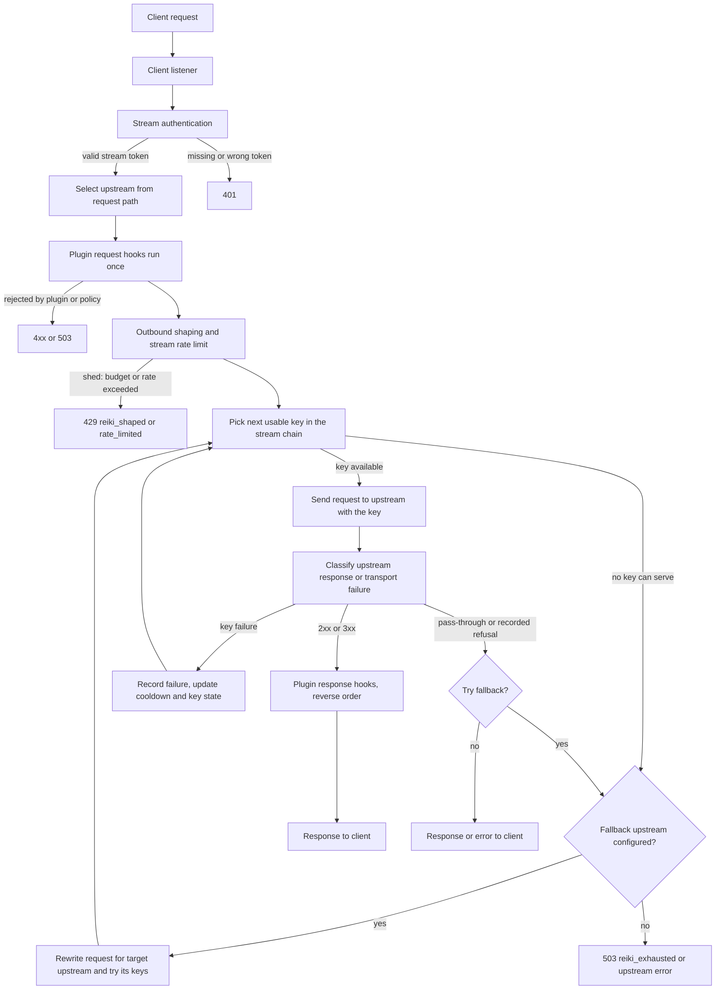

# Architecture

This page describes how a request moves through Reiki and where each step lives in the source and configuration.

## Request path

Request hooks run once before the failover loop, so every key attempt sees the same rewritten request. Response hooks run in reverse plugin order on the chosen response. A decoded 2xx or 3xx response is streamed after its head is chosen; a transport failure after that point is not retried on another key. Details: [failover](failover.md), [plugins](plugins.md), [shaping](shaping.md).

## Key states

`docs/failover.md` defines the key state diagram, and [Response classification](classification.md#response-rules) has the status-to-effect table. See [Key states](failover.md#key-states).

## Stage map

| Stage | What happens | Source files | Configuration |
| --- | --- | --- | --- |
| Client listener | Accepts connections, applies connection caps, and serves `/__reiki/healthz`. | `src/main.rs`, `src/serve.rs`, `src/proxy.rs` | `listen`, `[server]`, `[service]` |
| Stream authentication | Reads the client token, matches it to a stream, and applies failed-login backoff on the client listener. | `src/auth.rs`, `src/proxy.rs`, `src/serve.rs` | `[streams.*].token_sha256`, `[auth]` |
| Path and upstream selection | Maps the request path prefix to an upstream and filters chain keys to that upstream. | `src/proxy.rs`, `src/config.rs`, `src/rewrite.rs` | `[upstream.*]`, `[streams.*].chain` |
| Plugin request hooks | Runs request hooks once, before any key is tried, in build order. | `src/plugins.rs`, `src/proxy.rs`, plugin crates in `crates/` | `[plugins.*]`, `streams` on plugin tables |
| Stream rate limit and shaping | Counts the stream attempt budget, waits for or sheds an outbound slot, and tracks usage/cooldown hints. | `src/proxy.rs`, `src/shaper/`, `src/pressure.rs`, `src/chain.rs` | `[streams.*].rate_limit_per_minute`, `[upstream.*].limits`, `[accounts.*.limits]` (parsed) |
| Key chain selection | Chooses the next usable key by strategy, skipping cooling, disabled or shaped-out keys. | `src/chain.rs`, `src/proxy.rs`, `src/state.rs` | `[streams.*].chain`, `[streams.*].strategy`, `[keys.*]` |
| Upstream call | Rewrites and sends the request through the reverse-proxy, forwarder or tunnel/intercept path and sets the upstream credential. | `src/proxy.rs`, `src/upstream.rs`, `src/forward.rs`, `src/rewrite.rs`, `src/intercept.rs`, `src/tunnel.rs` | `[upstream.*]` (`base_url`, auth, rewrites, transport, `forward`, `passthrough`), `[tunnel]`, `[tunnel.intercept]` |
| Response classification and key state | Reads the outcome, classifies failures, updates key health and cooldowns, and records recent failures. | `src/classify.rs`, `src/proxy.rs`, `src/chain.rs`, `src/state.rs`, `src/failures.rs`, `src/quota.rs` | `[keys.*].quota_resets`, `[upstream.*].confirm_quota`, `[upstream.*].scope_escalate_after`, `[upstream.*].hold_unauthorized`, `[upstream.*].pass_errors` |
| Fallback upstream | Rewrites the request for the configured target and continues on that upstream when the source chain cannot serve. | `src/proxy.rs`, `src/config.rs`, `src/rewrite.rs` | `[upstream.*.fallback]` |
| Plugin response hooks | Runs response head and chunk hooks in reverse order on the selected response. | `src/plugins.rs`, `src/proxy.rs` | `[plugins.*]` |
| Admin, peers and observability | Serves admin routes, publishes peer health, and exposes logs, metrics and the live view. | `src/admin.rs`, `src/peers/`, `src/logging.rs`, `src/top.rs`, plugin crates | `[admin]`, `[peers]`, `[log]`, `[plugins.metrics]`, `[plugins.requestlog]` |

See also: [overview](overview.md), [configuration](configuration.md), [cli](cli.md), [providers](providers.md).
