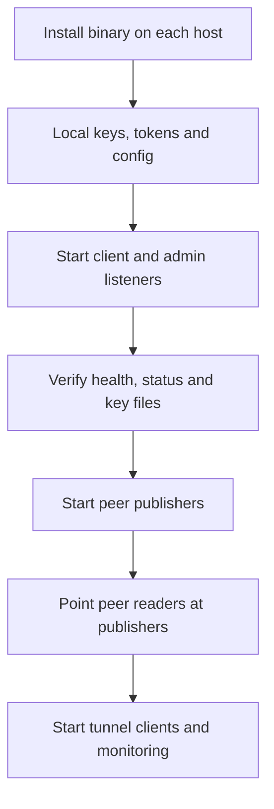

# Deploy

Reiki runs in the foreground and logs to stderr; a process manager supervises it. This page covers install, filesystem layout, listeners, lifecycle, first start, health checks, backup, upgrade, the reload map, state files and gateway-store recovery. For a first proof of operation see the [quickstart](quickstart.md); for config keys and flags see [configuration](configuration.md) and [CLI](cli.md).

## Install

| Method | Command | Binary |
| --- | --- | --- |
| Source checkout, Rust 1.99+ | `make install` | `/usr/local/bin/reiki` as root, otherwise `~/.local/bin/reiki` |
| Custom prefix | `PREFIX=/opt/reiki make install` | `/opt/reiki/bin/reiki` |
| Release archive | Download the `.tar.gz`, check its `.sha256`, copy `reiki` onto `PATH` | Any directory on `PATH`; mode `0755` |

`make build` runs `cargo build --release --locked --features top`. `make install` builds that target, creates the `bin` directory and installs one file with mode `0755`; `DESTDIR=` stages it and `make uninstall` removes it. It creates no config, keys, state directory or service unit.

```sh
tag=<version>
gh release download "$tag" --repo ddproxy/reiki \
  --pattern '*.tar.gz' --pattern '*.sha256' --dir dist
(cd dist && shasum -a 256 -c *.sha256)
tar -xzf "dist/reiki-$tag-x86_64-unknown-linux-musl.tar.gz" -C dist
install -m 0755 dist/reiki-"$tag"-x86_64-unknown-linux-musl/reiki ~/.local/bin/reiki
```

Archives also ship an SBOM and provenance attestations; see [security](security.md). Cargo features add opt-in subsystems: `top` (terminal fleet view), `plugin-cost` (spend estimates), `plugin-wasm` (runtime plugins) and `fuzzing` (parser entry points for fuzz targets, never in a release build). Plugin selection and order are build arguments; see [plugins](plugins.md). Prebuilt archives are produced for `x86_64-unknown-linux-musl`, `aarch64-unknown-linux-musl`, `aarch64-apple-darwin` and `x86_64-apple-darwin`.

```sh
reiki --version
reiki --help
reiki --config /etc/reiki/reiki.toml check
```

## Directory layout

These are recommended paths. Reiki creates the state file, service log, request-log file and request-log socket; it does not create their parent directories.

| Path | Owner and mode | Set by | Purpose |
| --- | --- | --- | --- |
| `/usr/local/bin/reiki` | `root:root`, `0755` | `make install` | Binary |
| `/etc/reiki/` | `reiki:reiki`, `0750` | Operator | Config and secrets; writable so the state file can be saved |
| `/etc/reiki/reiki.toml` | `reiki:reiki` or `root:reiki`, `0640` | Operator | Config; default path |
| `/etc/reiki/reiki.toml.state` | `reiki:reiki`, `0600` | Reiki | Key health and shaping state; `<config>.state` |
| `/etc/reiki/keys/` | `reiki:reiki`, `0700` | Operator | Key directory |
| `/etc/reiki/keys/zen-a` | `reiki:reiki`, `0600` | Operator | One raw provider key per file |
| `/etc/reiki/admin.token` | `reiki:reiki`, `0600` | Operator | Raw admin token for CLI calls |
| `/etc/reiki/peers/` | `reiki:reiki`, `0700` | Operator | Peer token and TLS material |
| `/etc/reiki/peers/peer-a.token` | `reiki:reiki`, `0600` | Operator | Raw token this instance presents to a peer |
| `/etc/reiki/peers/listener.key` | `reiki:reiki`, `0600` | Operator | Peer TLS key; group and other bits are refused by default |
| `/etc/reiki/ca/` | `reiki:reiki`, `0700` | Operator | Interception CA |
| `/etc/reiki/ca/ca.key` | `reiki:reiki`, `0600` | `reiki ca-init` | CA private key; group and other bits are refused by default |
| `/etc/reiki/ca/ca.pem` | `reiki:reiki`, `0644` | `reiki ca-init` | CA certificate; distribute to clients that intercept |
| `/var/lib/reiki/reiki.log` | `reiki:reiki`, `0640` | Reiki | Optional `[log] file`; symlinks are refused |
| `/var/lib/reiki/requests.jsonl` | `reiki:reiki`, `0600` | Reiki | Optional request-log file |
| `/run/reiki/requests.sock` | `reiki:reiki`, `0600` | Reiki | Optional request-log socket; parent `0700` |

Reiki enforces `0600` on the state file and request-log file and socket, and tightens an existing service log to `0640`. By default startup and reload refuse a key file with group or other read or write bits (`strict_key_permissions = true`); set it to `false` to warn instead. `reiki keys --check` always reports such a file as a warning and exits `1`. Peer tokens, peer TLS keys and the intercept CA key must be private. See [keys](keys.md), [provider health](provider-health.md) and [security](security.md).

## Startup checks

Before binding listeners, Reiki probes the state directory (the parent of `<config>.state`) and, when `[log] file` is configured, the log directory. Each probe creates and removes an unpredictably named temp file with `create_new` and `O_NOFOLLOW`, writes a few KB and removes it. A pre-existing file or symlink at a probe path cannot satisfy the check, and no files are created outside the configured paths.

With `[gateway] on_store_error = "closed"` (the default), a failed state-directory probe exits 1 naming the path and the OS cause; with `"open"`, Reiki logs one `WARN` and continues. A failed log-directory probe never stops startup: Reiki logs one `WARN` and disables the log file for that run. The unit below uses `ReadWritePaths=/etc/reiki` for the default config path; for a config under `StateDirectory` that line is not needed.

## Listeners

| Listener | Config | Default | Authentication and use |
| --- | --- | --- | --- |
| Client | top-level `listen` | `127.0.0.1:4097` | Stream token on proxied requests. `GET /__reiki/healthz` needs no token. `--listen` wins over `REIKI_LISTEN`, which wins over config. Plain HTTP. |
| Admin | `[admin].listen` and `token_sha256` | none; optional table | Bearer admin token. Serves `/v1/status`, `/v1/failures`, `/v1/reload`, `/v1/keys/enable` and `/v1/metrics`. Must be a literal loopback IP and port and differ from the client listener; hostnames are refused. |
| Peers | `[peers].enabled`, `publish`, `listen` and a token | none; optional table | Read-only `/v1/health` and `/v1/health/stream` with a peer token. Needs the `peers` feature. A non-loopback address needs TLS. |
| Tunnel | `[tunnel].listen` and `allow` | none; optional table | Opaque CONNECT on an allow-list. No token on the socket, so restrict network access. `[tunnel.intercept]` adds TLS termination for listed hosts. |

Every bound listener must have a distinct address. Docs examples use `4099` for both peers and tunnel; choose two different ports. Keep plain HTTP listeners on loopback or put TLS in front. See [configuration](configuration.md), [monitoring](monitoring.md), [provider health](provider-health.md) and [tunnel](tunnel.md).

## Signals and lifecycle

| Signal | Effect |
| --- | --- |
| `SIGTERM`, `SIGINT` | All listeners stop accepting. Idle keep-alive connections close. Requests in flight get `[service] shutdown_timeout_secs` (default 25, range 1 to 300) to finish. Then the request log and state file are written and Reiki exits 0. |
| A second `SIGTERM` or `SIGINT` | Exits at once with status `128 + signal`: 143 or 130. |
| `SIGHUP` | Reloads config, key files, plugin settings, interception CA files and peer TLS files, like `POST /v1/reload`. See [reload vs restart](#reload-vs-restart). |

A streamed response still running when the drain ends is cut. With `[tunnel] close_idle_on_stop = true` (the default), tunnels with no bytes in either direction for at least one second close as soon as the stop begins; active tunnel connections get the same drain time and are then cut. Keep `TimeoutStopSec` above `shutdown_timeout_secs`.

With `Type=notify`, Reiki sends `READY=1` after every listener binds and `STOPPING=1` when a stop begins. With `WatchdogSec=`, it sends `WATCHDOG=1` at half the period while the async runtime is alive. Without `NOTIFY_SOCKET` these calls do nothing. Each client and upstream connection uses a file descriptor; the client listener admits 1024 connections by default, and Reiki warns at start when the soft limit is below 4096. Exit status is 0 after a clean stop, 1 for config, key, plugin, state-directory or bind failure, 143 or 130 after a second stop signal; CLI usage errors use 2. See [CLI](cli.md).

## systemd unit

```ini
[Unit]
Description=Reiki security proxy for agent and LLM traffic
After=network-online.target
Wants=network-online.target

[Service]
Type=notify
User=reiki
Group=reiki
ExecStart=/usr/local/bin/reiki --config /etc/reiki/reiki.toml
ExecReload=/bin/kill -HUP $MAINPID
Restart=always
RestartSec=3
TimeoutStopSec=40
WatchdogSec=60
LimitNOFILE=65536
StateDirectory=reiki
RuntimeDirectory=reiki
RuntimeDirectoryMode=0700
ReadWritePaths=/etc/reiki
NoNewPrivileges=true
ProtectSystem=strict
ProtectHome=true
PrivateTmp=true
PrivateDevices=true
ProtectKernelTunables=true
ProtectKernelModules=true
ProtectControlGroups=true
RestrictNamespaces=true
RestrictRealtime=true
LockPersonality=true
UMask=0077

[Install]
WantedBy=multi-user.target
```

`ReadWritePaths=/etc/reiki` lets Reiki write `<config>.state` beside the config; it also makes the key files writable, so keep keys elsewhere if that matters. Add a `ReadWritePaths=` entry for a service log or request log outside `StateDirectory`. A forwarder inherits these limits; check `systemd-analyze security reiki` before adding `SystemCallFilter=` or `MemoryDenyWriteExecute=`, which some JavaScript runtimes may not tolerate. Forwarders run as child commands or Unix sockets; a socket in a group- or other-writable directory needs `expect_uid`. See [providers](providers.md).

## First-start checklist

1. Install the binary and create the service user and directories from the layout table:

   ```bash
   useradd --system --home /nonexistent --shell /usr/sbin/nologin reiki
   install -d -m 0750 -o reiki -g reiki /etc/reiki
   install -d -m 0700 -o reiki -g reiki /etc/reiki/keys
   reiki --version
   ```

2. Create one key file and one admin token. Hash the stream token and the admin token. Config takes hashes; CLI calls take the raw admin token.

   ```bash
   umask 077
   printf '%s' "$PROVIDER_KEY" > /etc/reiki/keys/zen-a
   chmod 0600 /etc/reiki/keys/zen-a

   ADMIN_TOKEN=$(openssl rand -hex 32)
   CLIENT_TOKEN=$(openssl rand -hex 32)
   printf '%s' "$ADMIN_TOKEN" > /etc/reiki/admin.token
   chmod 0600 /etc/reiki/admin.token
   printf '%s' "$CLIENT_TOKEN" | reiki hash-token
   printf '%s' "$ADMIN_TOKEN" | reiki hash-token
   ```

3. Write `/etc/reiki/reiki.toml`. Replace both hashes.

   ```toml
   listen = "127.0.0.1:4097"

   [admin]
   listen = "127.0.0.1:4098"
   token_sha256 = "<64 hex from the admin token>"

   [upstream.example]
   base_url = "https://api.example.com/v1"

   [keys.example-a]
   upstream = "example"
   file = "/etc/reiki/keys/zen-a"

   [streams.client-a]
   token_sha256 = "<64 hex from the stream token>"
   chain = ["example-a"]
   ```

4. Validate config and key files, then try the foreground process.

   ```bash
   reiki --config /etc/reiki/reiki.toml check
   reiki --config /etc/reiki/reiki.toml keys --check
   reiki --config /etc/reiki/reiki.toml
   ```

   `check` prints `caps:`, `peers:` and `ok:` lines. `keys --check` exits 0 when every key file is clean, 1 for a file problem or permission warning and 2 when the config cannot be read.

5. From another terminal, check both listeners:

   ```bash
   curl -s http://127.0.0.1:4097/__reiki/healthz
   curl -s -H "Authorization: Bearer $ADMIN_TOKEN" \
     http://127.0.0.1:4098/v1/status
   ```

6. Stop the foreground process with `SIGTERM`, install the unit, then start the service:

   ```bash
   systemctl daemon-reload
   systemctl enable --now reiki
   systemctl status reiki
   journalctl -u reiki -f
   ```

## Multi-machine order



1. Install and configure each instance on its own host, with a unique address for every listener.
2. Start each instance with its client and admin listeners. Confirm `/__reiki/healthz`, `/v1/status` and `reiki keys` before adding peers.
3. Bring up peer publishers: `[peers] enabled = true`, `publish = true`, `listen` and at least one token hash. Adding or moving the peer listener needs a restart; a non-loopback listener needs `tls_cert` and `tls_key`.
4. Configure readers with `[peers.NAME] url`, `token_file` and, for HTTPS, `ca_file`. Token and reader changes apply on reload. `reiki peers` and `reiki top` then show the fleet.
5. Start tunnel clients after the tunnel listener and allow-list are in place. Create the CA with `reiki ca-init` before enabling interception; distribute only `ca.pem`. Keep `deny_private = true` with a broad allow-list.
6. Use `reiki top` and `/v1/metrics` once admin and peer listeners are healthy. See [top](top.md), [provider health](provider-health.md) and [monitoring](monitoring.md).

## Health checks

```sh
curl -fsS http://127.0.0.1:4097/__reiki/healthz
REIKI_ADMIN_TOKEN="$(cat /etc/reiki/admin.token)" reiki keys
REIKI_ADMIN_TOKEN="$(cat /etc/reiki/admin.token)" reiki failures --limit 20
```

The probe needs no token and answers `ok` while the listener is up; it does not prove an upstream works. `reiki keys` exits 0 on a good answer, 1 on a refusal and 2 when the admin listener cannot be reached. `reiki top --once` adds a fleet view when peers are configured. `reiki_gateway_store_ok` on `/v1/metrics` is `0` while the gateway store is closed; see [troubleshoot gateway store unavailable](#troubleshoot-gateway-store-unavailable).

The service log goes to stderr and `[log] file` in `text`, `json` or `ocsf` format at the `[log].level`; `RUST_LOG` overrides it at startup. Changing `level` applies on reload and reopens the file; other `[log]` settings need a restart. The file is mode `0640` and refuses symlinks; a line that cannot be written is dropped and counted as `log.write_errors` on `/v1/status`. `info` logs one line per forwarded request, `warn` logs `upstream key failed`, and `debug` logs the first 160 characters of upstream error bodies, which can include part of a rejected key. Keep `debug` off in shared logs. Every line made while a request is handled carries its `id` in `req{id=…}`, matching the [request log](requestlog.md). Key values and stream tokens stay out of the log.

## Backup and restore

Back up config and private files together; never paste their contents into a ticket.

| File | Default path | Mode | Backup rule |
| --- | --- | --- | --- |
| Config | `/etc/reiki/reiki.toml` | `0640` | Copy before a config change; it contains token hashes, not raw tokens. |
| Key files | `/etc/reiki/keys/NAME` | `0600` | Copy with an existing backup system; a rotated key changes the saved digest in the state file. |
| Key health and shaping state | `/etc/reiki/reiki.toml.state` | `0600` | Copy while stopped, or immediately after a successful write; an unknown shape is ignored and rebuilt. |
| Dynamic stream state | `/etc/reiki/stream-admin.json` (or `stream_admin.state_file`) | `0600` | Copy while stopped; holds token hashes and ids, never token values. |
| Stream audit log | `/etc/reiki/stream-admin-audit.jsonl` (or `stream_admin.audit_log`) | `0600` | Append-only; copy the whole file plus its `.head` sidecar together. Never truncate or edit either. |
| Request log | `[plugins.requestlog] file`, e.g. `/var/lib/reiki/requests.jsonl` | `0600` | Optional; summaries by default, bodies only with `capture_bodies = true`. |

Restore with the instance stopped: put files back with the owner and mode from the table, then start and check `GET /v1/status` (including `stream_admin.state_error`) and `reiki streams audit verify FILE` on a copy of the audit log. A fresh audit file starts a new chain at record 1, so keep old JSONL and sidecar pairs for earlier periods. See [dynamic streams](dynamic-streams.md#backup-and-restore).

## Upgrade and rollback

1. Read the target section of the [changelog](../CHANGELOG.md) for new keys, changed defaults and operator actions.
2. Install the new binary without replacing the running one, with mode `0755`, then check config and keys:

   ```sh
   reiki --config /etc/reiki/reiki.toml check
   reiki --config /etc/reiki/reiki.toml keys --check
   reiki --config /etc/reiki/reiki.toml reload --dry-run \
     --token-file /etc/reiki/admin.token
   ```

3. If `restart_needed` is empty, apply the reload. Otherwise stop with `SIGTERM`, swap the binary and start again. Any change that adds, removes or edits `[stream_admin]`, listener addresses, connection caps or TLS needs a restart. A binary-only upgrade always needs a restart: reload applies config, not code.
4. Confirm `/__reiki/healthz` answers `ok` and `GET /v1/status` shows the expected counts; see [monitoring](monitoring.md#get-v1status). Upgrade one instance at a time across a fleet. Peers use strict wire shapes, so a mixed fleet may show `unknown` rather than a partial view.

Keep the previous binary and config until verification passes, for example `/usr/local/bin/reiki.previous` and `/etc/reiki/reiki.toml.previous`. For a config-only change, restore the old config and reload. For a binary change, restore the old binary and config and restart; state files written by the newer binary may not be readable by an older one, so restore `<config>.state` from the backup taken before the upgrade if the older binary refuses it. Do not roll back a config that still contains keys unknown to the older binary. Roll a fleet back in reverse order and verify each host before moving on.

## Reload vs restart

`SIGHUP`, `reiki reload`, `POST /v1/reload` and `[reload] watch` re-read the config, key files, plugin settings, tunnel policy and TLS material, build and check the whole new state first, and swap it only when every part is valid. A bad reload keeps the running state. Requests and tunnels already open keep the state they started with. "Live" means the change applies on reload; "Check only" means the new value is validated but has no running state to swap; "Restart" means the reload keeps the running value and reports a `restart_needed` label where the code defines one.

| Config | Reload | Restart | Notes |
| --- | --- | --- | --- |
| Top level: `listen` | — | Yes | Label `listen`. `--listen` and `REIKI_LISTEN` also bind only at start. |
| Top level: `strict_key_permissions` | Live | — | Applies to key files read on the next reload; loaded keys keep running. |
| `[admin]`: `token_sha256` | Live | — | New bearer hash applies on reload. |
| `[admin]`: `listen` | — | Yes | Label `admin.listen`. Adding or removing `[admin]` also needs a restart. |
| `[stream_admin]`: all keys | — | Yes | Management settings are read when the manager is created. Adding or removing the table needs a restart; routes appear only when configured. A reload re-reads the dynamic state file. |
| `[auth]`: `backoff`, `max_failures`, `window_secs` | Live | — | Failed-token throttle settings. |
| `[server]`: client and admin connection caps | — | Yes | Labels `server.*`; loopback is exempt from per-address caps. |
| `[service]`: `shutdown_timeout_secs` | — | Yes | Label `service.shutdown_timeout_secs`. |
| `[reload]`: `watch`, `interval_secs` | Live | — | Apply to the watcher on the next reload. |
| `[log]`: `level` | Live | — | `RUST_LOG`, when set at startup, keeps overriding it. The log file is reopened. |
| `[log]`: `file`, `format`, `stderr`, `file_max_bytes`, `file_keep` | — | Yes | Labels `log.*`. |
| `[upstream.NAME]`: route, auth, aliases, limits and transport fields | Live | — | The upstream is rebuilt for new requests; in-flight requests keep the old route. |
| `[upstream.NAME.fallback]`, `[upstream.NAME.forward]` | Live | — | Applied with the upstream; existing forwarder links keep their starting config. |
| `[keys.NAME]`: `file`, `quota_resets`, `upstream` | Live | — | Key files are re-read; a changed digest or upstream starts that key healthy. |
| `[gateway]`: `on_store_error`, `usage_rpm` | Live | — | Applies to new admissions and usage-route requests. |
| `[streams.NAME]`: `token_sha256`, `chain`, `strategy`, `weight`, `allowed_upstreams`, `allowed_models` | Live | — | A changed token hash starts that stream's gateway counters fresh. In-flight requests keep the old chain. |
| `[streams.NAME.limits]`: all fields, including `period_zone` | Live | — | Unchanged streams keep their counters; limits are read from the new config. |
| `[tunnel]`: `listen`; adding or removing `[tunnel]` | — | Yes | Labels `tunnel.listen`; no listener exists until restart. |
| `[tunnel]`: `allow`, `connect_timeout_secs`, `allow_loopback`, `deny_private`, `close_idle_on_stop` | Live | — | Open tunnels keep their policy; new tunnels use the reloaded one. |
| `[tunnel.intercept]`: `ca_cert`, `ca_key`, `leaf_ttl_hours`, `require_auth`, `hosts` | Live | — | The new CA is validated before swap. Open connections keep their old certificate, so clients must trust the new CA. |
| `[tunnel.intercept]`: `ca_key_permissions` | Check only | — | The mode check runs on each reload; there is no running state to swap. |
| Adding or removing `[tunnel.intercept]` | — | Yes | Interception is bound at start. |
| `[[tunnel.intercept.hosts]]`: `host`, `upstream`, `stream`, `paths` | Live | — | Applied to new CONNECTs; an open CONNECT keeps the host it was authorised with. |
| `[peers]`: `enabled`, `publish`, `listen` | — | Yes | Label `peers.listen` when the publishing listener appears, moves or goes away. |
| `[peers]`: exposure, session and interval settings | Live | — | Publisher payload and stream events. |
| `[peers]`: subscriber and connection caps | Live | Needed, not reported | Apply to new streams; the listener's accepted-connection capacity is fixed at start. |
| `[peers]`: `poll_interval_secs` | Live | — | Reader setting for `reiki peers` and `reiki top`; the proxy does not poll peers. |
| `[peers]`: `peer_token_sha256`, `tokens`, `[[peers.tokens]]` | Live | — | Publisher token names and hashes apply on reload. |
| `[peers]`: `tls_cert`, `tls_key` | Live | Yes for HTTP↔HTTPS only | Contents and paths swap while the listener stays HTTPS; adding or removing TLS needs a restart with label `peers.tls`. |
| `[peers]`: `tls_key_permissions` | Check only | — | The key mode check runs on each TLS reload. |
| `[peers.NAME]`: `url`, `token_file`, `ca_file` | Live | — | Reader settings, read on the next command. |
| `[plugins.NAME]`: `enabled`, `streams`, `on_error` | Live | Maybe | `requestlog` and `metrics` keep the running instance and report `plugins.<name>`. |
| Plugin-specific settings, `watched_files` | Rebuild | Maybe | A plugin with `live_reload() == false` keeps the running instance and reports `plugins.<name>`. |
| `dry_run` | Live | — | Injected by `reiki check` and reload previews; not a config key. |

Reload error cases keep the old state: an unknown plugin, an invalid setting, a missing or too-short key file, and a failed interception CA check. Preview with `reiki reload --dry-run` or `?dry_run=true` on `POST /v1/reload`; the answer carries `changed` and `restart_needed`. See [troubleshooting](troubleshooting.md#reload) for command flags and [monitoring](monitoring.md#post-v1reload) for the route.

## State file

Key health lives in `<config>.state`, beside the config. The state file is TOML with `keys` and an optional `shaper` table; unknown fields are errors, and a file that is not in the current shape is ignored with a warning and rebuilt.

| Fact | Effect |
| --- | --- |
| Missing, unreadable or unsupported file | Logged as a warning; Reiki starts fresh. |
| Key SHA-256 and saved upstream | A rotated key file or re-pointed key starts healthy; the recorded digest is the only rotation check. |
| Disabled flag, key cooldown, transient failures | Restored at start when the key name, upstream and file digest still match. |
| Scoped `(route, model)` cooldowns, last status and the failure ring | Not saved; they start empty. |
| Shaper snapshot | Saved with the same digest and upstream; durations are rounded up to whole seconds. |
| Write path | A sibling temporary file with mode `0600`, `sync_all`, rename, then parent directory sync. |
| Config path | The state path follows the config path; copy `<config>.state` when moving the config if health must survive the move. |

A reload does not read the state file again: it prunes keys removed from the config and starts new or changed keys healthy. `reiki keys --enable NAME` clears health and persists it. See [keys](keys.md) and [key health](troubleshooting.md#key-health).

### Dynamic stream state

With `[stream_admin]`, dynamic streams live in `stream-admin.json` (or the configured `state_file`) in the same state directory. Reiki writes it atomically with mode `0600`; it holds token hashes, not token values. Startup, reload and restart re-read the file and restore dynamic streams. An unreadable, oversized, invalid or unsupported-version file drops dynamic access while static streams from the config keep working. Check the condition with `GET /v1/status` (`stream_admin.state_error`) and repair it before relying on dynamic streams again.

Reiki does not rotate either file. Copy the state file only when the instance is stopped or immediately after a successful write. The audit log (`audit_log`, required) is append-only JSONL created with mode `0600`, with a sibling `.head` sidecar holding the last sequence number and hash: do not truncate or edit either, because a missing or changed record breaks verification. Archive old JSONL and sidecar pairs together for offline verification with `reiki streams audit verify FILE`; a fresh file starts a new chain at record 1. Adding, removing or editing `[stream_admin]` needs a restart. See [dynamic streams](dynamic-streams.md).

## Troubleshoot gateway store unavailable

A client gets `503` with `{"ok":false,"error":{"code":"gateway_store_unavailable","message":"per-stream counters are unavailable"}}` when the gateway store is closed and the stream is fail-closed (`[gateway] on_store_error = "closed"`, the default, or a per-stream override). With `"open"`, requests continue while the failure is counted in `reiki_gateway_store_errors_total{stream}` and reported as `GatewayStoreError` events. See [gateway admission](shaping.md).

The store closes when a state write fails, for example `ENOSPC`, a read-only state file or directory, or another I/O error. It also closes at startup when an existing `<config>.state` cannot be read or parsed, including a corrupt file. A missing state file is not an error: counters and saved cooldowns start fresh. Check free space, mounts, and the owner and mode of the state directory and file (mode `0600`; see [backup and restore](#backup-and-restore)).

For a failed write, the background `reiki-state` writer probes the current counters on a timer without waiting for new traffic: 5 seconds after the failure, again after 5, then 10, 20 and a 30-second cap while writes keep failing. The first successful write reopens admission. The transition logs one `WARN` on close and one `INFO` on recovery, not one line per refused request. `reiki_gateway_store_ok` is `0` while closed and `1` while open; see the [alert rules](monitoring.md#alert-rules).

A store closed at startup because the state file was unreadable or corrupt is different. The timer deliberately does not probe it, because writing would replace the file with zeroed counters. Any later successful state write would still reopen the store and overwrite the file, so restore or repair `<config>.state`, fix its owner and mode, and restart Reiki. Removing a damaged file also works if losing saved counters and cooldowns is acceptable.

```sh
journalctl -u reiki --since '1 hour ago' | grep -E 'gateway counter store|cannot write key state|cannot read key state|ignoring key state'
journalctl -u reiki -f
```

`gateway counter store unavailable` is the `WARN` on close and `gateway counter store recovered` the `INFO` on recovery. `cannot write key state` carries the path and OS cause of a failed write; at startup `cannot read key state; starting fresh` and `ignoring key state in an unsupported format; starting fresh` carry the path and the read or parse cause. All are visible at the default `info` level.
