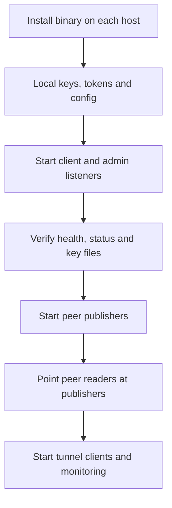

# Deploy

Reiki runs in the foreground and logs to stderr. A process manager supervises it. This page covers install paths, filesystem layout, listeners, a systemd unit, first-start checks and multi-machine order.

## Install

| Method | Command | Binary |
| --- | --- | --- |
| Source checkout, Rust 1.99+ | `make install` | `/usr/local/bin/reiki` as root, otherwise `~/.local/bin/reiki` |
| Custom prefix | `PREFIX=/opt/reiki make install` | `/opt/reiki/bin/reiki` |
| Release archive | Download the `.tar.gz`, check its `.sha256`, copy `reiki` onto `PATH` | Any directory on `PATH`; set mode `0755` |

`make build` runs `cargo build --release --locked --features top`. `make install` creates the `bin` directory and installs one file with mode `0755`. It creates no config, keys, state directory or service unit. Release archives contain `reiki`, `LICENSE` and `README.md`; they contain no service files.

Plugin selection and order are build arguments. See [plugins](plugins.md#choose-and-order-plugins-at-build-time) and [plugin authoring](plugin-authoring.md).

## Directory layout

These are recommended paths. Reiki creates the state file, service log, request-log file and request-log socket; it does not create their parent directories.

| Path | Owner and mode | Set by | Purpose |
| --- | --- | --- | --- |
| `/usr/local/bin/reiki` | `root:root`, `0755` | `make install` | Binary |
| `/etc/reiki/` | `reiki:reiki`, `0750` | Operator | Config and secrets; writable so the state file can be saved |
| `/etc/reiki/reiki.toml` | `reiki:reiki` or `root:reiki`, `0640` | Operator | Config; default path |
| `/etc/reiki/reiki.toml.state` | `reiki:reiki`, `0600` | Reiki | Key health and shaping state; `<config>.state` |
| `/etc/reiki/keys/` | `reiki:reiki`, `0700` | Operator | Key directory |
| `/etc/reiki/keys/zen-a` | `reiki:reiki`, `0600` | Operator | One raw provider key per file |
| `/etc/reiki/admin.token` | `reiki:reiki`, `0600` | Operator | Raw admin token for CLI calls |
| `/etc/reiki/peers/` | `reiki:reiki`, `0700` | Operator | Peer token and TLS material |
| `/etc/reiki/peers/peer-a.token` | `reiki:reiki`, `0600` | Operator | Raw token this instance presents to a peer |
| `/etc/reiki/peers/listener.key` | `reiki:reiki`, `0600` | Operator | Peer TLS key; group and other bits are refused by default |
| `/etc/reiki/ca/` | `reiki:reiki`, `0700` | Operator | Interception CA |
| `/etc/reiki/ca/ca.key` | `reiki:reiki`, `0600` | `reiki ca-init` | CA private key; group and other bits are refused by default |
| `/etc/reiki/ca/ca.pem` | `reiki:reiki`, `0644` | `reiki ca-init` | CA certificate; distribute to clients that intercept |
| `/var/lib/reiki/reiki.log` | `reiki:reiki`, `0640` | Reiki | Optional `[log] file`; symlinks are refused |
| `/var/lib/reiki/requests.jsonl` | `reiki:reiki`, `0600` | Reiki | Optional request-log file |
| `/run/reiki/requests.sock` | `reiki:reiki`, `0600` | Reiki | Optional request-log socket; parent `0700` |

Reiki enforces `0600` on the state file and request-log file and socket. It tightens an existing service log to `0640`. By default startup, reload and `reiki keys --check` refuse a key file with group or other read or write bits (`strict_key_permissions = true`); set it to `false` for warning-only behaviour. Peer tokens, peer TLS keys and the intercept CA key must be private. See [keys](keys.md#key-files), [peers](peers.md) and [security](security.md#hardening).

Before binding listeners, Reiki creates and removes an unpredictably named probe file in the state directory (the parent of `<config>.state`) with `create_new` and `O_NOFOLLOW`. A pre-existing file or a symlink at a probe path cannot satisfy the check. A failed probe exits 1 with an error naming that directory and the OS cause, so a read-only mount cannot leave a running instance without health persistence. The unit below uses `ReadWritePaths=/etc/reiki` for the default config path. For a config under `StateDirectory`, that line is not needed.

## Listeners

| Listener | Config | Default | Authentication and use |
| --- | --- | --- | --- |
| Client | top-level `listen` | `127.0.0.1:4097` | Stream token on proxied requests. `GET /__reiki/healthz` needs no token. `--listen` wins over `REIKI_LISTEN`, which wins over config. Plain HTTP. |
| Admin | `[admin].listen` and `token_sha256` | none; optional table | Bearer admin token. Serves `/v1/status`, `/v1/failures`, `/v1/reload`, `/v1/keys/enable` and `/v1/metrics`. Must be a literal loopback IP and port and differ from the client listener; hostnames are refused. |
| Peers | `[peers].enabled`, `publish`, `listen` and a token | none; optional table | Read-only `/v1/health` and `/v1/health/stream` with a peer token. Needs the `peers` feature. A non-loopback address needs TLS. |
| Tunnel | `[tunnel].listen` and `allow` | none; optional table | Opaque CONNECT on an allow-list. No token on the socket, so restrict network access. `[tunnel.intercept]` adds TLS termination for listed hosts. |
| Hub | `[hub].listen` | none; optional table | Parsed and validated only in this release. No listener is bound and no hub is contacted. The `hub` feature is not in release builds. |

Every bound listener must have a distinct address. Docs examples use `4099` for both peers and tunnel; choose two different ports. Keep plain HTTP listeners on loopback or put TLS in front. See [configuration](configuration.md#validation), [monitoring](monitoring.md), [peers](peers.md) and [tunnel](tunnel.md).

## Signals and lifecycle

| Signal | Effect |
| --- | --- |
| `SIGTERM`, `SIGINT` | All listeners stop accepting. Idle keep-alive connections close. Requests in flight get `[service] shutdown_timeout_secs` (default 25, range 1 to 300) to finish. Then the request log and state file are written and Reiki exits 0. |
| A second `SIGTERM` or `SIGINT` | Exits at once with status `128 + signal`: 143 or 130. |
| `SIGHUP` | Reloads config, key files, plugin settings, interception CA files and peer TLS files, like `POST /v1/reload`. See [upgrades](upgrades.md#reload-vs-restart). |

A streamed response still running when the drain ends is cut. With `[tunnel] close_idle_on_stop = true` (the default), tunnels with no bytes in either direction for at least one second close as soon as the stop begins; active tunnel connections get the same drain time and are then cut. Keep `TimeoutStopSec` above `shutdown_timeout_secs`.

With `Type=notify`, Reiki sends `READY=1` after every listener binds and `STOPPING=1` when a stop begins. With `WatchdogSec=`, it sends `WATCHDOG=1` at half the period while the async runtime is alive. Without `NOTIFY_SOCKET` these calls do nothing, so the same binary runs under any manager or none. Each client and upstream connection uses a file descriptor; the client listener admits 1024 connections by default. Reiki warns at start when the soft limit is below 4096.

Exit status: 0 after a clean stop, 1 for config, key, plugin, state-directory or bind failure, 143 or 130 after a second stop signal. CLI usage errors use 2. See [CLI](cli.md#exit-codes).

## systemd unit

```ini
[Unit]
Description=Reiki security proxy for agent and LLM traffic
After=network-online.target
Wants=network-online.target

[Service]
Type=notify
User=reiki
Group=reiki
ExecStart=/usr/local/bin/reiki --config /etc/reiki/reiki.toml
ExecReload=/bin/kill -HUP $MAINPID
Restart=always
RestartSec=3
TimeoutStopSec=40
WatchdogSec=60
LimitNOFILE=65536
StateDirectory=reiki
RuntimeDirectory=reiki
RuntimeDirectoryMode=0700
ReadWritePaths=/etc/reiki
NoNewPrivileges=true
ProtectSystem=strict
ProtectHome=true
PrivateTmp=true
PrivateDevices=true
ProtectKernelTunables=true
ProtectKernelModules=true
ProtectControlGroups=true
RestrictNamespaces=true
RestrictRealtime=true
LockPersonality=true
UMask=0077

[Install]
WantedBy=multi-user.target
```

`ReadWritePaths=/etc/reiki` lets Reiki write `<config>.state` beside the config. It also makes the key files writable, so keep keys elsewhere if that matters to you. Add a `ReadWritePaths=` entry for a service log or request log outside `StateDirectory`. A forwarder command inherits these limits; check `systemd-analyze security reiki` before adding `SystemCallFilter=` or `MemoryDenyWriteExecute=`, which some JavaScript runtimes may not tolerate.

## First-start checklist

1. Install the binary and create the service user and directories from the layout table.

   ```bash
   useradd --system --home /nonexistent --shell /usr/sbin/nologin reiki
   install -d -m 0750 -o reiki -g reiki /etc/reiki
   install -d -m 0700 -o reiki -g reiki /etc/reiki/keys
   reiki --version
   ```

2. Create one key file and one admin token. Hash the stream token and the admin token. Config takes hashes; CLI calls take the raw admin token.

   ```bash
   umask 077
   printf '%s' "$PROVIDER_KEY" > /etc/reiki/keys/zen-a
   chmod 0600 /etc/reiki/keys/zen-a

   ADMIN_TOKEN=$(openssl rand -hex 32)
   CLIENT_TOKEN=$(openssl rand -hex 32)
   printf '%s' "$ADMIN_TOKEN" > /etc/reiki/admin.token
   chmod 0600 /etc/reiki/admin.token
   printf '%s' "$CLIENT_TOKEN" | reiki hash-token
   printf '%s' "$ADMIN_TOKEN" | reiki hash-token
   ```

3. Write `/etc/reiki/reiki.toml`. Replace both hashes.

   ```toml
   listen = "127.0.0.1:4097"

   [admin]
   listen = "127.0.0.1:4098"
   token_sha256 = "<64 hex from the admin token>"

   [upstream.example]
   base_url = "https://api.example.com/v1"

   [keys.example-a]
   upstream = "example"
   file = "/etc/reiki/keys/zen-a"

   [streams.client-a]
   token_sha256 = "<64 hex from the stream token>"
   chain = ["example-a"]
   ```

4. Validate config and key files, then try the foreground process.

   ```bash
   reiki --config /etc/reiki/reiki.toml check
   reiki --config /etc/reiki/reiki.toml keys --check
   reiki --config /etc/reiki/reiki.toml
   ```

   `check` prints `caps:`, `peers:` and `ok:` lines. `keys --check` exits 0 when every key file is clean, 1 for a file problem or permission warning, 2 when the config cannot be read. See [CLI](cli.md#check) and [keys](keys.md#key-files).

5. From another terminal, check both listeners.

   ```bash
   curl -s http://127.0.0.1:4097/__reiki/healthz
   curl -s -H "Authorization: Bearer $ADMIN_TOKEN" \
     http://127.0.0.1:4098/v1/status
   ```

6. Stop the foreground process with `SIGTERM`, install the unit, then start the service.

   ```bash
   systemctl daemon-reload
   systemctl enable --now reiki
   systemctl status reiki
   journalctl -u reiki -f
   ```

## Multi-machine order



1. Install and configure each instance on its own host. Give every listener a unique address.
2. Start each instance with its client and admin listeners. Confirm `/__reiki/healthz`, `/v1/status` and `reiki keys` before adding peers.
3. Bring up peer publishers: `[peers] enabled = true`, `publish = true`, `listen`, and at least one token hash. Adding or moving the peer listener needs a restart. A non-loopback listener needs `tls_cert` and `tls_key`.
4. Configure readers with `[peers.NAME] url`, `token_file` and, for HTTPS, `ca_file`. Token and reader changes apply on reload. `reiki peers` and `reiki top` then show the fleet.
5. Start tunnel clients after the tunnel listener and allow-list are in place. Create the CA with `reiki ca-init` before enabling interception; distribute only `ca.pem`. Keep `deny_private = true` with a broad allow-list.
6. Use `reiki top` and `/v1/metrics` once admin and peer listeners are healthy. See [top](top.md), [peers](peers.md) and [monitoring](monitoring.md).

Forwarders run as child commands or Unix sockets and inherit the service limits. A socket in a group- or other-writable directory needs `expect_uid`. See [providers](providers.md#forwarding). Hub configuration cannot be brought up in this release.

## Upgrade and rollback

Use `SIGHUP`, `reiki reload` or `POST /v1/reload` for config, key and plugin settings that apply live. Restart for listener moves, connection caps and log file settings. The state file sits beside the config; Reiki ignores it and starts fresh when it is missing, unreadable or not in the current format. See [upgrades](upgrades.md) and [troubleshooting](troubleshooting.md#reload).
