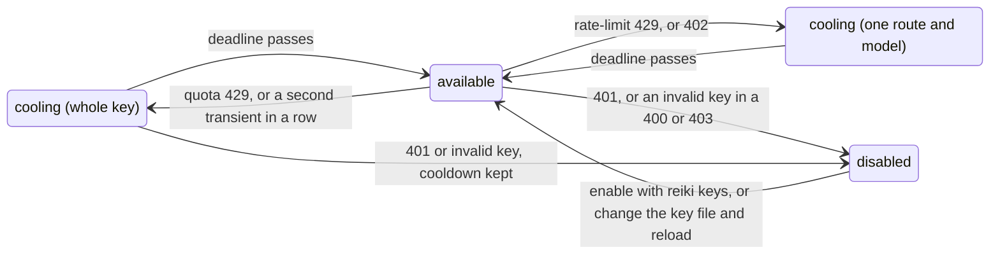

# Failover

Reiki keeps a stream working when one key fails. It tries the next key in the stream's chain; when no key can serve, it can hand the request to a fallback upstream. This page defines response classification, key states, cooldowns and the client responses when keys run out.

## Chains

```toml
[streams.client-a]
token_sha256 = "<sha256 of the stream token>"
chain = ["zen-a", "zen-b", "openrouter-a"]
strategy = "sticky"
```

- A request uses only chain keys whose upstream matches the request path. One chain can hold keys for several upstreams.
- `sticky` keeps the current key until it fails, then moves to the next usable key. `round_robin` starts each request at the key after the last one used, skipping cooling and disabled keys.
- A request does not retry a key it has already skipped. It makes at most the chain length plus one attempts. A `429` with a zero cooldown from `Retry-After: 0` does not skip the key, so the same request can reach it again up to that cap.
- Streams that list the same key share its health: a cooldown or disable applies to all of them.

## Key states



A combination cooldown is a narrower state: the key stays available for other routes and models while only the failed `(route, model)` pair is held back. `reiki keys` reports `ok`, `cooling` and `disabled`; `/v1/status` reports `available`, `cooling` and `out_of_rotation`. See [keys](keys.md) and [monitoring](monitoring.md).

## Reading order

1. `/__reiki/healthz` and every 2xx or 3xx response reach the client directly. A byte-level failure after the status line belongs to the client stream; no key cools.
2. `pass_errors = true` makes every status a pass-through: the response is relayed after scrubbing and no key changes state.
3. A transport failure is a `transient` class against the selected key. Idempotent methods replay on the next key; a non-idempotent method ends with `504` on timeout or `502` on connection failure.
4. Error bodies are read up to 64 KiB, scrubbed of key and credential forms and truncated with `x-reiki-truncated: 1` when longer. The body is lowercased before checks.
5. Request-size errors are checked first for `400`, `402` and `413` and short-circuit every status rule. The rules below are then evaluated in order; first match wins. All body conditions are lowercase substrings except the `400` invalid-key marker, which must be a `reason` string property in a JSON body. Text that only looks like a pair, including an echoed prompt or a non-JSON body, is ignored.
6. With `confirm_quota = true`, the first quota `429` from a key in a request waits 3 seconds and retries that key. It enters the failure ring but does not update key health or cool the key; only the second one does. This applies to `429` only, never `402`.
7. One request disables at most one key. With `hold_unauthorized = true`, a `401` is held as a refusal until a later key serves the request; a second `401` in the same walk stays a refusal.

## Response rules

| Upstream status | Body check | Class | Key effect | Next step for the request |
| --- | --- | --- | --- | --- |
| 200-399 | none | success | Transient count reset | Response delivered |
| 401 | none | `unauthorized` | Disabled | Next key |
| 400 | `fewer max_tokens` or `can only afford` in JSON `error.message`/`message`, or in the whole body when not JSON | `request_error` | None | Next key; relay the last upstream 400 if no key serves |
| 400 | Parsed JSON `reason` string equal to `api_key_invalid` | `unauthorized` | Disabled | Next key |
| 400 | `credit balance is too low` | `quota_exhausted` | Cooling, whole key | Next key |
| 400 | anything else, after the checks above and configured phrases | pass-through | None | Response relayed |
| 402 | JSON `error.message` or `message` contains `fewer max_tokens` or `can only afford`; whole-body match only when not JSON | `request_error` | None | Next key; relay the last upstream 402 if no key serves |
| 402 | anything else, after request-size, quota and configured rate-limit checks | `quota_exhausted` | Cooling for `(route, model)` | Next key |
| 429 | `usage exceeded`, `quota`, `free usage limit` or `insufficient` | `quota_exhausted` | Cooling, whole key | Next key |
| 429 | none of the above | `rate_limited` | Cooling for `(route, model)` | Next key |
| 403 | `error code: 10` (edge block page) | pass-through | None | Response relayed |
| 403 | `access is disabled`, `free tier` or `not enabled` | `access_disabled` | None | Skip key for this request |
| 403 | names an invalid, expired or revoked key or token | `unauthorized` | Disabled | Next key |
| 403 | anything else | `access_disabled` | None | Skip key for this request |
| 5xx | `model access is disabled` or `access is disabled` | `access_disabled` | None | Skip key for this request |
| 5xx | `rate limit` | `rate_limited` | Cooling for `(route, model)` | Next key |
| 5xx | anything else | `transient` | Cooling after two in a row | Skip key for this request |
| 413 | `fewer max_tokens` or `can only afford` | `request_error` | None | Next key; relay the last upstream 413 if no key serves |
| other (404, 413 without a phrase, 422, ...) | none | pass-through | None | Response relayed |
| No response | connect or timeout | `transient` | Counted as a transient failure | See [transport failures](#transport-failures) |

`(route, model)` means that combination; for a request with no `model`, the failure cools the whole key. Each upstream can extend the built-in phrases. A cooldown only moves later: a shorter failure does not shorten a longer one, while a later, longer failure extends it. See [cooldowns](#cooldowns) and [providers](providers.md) for the upstream switches.

Invalid-credential phrases matched on `403`: `invalid api key`, `incorrect api key`, `api key is invalid`, `api key not valid`, `api key is not valid`, `api key has expired`, `api key has been revoked`, `api key is disabled`, `api_key_invalid`, `invalid_api_key`, `invalid x-api-key`, `invalid credential`, `credential has been revoked`, `credential has expired`, `invalid token`, `token has been revoked`, `token has expired`.

## Custom response phrases

Each upstream may add body phrases to the built-in lists:

```toml
[upstream.zen]
base_url = "https://opencode.ai/zen/v1"
request_error_phrases = ["fewer max_tokens", "your max_tokens is too high"]
quota_phrases = ["plan limit reached", "top up your balance", "free-models-per-day"]
rate_limit_phrases = ["slow down"]
```

- Each list holds at most 16 unique phrases of 3 to 120 non-control characters. A bad list is a config error naming the upstream and phrase.
- Matching is case-insensitive against a substring of the first 64 KiB of the body; configured phrases extend, never replace, the built-ins.
- `request_error_phrases` apply to `400`, `402` and `413` only: the response is relayed and the key stays healthy. Built-ins: `fewer max_tokens`, `can only afford`.
- `quota_phrases` cool the whole key, like a quota `429`. Built-ins: `credit balance is too low` on `400` and the four `429` phrases in the table. A configured `402` quota phrase also cools the whole key.
- `rate_limit_phrases` cool the `(route, model)` scope. A match on `400`, `402` or `413` classifies the response as `rate_limited` when no request-size or quota phrase matched. Built-in: `rate limit` on 5xx.
- Overlapping lists resolve in order: request error, then quota, then rate limit.

Changes take effect on reload. See [configuration](configuration.md).

## Cooldowns

The fixed values are compiled in. `quota_resets` overrides the quota window per key and `scope_escalate_after` changes when scoped cooldowns become key-wide; the durations themselves are not configurable.

| Class | Cooldown | Scope |
| --- | --- | --- |
| `unauthorized` | Until enabled again; no timer | Key |
| `rate_limited` | `Retry-After` when present (zero means no cooldown), else 60 seconds | `(route, model)` |
| `quota_exhausted` (402) | Same as the quota row below | `(route, model)` |
| `quota_exhausted` (429) | Same as the quota row below | Key |
| `access_disabled` | None; skip the key for this request only | None |
| `request_error` | None; skip the key for this request only | None |
| `transient` | 30 seconds, after two failures in a row with no success between | Key |

Quota cooldown takes the first applicable source: `quota_resets` on the key (`daily HH:MM zone` or `monthly D HH:MM zone`) until the next reset, then a non-zero `Retry-After`, then 5 hours. `Retry-After` is capped at 24 hours; an HTTP date in the past gives zero, which counts as absent for a quota. With a schedule or a non-zero header the failure also carries an absolute `quota_reset_at` in peer health; the fixed 5-hour window publishes none. See [configuration](configuration.md).

## Scoped cooldowns

A scope is a `(route, model)` pair:

- Route: the path after the upstream prefix, without the query. All-digit segments and segments longer than 24 characters become `*`, so `/files/123` and `/files/456` share `/files/*`.
- Model: the top-level `"model"` string in the JSON body. A request with no model is key-scoped.

Only `rate_limited` failures and 402 quota failures are scoped. Request-size 402s are `request_error` and neither cool nor disable. A quota `429`, a `401`, a transient and any failure on a request with no model are key-wide. `scope_escalate_after` sets the per-upstream threshold (default 3, range 2 to 16): a combination failure escalates to a whole-key cooldown when that many distinct models are already cooling, or when the remembered combinations would exceed twice that. At most 64 combinations are kept; the soonest-ending is evicted when full. A whole-key cooldown clears the scoped entries. Scoped cooldowns are in memory; the state file holds key-level health. The `cooling_combinations` count in peer health is the number of combinations cooling on an upstream's keys. See [provider health](provider-health.md).

## Client responses when keys run out

| Situation | What the client gets |
| --- | --- |
| No key can serve, no refusal recorded | `503`, JSON code `reiki_exhausted`, `Retry-After` |
| No key can serve, every usable key disabled | `503`, `reiki_exhausted`, no `Retry-After` |
| A refusal recorded during the walk (`access_disabled`, transient 5xx, second 401) | The upstream's own status and body from the last refusal |
| Last refusal was a request-size 402 (`request_error`) | That upstream's 402 and body, unchanged |
| Chain out and a fallback configured | The fallback's answer, under the same rules |
| Stream limit or allowlist refused before key selection | `429` or `403`, JSON code `gateway_*`, with `Retry-After` on a `429` |
| Every key shaped out, no refusal recorded | `429`, `reiki_shaped`, `Retry-After`, `x-reiki-origin: local` |

`Retry-After` on `reiki_exhausted` is the shortest wait until any non-disabled key recovers, rounded up and at least 1; it accounts for the request's model cooldowns too. An `access_disabled`, `request_error` or held/second-`401` refusal does not cool the key. A transient 5xx is kept as the last refusal and cools the key after two in a row. The ring's `action` field is `cooldown` when a scope or key cooled, `rotate` when an `unauthorized` disabled the key, and `pass-through` when the key was only skipped for that request. See [monitoring](monitoring.md) and [shaping](shaping.md).

## Confirming a quota 429

`confirm_quota = true` is per upstream and off by default. The first quota `429` from a key in a request does not count against key health or cool it, though it enters the failure ring. Reiki waits 3 seconds and sends the request to the same key again; only a second quota `429` from that key in the same request cools it. It does not apply to `402`.

## Fallback upstream

```toml
[upstream.zen.fallback]
upstream = "openrouter"
model_aliases = { "*" = "openrouter/free" }
```

- The fallback runs once, only after the source walk ends with no answer. The target's own fallback is not followed.
- It runs when no key can serve or when the walk recorded a refusal, including a request-size 402.
- It does not run after a stream rate-limit `429`, a `reiki_shaped` `429` with no refusal, a pass-through answer or a forwarder link failure.
- Aliases apply in order: the fallback's `model_aliases`, then the target's own aliases. `"*"` matches any model.
- The target must exist and differ from the source; a passthrough upstream cannot have a fallback. Every stream using the source must hold a key for the target.

See [providers](providers.md) and [configuration](configuration.md).

## Observed passthrough headers

A `passthrough` upstream holds no Reiki key, so its answer cannot cool or disable one. Reiki still classifies the status and a bounded error-body prefix, then records one observation under the upstream's `account` label. Classes are fixed in code, never taken from a response: `ok`, `rate_limited`, `quota_exhausted`, `credential_rejected`, `access_disabled`, `request_error`, `error` and `pass_through`.

| Header | Meaning |
| --- | --- |
| `Retry-After` | Remaining wait in seconds or an HTTP date, capped at 24 hours and counted from the host clock. |
| `x-ratelimit-limit-requests`, `x-ratelimit-remaining-requests`, `x-ratelimit-reset-requests` | OpenAI-style request quota; reset accepts seconds, `h`/`m`/`s`/`ms` components, a small epoch delta or an epoch value. |
| `x-ratelimit-limit-tokens`, `x-ratelimit-remaining-tokens`, `x-ratelimit-reset-tokens` | OpenAI-style token quota. |
| `x-ratelimit-limit`, `x-ratelimit-remaining`, `x-ratelimit-reset` | Generic request quota where the families above are absent. |
| `anthropic-ratelimit-requests-limit`, `anthropic-ratelimit-requests-remaining`, `anthropic-ratelimit-requests-reset` | Anthropic request quota; reset is an RFC3339 instant, read relative to the response's `Date` when present. |
| `anthropic-ratelimit-tokens-limit`, `anthropic-ratelimit-tokens-remaining`, `anthropic-ratelimit-tokens-reset` | Anthropic token quota. |

Unparseable numbers and resets beyond 24 hours are ignored. The observed view appears in `/v1/status`, peer health and `reiki top`; it never holds a credential. Client-sent `X-Reiki-*` headers are removed before the request is sent. See [providers](providers.md) and [monitoring](monitoring.md).

## Client errors from Reiki

| Status | `error.code` | Cause |
| --- | --- | --- |
| `400` | `bad_path` | Malformed request path |
| `401` | `unauthorized` | Missing or unknown stream token |
| `403` | `gateway_forbidden` | Stream not configured |
| `403` | `gateway_upstream_forbidden` | Upstream outside the stream's `allowed_upstreams` |
| `403` | `gateway_model_unknown` | Model could not be determined while `allowed_models` is set |
| `403` | `gateway_model_forbidden` | Model outside the stream's `allowed_models` |
| `404` | `not_found` | No upstream prefix, or unknown upstream |
| `408` | `body_timeout` | Request body timed out |
| `413` | `too_large` | Request body over 8 MiB |
| `429` | `gateway_rate_limited`, `gateway_token_limited` | Stream `rpm` or `tpm` reached |
| `429` | `gateway_daily_requests`, `gateway_daily_tokens`, `gateway_monthly_requests`, `gateway_monthly_tokens` | Calendar quota reached |
| `429` | `gateway_concurrent_limited` | Too many requests from the stream in flight |
| `429` | `gateway_fairness_limited` | Another stream's turn on a shared key |
| `429` | `gateway_usage_limited` | `/v1/usage` exceeded `[gateway] usage_rpm` |
| `429` | `rate_limited` | Failed-login backoff after repeated wrong tokens from one address |
| `429` | `reiki_shaped` | Local key shaping held the request; `x-reiki-origin: local` |
| `502` | `bad_gateway` | Unreachable upstream, oversized buffered response, unreadable body or failed forwarder link |
| `503` | `gateway_store_unavailable` | Counter state unavailable and the stream is fail-closed |
| `503` | `reiki_exhausted` | Every key in the chain is unavailable |
| `504` | `gateway_timeout` | Upstream headers or buffered body timed out |

Gateway `429`s carry `Retry-After` of at least 1 second. After ten bad tokens from one address in a minute, the next request gets `429` with `Retry-After`. Gateway and local-shaping `429`s leave every key available. See [troubleshooting](troubleshooting.md).

## What happens after bytes reach the client

Reiki chooses a response at its status line. Once it has a 2xx or 3xx it streams that response; there is no failover after that point. A body that breaks mid-stream is visible to the client and does not cool the key. Error bodies are read in full before the decision, up to 64 KiB, and only the final answer reaches the client.

## Transport failures

A transport failure counts as `transient` against the key.

| Failure | Method | Behaviour |
| --- | --- | --- |
| Connection refused before any bytes were sent | Any | Next key |
| Timeout or reset, bytes may have been sent | `GET`, `HEAD`, `PUT`, `DELETE`, `OPTIONS`, `TRACE` | Next key |
| Timeout or reset, bytes may have been sent | Any other method, such as `POST` or `PATCH` | Not replayed: `504 gateway_timeout` on timeout, otherwise `502 bad_gateway` |

Replaying a non-idempotent request could duplicate a side effect, so Reiki does not replay it.

## Re-enabling keys

- `reiki keys --enable NAME` clears the cooldown, disabled flag, failure count and combination cooldowns, then persists the state. See [cli](cli.md) and [keys](keys.md).
- A reload (`reiki reload`, SIGHUP or `[reload] watch`) re-enables a key only when its file content changed or the key is new.
- A restart restores disabled flags and key-level cooldowns from `<config>.state`. Combination cooldowns and the last status are not restored; a key whose file or upstream changed starts healthy.

## Watching failover

| Where | What it shows |
| --- | --- |
| `reiki keys` | Per key: `ok`, `cooling` or `disabled`, cooldown seconds, last status, streams. |
| `reiki keys --json` | Adds a `scopes` array for keys with cooling combinations. |
| `/v1/status` (admin) | `keys[].state` is `available`, `cooling` or `out_of_rotation`, plus cooldown fields, failure count, last status and scopes. |
| `reiki top` | Live view of cooldowns and failures. |
| `/v1/metrics` | `reiki_cooldowns_total{key,class,scope}` and `reiki_failovers_total{stream,key,class}`; needs the metrics plugin. |
| Log | `upstream key failed`, `request needs more than this key can afford, trying the next key`, `falling back`, `key refused this request, trying the next key`, `not replaying a non-idempotent request`. |

For a `503` that does not clear, check the log for `upstream key failed` and whether the key shows as `disabled`. See [monitoring](monitoring.md), [top](top.md) and [troubleshooting](troubleshooting.md).
