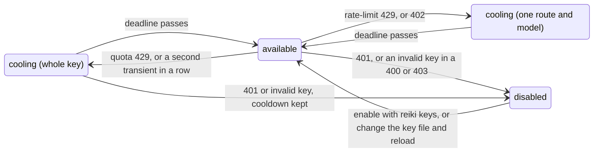

# Failover

Reiki keeps a stream working when one key fails. It tries the next key in the stream's chain. When no key can serve, it can hand the request to a fallback upstream. This page covers how each failure changes a key, how long the key stays out, and what the client sees.

## Chains

```toml
[streams.client-a]
token_sha256 = "<sha256 of the stream token>"
chain = ["zen-a", "zen-b", "openrouter-a"]
strategy = "sticky"          # or "round_robin"
```

- A request uses only the chain keys whose upstream matches the request path. One chain can hold keys from several upstreams.
- `sticky` (the default) keeps using the current key until it fails. Then it moves to the next usable key and stays there.
- `round_robin` starts each request at the key after the last one used. Cooling and disabled keys are skipped.
- A request does not try a key again after that key has been skipped for it. A request makes at most the chain length plus one attempts. A 429 whose cooldown is zero, from `Retry-After: 0`, does not skip the key, so the same request can reach it again up to that cap.
- Streams that list the same key share its health. A cooldown or disable applies to every stream that uses the key.

## Key states

Each key is in one of three states:



A combination cooldown is a fourth, narrower state. The key stays available for every other model and route. Only the `(route, model)` pair that failed is held back.

## Status to class to key effect

Reiki reads the upstream status first. Then it reads the first 64 KiB of the body, lowercased. Body checks are substring matches unless noted.

| Upstream status | Body check | Class | Key effect | Next step for the request |
| --- | --- | --- | --- | --- |
| 200-399 | none | success | Transient count reset | Response is delivered |
| 401 | none | `unauthorized` | Disabled | Next key |
| 400 | JSON pair `"reason": "API_KEY_INVALID"` | `unauthorized` | Disabled | Next key |
| 400 | `credit balance is too low` | `quota_exhausted` | Cooling, whole key | Next key |
| 400 | anything else | pass-through | None | Response is relayed |
| 402 | JSON `error.message` or `message` contains `fewer max_tokens` or `can only afford`; whole-body substring match only when the body is not JSON | `request_error` | None; the key is not cooled | Next key; the last upstream 402 is relayed unchanged if no key serves |
| 402 | anything else | `quota_exhausted` | Cooling for `(route, model)` | Next key |
| 429 | `usage exceeded`, `quota`, `subscribe to go`, `free usage limit`, `free-models-per-day` or `insufficient` | `quota_exhausted` | Cooling, whole key | Next key |
| 429 | none of the above | `rate_limited` | Cooling for `(route, model)` | Next key |
| 403 | `error code: 10` (edge block page) | pass-through | None | Response is relayed |
| 403 | `access is disabled`, `free tier` or `not enabled` | `access_disabled` | None | Skip key for this request |
| 403 | names an invalid, expired or revoked key or token | `unauthorized` | Disabled | Next key |
| 403 | anything else | `access_disabled` | None | Skip key for this request |
| 5xx | `access is disabled` | `access_disabled` | None | Skip key for this request |
| 5xx | `rate limit` | `rate_limited` | Cooling for `(route, model)` | Next key |
| 5xx | anything else | `transient` | Cooling after two in a row | Skip key for this request |
| other (404, 422, ...) | none | pass-through | None | Response is relayed |
| No response (connect or timeout) | none | `transient` | Counted as a transient failure | See transport rules below |

`(route, model)` means that combination. For a request with no `model`, the same failure cools the whole key.

Each upstream can extend the built-in phrases; see [custom response phrases](#custom-response-phrases).

With `pass_errors = true` on the upstream, every status is a pass-through. No key changes state. See [providers](providers.md#relaying-errors-as-they-are).

With `hold_unauthorized = true`, a 401 does not disable the key until a later key serves the same request. See [providers](providers.md#unauthorized-keys).

A second key that refuses the same request with a 401 is not disabled. One request disables at most one key.

## Custom response phrases

Each upstream may add body phrases to the built-in lists:

```toml
[upstream.zen]
base_url = "https://opencode.ai/zen/v1"
request_error_phrases = ["fewer max_tokens", "your max_tokens is too high"]
quota_phrases = ["plan limit reached", "top up your balance"]
rate_limit_phrases = ["slow down"]
```

- Each list holds at most 16 unique phrases of 3 to 120 non-control characters. A bad list is a config error naming the upstream and the phrase.
- Matching is case-insensitive, against a substring of the first 64 KiB of the body. Configured phrases extend, never replace, the built-ins above.
- `request_error_phrases` apply to 400, 402 and 413 only. The response is relayed and the key stays healthy. Built-ins: `fewer max_tokens`, `can only afford`.
- `quota_phrases` cool the whole key, like a quota 429. Built-ins: `credit balance is too low` on 400 and the six 429 phrases in the table above. A configured 402 quota phrase also cools the whole key; the built-in 402 request-size phrases still pass through.
- `rate_limit_phrases` cool the `(route, model)` scope. Built-in: `rate limit` on 5xx.
- When lists overlap in one response, the order is request error, then quota, then rate limit.

Changes to these lists take effect on reload.

## Cooldowns

These values are compiled in. The config file has no setting for them.

| Class | Cooldown | Scope |
| --- | --- | --- |
| `unauthorized` | Until enabled again. No timer. | Key |
| `rate_limited` | `Retry-After` when present (zero means no cooldown), else 60 seconds | `(route, model)` |
| `quota_exhausted` (402) | Same as the quota row below | `(route, model)` |
| `quota_exhausted` (429) | Same as the quota row below | Key |
| `access_disabled` | None. The key is skipped for the request only. | None |
| `request_error` | None. The key is skipped for the request only. | None |
| `transient` | 30 seconds, after two failures in a row with no success between | Key |

Quota cooldown takes the first of these that applies:

| Order | Source | Cooldown |
| --- | --- | --- |
| 1 | `quota_resets` on the key: `daily HH:MM zone` or `monthly D HH:MM zone` | Until the next reset |
| 2 | `Retry-After` on the response, non-zero | That long |
| 3 | Neither | 5 hours |

`Retry-After` is capped at 24 hours, whether it is seconds or an HTTP date. An HTTP date in the past gives zero. For a quota, zero counts as absent, so the next rule applies.

Since 0.10.3, a quota 429 with `Retry-After` cools the key for that long, not for the 5-hour default. A configured `quota_resets` still wins over the header. With neither, the 5-hour window applies. The test `a_quota_429_with_retry_after_cools_the_key_for_that_long` in `tests/exhausted.rs` covers this.

A cooldown only moves later. A shorter failure does not shorten a longer cooldown. A later, longer failure extends it.

## Scoped cooldowns

A scope is the pair of route and model:

- Route: the request path after the upstream prefix. The query is dropped. Segments that are all digits, or longer than 24 characters, become `*`, so `/files/123` and `/files/456` share `/files/*`.
- Model: the top-level `"model"` string in the JSON body. A request with no model is key-scoped.

Only two failures are scoped: a `rate_limited` failure and a 402 that is treated as `quota_exhausted`. A request-size 402 (`fewer max_tokens` or `can only afford`) is `request_error`, not a key failure, so it neither cools nor disables the key. A quota 429 is always key-wide, as are 401s, transients and any failure on a request with no model.

A key with many cooling models is treated as broken. `scope_escalate_after` sets the count per upstream. The default is 3, and the allowed range is 2 to 16. When three different models are cooling on a key, or the combinations reach twice that count, the next scoped failure cools the whole key for its duration. A whole-key cooldown clears the scoped entries.

Each key remembers at most 64 combinations. When the map is full, the soonest-ending entry is dropped. Scoped cooldowns are held in memory only. They are not saved to the state file.

The `cooling_combinations` count in a peer's view is the number of combinations cooling on that upstream's keys. See [peers](peers.md).

## Client responses when keys run out

| Situation | What the client gets |
| --- | --- |
| No key can serve, and no refusal was recorded during the walk | `503`, JSON code `reiki_exhausted`, `Retry-After` |
| No key can serve, and every usable key is disabled | `503`, `reiki_exhausted`, no `Retry-After` |
| A refusal was recorded during the walk (`access_disabled`, a transient 5xx, or a second 401) | The upstream's own status and body from the last refusal |
| No key can serve, and the last refusal was a request-size 402 (`request_error`) | The last upstream's own 402 and body, unchanged |
| The chain is out and a fallback is configured | The fallback's answer, under the same rules |
| The stream's `rate_limit_per_minute` is exceeded | `429`, `rate_limited`, `Retry-After` |
| Every key is shaped out and no refusal was recorded | `429`, `reiki_shaped`, `Retry-After`, `x-reiki-origin: local` |

`Retry-After` on `reiki_exhausted` is the shortest wait until any non-disabled key recovers. It is rounded up to whole seconds and is at least 1. When the request has a model, the wait accounts for that model's cooldowns too.

A refusal does not cool the key. A request-size 402 is recorded in the failure ring as `request_error`, but it also does not cool the key: another key may still afford the request. The client sees the upstream's error, which says more than `reiki_exhausted`.

## Confirming a quota 429

`confirm_quota = true` is set per upstream. The default is `false`. With it, the first quota 429 from a key in a request is not recorded. Reiki waits 3 seconds and sends the request to the same key again. Only a second quota 429 from that key in the same request cools it. Use this for an upstream that sometimes returns a quota 429 for a good key. It does not apply to 402.

## Fallback upstream

```toml
[upstream.zen.fallback]
upstream = "openrouter"
model_aliases = { "*" = "openrouter/free" }
```

- The fallback runs once, and only after the walk on the source upstream ends with no answer. The target's own fallback is not followed.
- It runs when no key can serve, or when the walk recorded a refusal, including a request-size 402.
- It does not run after a stream rate limit (`rate_limited` 429), after a `reiki_shaped` 429 with no refusal, after a pass-through answer, or after a forwarder link failure.
- Model aliases apply in order: first the fallback's `model_aliases`, then the target's own `model_aliases`. `"*"` matches any model.
- Startup refuses a fallback that names the upstream itself, an unknown upstream, or a passthrough upstream. It also refuses a stream that uses the source upstream without a key for the target.

## What happens after bytes reach the client

Reiki chooses a response at its status line. Once it has a 2xx or 3xx, it streams that response. There is no failover after that point. If the body breaks mid-stream, the client sees the error. The key is not cooled.

Error bodies are read in full before the decision is made, up to 64 KiB. Only the final answer reaches the client.

## Transport failures

A transport failure counts as `transient` against the key.

| Failure | Method | Behaviour |
| --- | --- | --- |
| Connection refused before any bytes were sent | Any | Next key |
| Timeout or reset, bytes may have been sent | `GET`, `HEAD`, `PUT`, `DELETE`, `OPTIONS`, `TRACE` | Next key |
| Timeout or reset, bytes may have been sent | Any other method, such as `POST` or `PATCH` | Not replayed. The client gets `504` `gateway_timeout` on a timeout, or `502` `bad_gateway` otherwise. |

Replaying a non-idempotent request could duplicate a side effect, so Reiki does not replay it.

## Re-enabling keys

- `reiki keys --enable NAME` calls `POST /keys/enable` on the admin listener. This clears the key's cooldown, its disabled flag, its failure count and its combination cooldowns. The change is saved.
- A reload (`reiki reload`, SIGHUP, or `[reload] watch`) re-enables a key only when its key file content changed, or when the key is new. A disabled key whose file did not change stays disabled.
- A restart restores disabled flags and key-level cooldowns from the state file, `<config>.state`. Combination cooldowns and the last status are not restored. A key whose file or upstream changed starts healthy.

## Watching failover

| Where | What it shows |
| --- | --- |
| `reiki keys` | Per key: `ok`, `cooling` or `disabled`, cooldown seconds, last status, streams. See [cli](cli.md). |
| `reiki keys --json` | Adds a `scopes` array for keys with cooling combinations. |
| `GET /status` (admin) | `keys[].state` is `available`, `cooling` or `out_of_rotation`. Also `retry_after_seconds`, `cooldown_class`, `consecutive_failures`, `last_status_code` and `scopes`. See [monitoring](monitoring.md). |
| `reiki top` | Live view of cooldowns and failures. See [top](top.md). |
| `/metrics` | `reiki_cooldowns_total{key,class,scope}` and `reiki_failovers_total{stream,key,class}`. Needs the `metrics` plugin. |
| Log | `upstream key failed` (with class, status, whether it cooled and seconds remaining), `request needs more than this key can afford, trying the next key`, `falling back`, `key refused this request, trying the next key`, and `not replaying a non-idempotent request`. |

For a 503 that does not clear, check the log for `upstream key failed` and whether the key shows as `disabled`. The [troubleshooting](troubleshooting.md) page covers the status codes Reiki sends.
