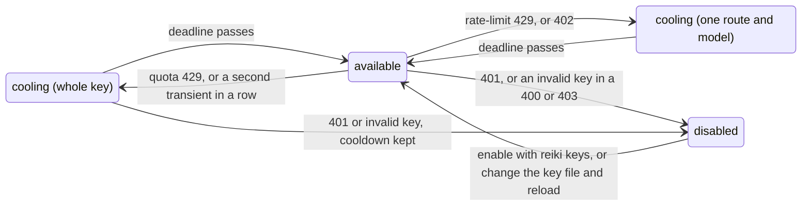

# Failover

Reiki keeps a stream working when one key fails. It tries the next key in the stream's chain. When no key can serve, it can hand the request to a fallback upstream. This page covers how each failure changes a key, how long the key stays out, and what the client sees.

## Chains

```toml
[streams.client-a]
token_sha256 = "<sha256 of the stream token>"
chain = ["zen-a", "zen-b", "openrouter-a"]
strategy = "sticky"          # or "round_robin"
```

- A request uses only the chain keys whose upstream matches the request path. One chain can hold keys from several upstreams.
- `sticky` (the default) keeps using the current key until it fails. Then it moves to the next usable key and stays there.
- `round_robin` starts each request at the key after the last one used. Cooling and disabled keys are skipped.
- A request does not try a key again after that key has been skipped for it. A request makes at most the chain length plus one attempts. A 429 whose cooldown is zero, from `Retry-After: 0`, does not skip the key, so the same request can reach it again up to that cap.
- Streams that list the same key share its health. A cooldown or disable applies to every stream that uses the key.

## Key states

Each key is in one of three states:



A combination cooldown is a fourth, narrower state. The key stays available for every other model and route. Only the `(route, model)` pair that failed is held back.

## Response rules and cooldowns

See [response classification](classification.md) for the rule for every status, the body and header conditions, the resulting key effect, the cooldown values, and the `Retry-After` and `quota_resets` precedence.

`(route, model)` in that table means that combination. A request with no `model` cools the whole key. With `pass_errors = true` on the upstream, every status is a pass-through; see [providers](providers.md#relaying-errors-as-they-are). With `hold_unauthorized = true`, a `401` is held until a later key serves the same request; see [providers](providers.md#unauthorized-keys). One request disables at most one key.

A cooldown only moves later. A shorter failure leaves a longer cooldown in place; a later, longer failure extends it.

## Scoped cooldowns

A scope is the pair of route and model:

- Route: the request path after the upstream prefix. The query is dropped. Segments that are all digits, or longer than 24 characters, become `*`, so `/files/123` and `/files/456` share `/files/*`.
- Model: the top-level `"model"` string in the JSON body. A request with no model is key-scoped.

Only two failures are scoped: a `rate_limited` failure and a 402 that is treated as `quota_exhausted`. A request-size 402 (`fewer max_tokens` or `can only afford`) is `request_error`, not a key failure, so it neither cools nor disables the key. A quota 429 is always key-wide, as are 401s, transients and any failure on a request with no model.

A key with many cooling models is treated as broken. `scope_escalate_after` sets the per-upstream threshold (default 3, range 2–16). A combination failure escalates to a whole-key cooldown when that many distinct models are already cooling, or when the number of remembered combinations would reach twice that. At most 64 combinations are remembered; the soonest-ending one is evicted when full. A whole-key cooldown clears the scoped entries. Scoped cooldowns live in memory; the state file holds key-level health.

The `cooling_combinations` count in a peer's view is the number of combinations cooling on that upstream's keys. See [provider health](provider-health.md).

## Client responses when keys run out

| Situation | What the client gets |
| --- | --- |
| No key can serve, and no refusal was recorded during the walk | `503`, JSON code `reiki_exhausted`, `Retry-After` |
| No key can serve, and every usable key is disabled | `503`, `reiki_exhausted`, no `Retry-After` |
| A refusal was recorded during the walk (`access_disabled`, a transient 5xx, or a second 401) | The upstream's own status and body from the last refusal |
| No key can serve, and the last refusal was a request-size 402 (`request_error`) | The last upstream's own 402 and body, unchanged |
| The chain is out and a fallback is configured | The fallback's answer, under the same rules |
| A stream limit or allowlist refuses the request before key selection | `429` or `403`, JSON code `gateway_*`, with `Retry-After` on a `429` |
| Every key is shaped out and no refusal was recorded | `429`, `reiki_shaped`, `Retry-After`, `x-reiki-origin: local` |

`Retry-After` on `reiki_exhausted` is the shortest wait until any non-disabled key recovers. It is rounded up to whole seconds and is at least 1. When the request has a model, the wait accounts for that model's cooldowns too.

An `access_disabled`, `request_error` or held/second-`401` refusal does not cool the key. A transient 5xx, which is also kept as the last refusal, does cool the key after two in a row. A request-size 402 is recorded in the failure ring as `request_error` but does not cool the key: another key may still afford the request. The client sees the upstream's error, which says more than `reiki_exhausted`.

The ring's `action` field names the outcome of that walk: `cooldown` when a scope or the key cooled, `rotate` when an `unauthorized` disabled the key, and `pass-through` when Reiki only skipped the key for this request. See [GET /v1/failures](monitoring.md#get-v1failures).

## Confirming a quota 429

`confirm_quota = true` is set per upstream. The default is `false`. With it, the first quota 429 from a key in a request does not count against key health and does not cool the key, though it is still added to the failure ring. Reiki waits 3 seconds and sends the request to the same key again. Only a second quota 429 from that key in the same request cools it. Use this for an upstream that sometimes returns a quota 429 for a good key. It does not apply to 402.

## Fallback upstream

```toml
[upstream.zen.fallback]
upstream = "openrouter"
model_aliases = { "*" = "openrouter/free" }
```

- The fallback runs once, and only after the walk on the source upstream ends with no answer. The target's own fallback is not followed.
- It runs when no key can serve, or when the walk recorded a refusal, including a request-size 402.
- It does not run after a stream rate limit (`rate_limited` 429), after a `reiki_shaped` 429 with no refusal, after a pass-through answer, or after a forwarder link failure.
- Model aliases apply in order: first the fallback's `model_aliases`, then the target's own `model_aliases`. `"*"` matches any model.
- Startup refuses a fallback that names the upstream itself or an unknown upstream. A passthrough upstream cannot have a fallback at all, and a stream that uses the source upstream must also hold a key for the target.

## What happens after bytes reach the client

Reiki chooses a response at its status line. Once it has a 2xx or 3xx, it streams that response. There is no failover after that point. If the body breaks mid-stream, the client sees the error. The key is not cooled.

Error bodies are read in full before the decision is made, up to 64 KiB. Only the final answer reaches the client.

## Transport failures

A transport failure counts as `transient` against the key.

| Failure | Method | Behaviour |
| --- | --- | --- |
| Connection refused before any bytes were sent | Any | Next key |
| Timeout or reset, bytes may have been sent | `GET`, `HEAD`, `PUT`, `DELETE`, `OPTIONS`, `TRACE` | Next key |
| Timeout or reset, bytes may have been sent | Any other method, such as `POST` or `PATCH` | Not replayed. The client gets `504` `gateway_timeout` on a timeout, or `502` `bad_gateway` otherwise. |

Replaying a non-idempotent request could duplicate a side effect, so Reiki does not replay it.

## Re-enabling keys

- `reiki keys --enable NAME` calls `POST /v1/keys/enable` on the admin listener. This clears the key's cooldown, its disabled flag, its failure count and its combination cooldowns. The change is saved. See [keys and streams](keys.md#key-state-and-enable).
- A reload (`reiki reload`, SIGHUP, or `[reload] watch`) re-enables a key only when its key file content changed, or when the key is new. A disabled key whose file did not change stays disabled.
- A restart restores disabled flags and key-level cooldowns from the state file, `<config>.state`. Combination cooldowns and the last status are not restored. A key whose file or upstream changed starts healthy.

## Watching failover

| Where | What it shows |
| --- | --- |
| `reiki keys` | Per key: `ok`, `cooling` or `disabled`, cooldown seconds, last status, streams. See [cli](cli.md). |
| `reiki keys --json` | Adds a `scopes` array for keys with cooling combinations. |
| `GET /v1/status` (admin) | `keys[].state` is `available`, `cooling` or `out_of_rotation`. Also `retry_after_seconds`, `cooldown_class`, `consecutive_failures`, `last_status_code` and `scopes`. See [monitoring](monitoring.md). |
| `reiki top` | Live view of cooldowns and failures. See [top](top.md). |
| `/v1/metrics` | `reiki_cooldowns_total{key,class,scope}` and `reiki_failovers_total{stream,key,class}`. Needs the `metrics` plugin. |
| Log | `upstream key failed` (with class, status, whether it cooled and seconds remaining), `request needs more than this key can afford, trying the next key`, `falling back`, `key refused this request, trying the next key`, and `not replaying a non-idempotent request`. |

For a 503 that does not clear, check the log for `upstream key failed` and whether the key shows as `disabled`. The [troubleshooting](troubleshooting.md) page covers the status codes Reiki sends.
