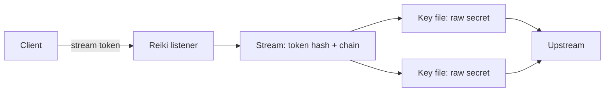

# Keys and streams

Reiki keeps provider keys in files. Clients hold a stream token. The config holds paths and SHA-256 hashes, never a key value or a raw token.



## Reference forms

| Value | Config form | Raw form | Notes |
| --- | --- | --- | --- |
| Upstream key | `[keys.NAME] file = "/path/to/key"` | File holds the key, trimmed on load | Read at startup and every reload |
| Stream token | `[streams.NAME] token_sha256 = "<64 hex>"` | Client sends it as a bearer token, `x-api-key`, `x-goog-api-key` or `?key=` | Hash made with `reiki hash-token` |
| Admin token | `[admin] token_sha256 = "<64 hex>"` | Caller supplies it with `--token-file` or `REIKI_ADMIN_TOKEN` | No raw token in the config |
| Read-only admin token | `[admin] read_token_sha256 = "<64 hex>"`, optional | `REIKI_ADMIN_READ_TOKEN` for `reiki top`, or a bearer token | Read routes only; distinct hash required |
| Stream-admin token | `[stream_admin] token_sha256 = "<64 hex>"` | CLI reads it from `--token-file` or `token_env` (default `REIKI_STREAM_ADMIN_TOKEN`) | Dedicated to dynamic stream management |
| Two-party confirm token | `[stream_admin] require_two_party = ["<64 hex>"]` | CLI reads it from `confirm_env` and sends `X-Confirm-Token` | Required for mutations when configured |
| Audit actor id | `[stream_admin] actor_id_sha256 = "<64 hex>"` | No raw form: a hash of the operator id | Written to audit records; not a credential |
| Peer token | `[peers.NAME] token_file = "/path/to/token"` or `[[peers.tokens]] token_sha256 = "<64 hex>"` | Raw token file for this instance, hash for tokens it accepts | See [provider health](provider-health.md) |

There is no `apiKey` config key and no `{file:...}` reference syntax. Use `file` on a `[keys.NAME]` table. See [configuration](configuration.md) for every field.

## Key files

| Item | Owner and mode | Rule |
| --- | --- | --- |
| Key directory, for example `/etc/reiki/keys/` | `reiki:reiki`, `0700` or `0750` | The Reiki user needs read access. |
| Key file, for example `/etc/reiki/keys/zen-a` | `reiki:reiki`, `0600` | No group or other read/write bits under the default `strict_key_permissions = true`. |
| Config file, for example `/etc/reiki/reiki.toml` | `reiki:reiki`, `0640` | Holds paths and hashes, not keys. |
| State file `<config>.state` | `reiki:reiki`, `0600` | Atomic temp-file-and-rename write; holds key digests and health, not values. |
| Cost state `<config>.state.cost.state` | `reiki:reiki`, `0600` | Written by the optional cost plugin; holds period totals, not credentials or prices. See [cost](cost.md). |

```bash
install -d -m 0700 -o reiki -g reiki /etc/reiki/keys
umask 077
printf '%s' "$PROVIDER_KEY" > /etc/reiki/keys/zen-a
chown reiki:reiki /etc/reiki/keys/zen-a
chmod 0600 /etc/reiki/keys/zen-a
```

At load and reload Reiki reads each file as UTF-8, trims whitespace and requires 8 to 4096 bytes. A missing, unreadable, empty, too short or too long file, or one with group or other read/write bits under strict mode, stops startup and refuses a reload. `reiki keys --check` checks the same files offline and never prints a key value; exit `0` means clean, `1` means a problem or warning, `2` means the config cannot be read. See [cli](cli.md).

`NAME` in `[keys.NAME]` is a stable label used in logs, `/v1/status`, chains and the state file. Keep a label until you intend to start fresh health for that key.

## Stream tokens

Use a random token of at least 16 characters and hash it once:

```bash
printf '%s' "$CLIENT_TOKEN" | reiki hash-token
```

`hash-token` trims stdin, counts characters and prints 64 lowercase hex digits. Config load checks only the 64-hex shape, so use the command to make the hash. Do not send whitespace around the token.

```toml
[upstream.zen]
base_url = "https://api.example.com/v1"

[keys.zen-a]
upstream = "zen"
file = "/etc/reiki/keys/zen-a"

[streams.client-a]
token_sha256 = "<64 hex characters from hash-token>"
chain = ["zen-a"]
strategy = "sticky"

[streams.client-a.limits]
rpm = 60
concurrent = 4
```

Clients send the token as `Authorization: Bearer <token>`, `x-api-key`, `x-goog-api-key` or `?key=`; the first form found wins. On key-backed routes Reiki removes client credential headers and the `key` query parameter before forwarding. A `passthrough` upstream has no Reiki token and forwards the client's credentials and query unchanged. See [security](security.md) and [providers](providers.md).

## Dynamic stream credentials

`[stream_admin]` is opt-in; without it there are no dynamic streams and no management routes. Its dedicated token hash must differ from the admin, stream and confirmation hashes. The CLI reads the raw token from `--token-file` or `token_env`; it is never an argument. With `require_two_party`, a mutation also needs a second token from `confirm_env` (default `REIKI_STREAM_ADMIN_CONFIRM_TOKEN`) sent as `X-Confirm-Token`. See [configuration](configuration.md) and [dynamic streams](dynamic-streams.md).

`actor_id_sha256` is the hash written as the actor on every audit record. It is a fixed operator label under one config, not a per-user identity and not a credential.

`streams create` and `streams token add` print a new raw token once. The config, state file and audit records hold hashes only; read routes expose token ids and expiry, never token values. Store the printed token in the client's secret store; if it is lost, revoke its token id and issue a new one. See [cli](cli.md).

Audit records are JSONL with `seq`, a UTC `time`, the actor hash, `source`, `action`, `stream`, `outcome`, `reason`, field-level `changes`, `prev` and `hash`. `hash` is a SHA-256 over the canonical JSON of every other field; `prev` links to the predecessor. A sibling `audit.head` stores the last sequence number and hash; `reiki streams audit verify FILE` checks the chain and that sidecar, so it also detects tail deletion or truncation. Copy the sidecar with the JSONL file when archiving it. Reason text is sanitized: long hex strings and credential-shaped prefixes become `[redacted]`. Raw tokens, raw actor ids and key values never enter the log. There is no HTTP audit route; `reiki streams audit head FILE` prints records offline. See [monitoring](monitoring.md).

The chain is tamper-evident, not proof of identity or intent: the actor hash is fixed, `source` is the peer address seen on the plain-HTTP admin listener, and the log covers management actions only. Someone with filesystem access can replace the log and sidecar with a fresh chain that verification cannot distinguish. Preserve archived logs separately where continuity matters. Management fails closed when an audit record cannot be written; denied attempts are rate-limited per source and recorded at most once per lockout window.

Dynamic state is written atomically with mode `0600` and holds token hashes, not raw values. Startup, reload and restart restore dynamic streams from that file; an invalid file drops dynamic access while static streams keep working. `reiki top` opens a read-only Streams screen with `t` using either admin token on the stream-console route, never the stream-management token; see [top](top.md) and [monitoring](monitoring.md).

## Chains and key state

A chain is the ordered list of keys a stream may try; `sticky` keeps the current key until it cannot serve and `round_robin` starts each request after the last key used. A request uses only chain keys whose upstream matches the request path. Streams that list the same key share its cooldown and disabled flag. One request disables at most one key. See [failover](failover.md) and [security](security.md).

`reiki keys` reports `ok`, `cooling` or `disabled`; `/v1/status` reports `available`, `cooling` or `out_of_rotation`. A key with scoped cooldowns stays available for other routes and models; `reiki keys --json` lists those scopes. See [monitoring](monitoring.md) and [cli](cli.md).

With the admin listener configured:

```bash
export REIKI_ADMIN_TOKEN="$(cat /etc/reiki/admin.token)"

reiki --config /etc/reiki/reiki.toml keys
reiki --config /etc/reiki/reiki.toml keys --json
reiki --config /etc/reiki/reiki.toml keys --enable zen-a
```

`--enable` clears the key's cooldown, disabled flag, failure count and scoped cooldowns, then persists the state; a successful call answers `{"key":"zen-a"}`. Enable a key after fixing its file or upstream, or the next failure takes it out again. A reload re-enables a key only when its file changed or the key is new; a restart restores key-level health from `<config>.state`. See [failover](failover.md).

## Rotate a key without downtime

Write the new secret, add the new key and remove the old key from every chain in one config edit. A reload swaps the whole config; a request already in flight keeps the old key in memory until it finishes.

```bash
umask 077
printf '%s' "$NEW_PROVIDER_KEY" > /etc/reiki/keys/zen-b
chmod 0600 /etc/reiki/keys/zen-b
```

```toml
[keys.zen-b]
upstream = "zen"
file = "/etc/reiki/keys/zen-b"

[streams.client-a]
token_sha256 = "<unchanged 64 hex characters>"
chain = ["zen-b"]
strategy = "sticky"
```

Then check and swap:

```bash
reiki --config /etc/reiki/reiki.toml check
reiki --config /etc/reiki/reiki.toml keys --check
reiki --config /etc/reiki/reiki.toml reload --dry-run --token-file /etc/reiki/admin.token
reiki --config /etc/reiki/reiki.toml reload --token-file /etc/reiki/admin.token
reiki --config /etc/reiki/reiki.toml keys --token-file /etc/reiki/admin.token
```

Wait for in-flight requests to finish, then revoke the old key at the provider and remove its file. A reload does not revoke provider keys. A new key starts healthy; a removed label loses its saved health. See [deploy](deploy.md) for reload and restart rules.
