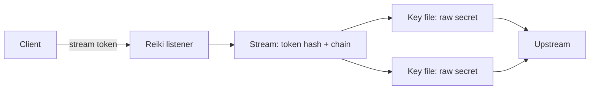

# Keys and streams

Reiki keeps provider keys in files. Clients hold a stream token. The config holds paths and SHA-256 hashes, never a key value or a raw token.



## Reference forms

| Value | Config form | Raw form | Notes |
| --- | --- | --- | --- |
| Upstream key | `[keys.NAME] file = "/path/to/key"` | File holds the key, trimmed on load | Read at startup and on every reload |
| Stream token | `[streams.NAME] token_sha256 = "<64 hex>"` | Client sends the token in a header or `?key=` | Hash made with `reiki hash-token` |
| Admin token | `[admin] token_sha256 = "<64 hex>"` | Caller supplies the raw token with `--token-file` or `REIKI_ADMIN_TOKEN` | No raw token in the config |
| Peer token | `[peers.NAME] token_file = "/path/to/token"` or `[[peers.tokens]] token_sha256 = "..."` | Raw token file for this instance, hash for tokens it accepts | See [peers](peers.md) |
| Hub token | `[hubs.NAME] token_file = "/path/to/token"` | Raw token file | Hub tables are parsed and validated only in this release; see [hub](hub.md) |

There is no `apiKey` config key and no `{file:...}` reference syntax. Use `file` on a `[keys.NAME]` table. Other credentials use the forms in the table.

## Key files

| Item | Owner and mode | Rule |
| --- | --- | --- |
| Key directory, for example `/etc/reiki/keys/` | `reiki:reiki`, `0700` or `0750` | The Reiki user needs read access. No other user needs it. |
| Key file, for example `/etc/reiki/keys/zen-a` | `reiki:reiki`, `0600` | Startup, reload and `reiki keys --check` refuse a file with group or other read or write bits set (the mode is checked on the same handle used to read the key). Set `strict_key_permissions = false` to downgrade this to a warning. |
| Config file, for example `/etc/reiki/reiki.toml` | `reiki:reiki`, `0640` | It holds paths and hashes, not raw keys. |
| State file `<config>.state` | `reiki:reiki`, `0600` | Reiki writes it through a temporary file and rename. It holds key digests and health, not key values. |

Create a file with no trailing newline ambiguity:

```bash
install -d -m 0700 -o reiki -g reiki /etc/reiki/keys
umask 077
printf '%s' "$PROVIDER_KEY" > /etc/reiki/keys/zen-a
chown reiki:reiki /etc/reiki/keys/zen-a
chmod 0600 /etc/reiki/keys/zen-a
```

`NAME` in `[keys.NAME]` is a stable label. Logs, `/status`, chains and the state file use it. Reiki does not enforce a naming pattern for the label or the file. Keep a name until you intend to start fresh health for that key.

At load and on reload, Reiki reads each file as UTF-8, trims whitespace and requires a non-empty value of at least 8 bytes. A file that is missing, unreadable, empty, too short, or (with the default `strict_key_permissions = true`) having group or other read or write bits stops startup and refuses the reload. See [configuration](configuration.md#keysname) and [troubleshooting](troubleshooting.md#key-health).

```bash
reiki --config /etc/reiki/reiki.toml keys --check
```

Exit status: 0 when every file is clean, 1 for a problem or permission warning (or a permission refusal under the default strict mode), 2 when the config cannot be read. The command never prints a key value.

## Stream tokens

Use a random token of at least 16 characters and hash it once:

```bash
printf '%s' "$CLIENT_TOKEN" | reiki hash-token
```

`hash-token` trims stdin, counts characters and prints 64 lowercase hex digits. Config load checks only the 64-hex shape, so use the command to make the hash. Do not add whitespace around the token when the client sends it.

```toml
[upstream.zen]
base_url = "https://api.example.com/v1"

[keys.zen-a]
upstream = "zen"
file = "/etc/reiki/keys/zen-a"

[streams.client-a]
token_sha256 = "<64 hex characters from hash-token>"
chain = ["zen-a"]
strategy = "sticky"
rate_limit_per_minute = 60
```

| Field | Rule |
| --- | --- |
| `token_sha256` | Required. 64 hex characters. Unique across streams and different from the admin token. |
| `chain` | Required. One or more `[keys.NAME]` labels, tried in order. |
| `strategy` | `sticky` or `round_robin`. Default `sticky`. |
| `rate_limit_per_minute` | Optional. Counts selected-key attempts, including retries and fallback. |

Clients may send the token as `Authorization: Bearer <token>`, `x-api-key`, `x-goog-api-key` or `?key=`. The first form found wins. On key-backed routes, Reiki removes client credential headers and the `key` query parameter before the request goes upstream. A `passthrough` upstream has no Reiki token and forwards the client's own credentials and query unchanged. See [security](security.md#clients-and-keys) and [providers](providers.md).

## Chains and strategies

| Strategy | Selection |
| --- | --- |
| `sticky` | Keeps the current key until it cannot serve, then moves to the next usable key. |
| `round_robin` | Starts each request on the key after the one the last request used. Cooling and disabled keys are skipped. |

A request uses only the chain keys whose upstream matches the request path. One chain can hold keys for several upstreams. Keys are shared state: two streams that list the same key share its cooldown and disabled flag. One request disables at most one key. Use separate instances for mutually untrusted clients. See [failover](failover.md#chains) and [security](security.md#limits-and-listener-enforcement).

## Key state and enable

| `reiki keys` state | `/status` state | Meaning |
| --- | --- | --- |
| `ok` | `available` | Key can be selected. |
| `cooling` | `cooling` | Key waits for `retry_after_seconds`. |
| `disabled` | `out_of_rotation` | Key stays out until enabled or its file changes. |

A key with scoped cooldowns stays `ok` for other routes and models. `reiki keys --json` shows the `scopes` array. See [monitoring](monitoring.md#get-status).

Set up the admin listener first; see [monitoring](monitoring.md#configure-and-authenticate). Then:

```bash
export REIKI_ADMIN_TOKEN="$(cat /etc/reiki/admin.token)"

reiki --config /etc/reiki/reiki.toml keys
reiki --config /etc/reiki/reiki.toml keys --json
reiki --config /etc/reiki/reiki.toml keys --enable zen-a
```

`reiki keys` calls `GET /status`. `--url` and `--token-file` override the admin address and token source. `reiki keys --enable NAME` calls `POST /keys/enable`:

```bash
curl -X POST -H "Authorization: Bearer $REIKI_ADMIN_TOKEN" \
  "http://127.0.0.1:4098/v1/keys/enable?key=zen-a"
```

The endpoint clears the key's cooldown, disabled flag, failure count and scoped cooldowns, then persists the state. A successful call answers `200` with `{"ok":true,"key":"zen-a"}`. `400` means a missing, repeated, bare or invalid `key` parameter, or an unknown flag; `401` a bad admin token, `404` an unknown key name. Enable a key after fixing its file or upstream; otherwise the next failure takes it out again. See [failover](failover.md#re-enabling-keys) and [monitoring](monitoring.md#post-keysenable).

## Rotate a key without downtime

Write the new secret, add the new key, and remove the old key from every chain in one config edit. A reload swaps the whole config, so a new request uses only the new chain. A request already in flight keeps the old key in memory until it finishes; it does not re-read the old file.

```bash
umask 077
printf '%s' "$NEW_PROVIDER_KEY" > /etc/reiki/keys/zen-b
chmod 0600 /etc/reiki/keys/zen-b
```

```toml
[keys.zen-b]
upstream = "zen"
file = "/etc/reiki/keys/zen-b"

[streams.client-a]
token_sha256 = "<unchanged 64 hex characters>"
chain = ["zen-b"]
strategy = "sticky"
```

Then check and swap:

```bash
reiki --config /etc/reiki/reiki.toml check
reiki --config /etc/reiki/reiki.toml keys --check
reiki --config /etc/reiki/reiki.toml reload --dry-run --token-file /etc/reiki/admin.token
reiki --config /etc/reiki/reiki.toml reload --token-file /etc/reiki/admin.token
reiki --config /etc/reiki/reiki.toml keys --token-file /etc/reiki/admin.token
```

Wait for in-flight requests to finish, then revoke the old key at the provider and remove its file. A reload does not revoke provider keys. A new key starts healthy; a key label that is removed from the config loses its saved health. See [upgrades](upgrades.md) for reload and restart rules, and [configuration](configuration.md#keysname) for `quota_resets`.
