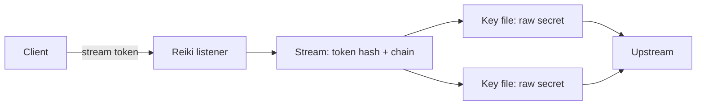

# Keys and streams

Reiki keeps provider keys in files. Clients hold a stream token. The config holds paths and SHA-256 hashes, never a key value or a raw token.



## Reference forms

| Value | Config form | Raw form | Notes |
| --- | --- | --- | --- |
| Upstream key | `[keys.NAME] file = "/path/to/key"` | File holds the key, trimmed on load | Read at startup and on every reload |
| Stream token | `[streams.NAME] token_sha256 = "<64 hex>"` | Client sends the token in a header or `?key=` | Hash made with `reiki hash-token` |
| Admin token | `[admin] token_sha256 = "<64 hex>"` | Caller supplies the raw token with `--token-file` or `REIKI_ADMIN_TOKEN` | No raw token in the config |
| Read-only admin token | `[admin] read_token_sha256 = "<64 hex>"` (optional) | Caller supplies it as `REIKI_ADMIN_READ_TOKEN` (used by `reiki top`) or as a bearer token | Read routes only; distinct hash required. See [monitoring](monitoring.md#read-only-token) |
| Stream-admin token | `[stream_admin] token_sha256 = "<64 hex>"` | CLI reads the raw token from `--token-file` or `token_env` (default `REIKI_STREAM_ADMIN_TOKEN`), never an argument | Dedicated to dynamic stream management; distinct hash required |
| Two-party confirm token | `[stream_admin] require_two_party = ["<64 hex>"]` | CLI reads the second raw token from `confirm_env` and sends `X-Confirm-Token` | Required for mutations when configured |
| Audit actor id | `[stream_admin] actor_id_sha256 = "<64 hex>"` | No raw form; a hash of the operator id | Written to audit records; not a credential |
| Peer token | `[peers.NAME] token_file = "/path/to/token"` or `[[peers.tokens]] token_sha256 = "..."` | Raw token file for this instance, hash for tokens it accepts | See [provider health](provider-health.md) |
| Hub token | `[hubs.NAME] token_file = "/path/to/token"` | Raw token file | Hub tables are parsed and validated only in this release; see [hub](hub.md) |

There is no `apiKey` config key and no `{file:...}` reference syntax. Use `file` on a `[keys.NAME]` table. Other credentials use the forms in the table.

## Key files

| Item | Owner and mode | Rule |
| --- | --- | --- |
| Key directory, for example `/etc/reiki/keys/` | `reiki:reiki`, `0700` or `0750` | The Reiki user needs read access. No other user needs it. |
| Key file, for example `/etc/reiki/keys/zen-a` | `reiki:reiki`, `0600` | Startup, reload and `reiki keys --check` refuse a file with group or other read or write bits set (the mode is checked on the same handle used to read the key). Set `strict_key_permissions = false` to downgrade this to a warning. |
| Config file, for example `/etc/reiki/reiki.toml` | `reiki:reiki`, `0640` | It holds paths and hashes, not raw keys. |
| State file `<config>.state` | `reiki:reiki`, `0600` | Reiki writes it through a temporary file and rename. It holds key digests and health, not key values. |
| Cost state `<config>.state.cost.state` | `reiki:reiki`, `0600` | Written by the optional cost plugin with the same atomic pattern; holds period totals and names, never credentials or prices. See [cost](cost.md#what-is-recorded). |

Create a file with no trailing newline ambiguity:

```bash
install -d -m 0700 -o reiki -g reiki /etc/reiki/keys
umask 077
printf '%s' "$PROVIDER_KEY" > /etc/reiki/keys/zen-a
chown reiki:reiki /etc/reiki/keys/zen-a
chmod 0600 /etc/reiki/keys/zen-a
```

`NAME` in `[keys.NAME]` is a stable label. Logs, `/v1/status`, chains and the state file use it. Reiki does not enforce a naming pattern for the label or the file. Keep a name until you intend to start fresh health for that key.

At load and on reload, Reiki reads each file as UTF-8, trims whitespace and requires a value of 8 to 4096 bytes. A file that is missing, unreadable, empty, too short, too long, or (with the default `strict_key_permissions = true`) having group or other read or write bits stops startup and refuses the reload. See [configuration](configuration.md#keysname) and [troubleshooting](troubleshooting.md#key-health).

```bash
reiki --config /etc/reiki/reiki.toml keys --check
```

Exit status: 0 when every file is clean, 1 for a problem or permission warning (or a permission refusal under the default strict mode), 2 when the config cannot be read. The command never prints a key value.

## Stream tokens

Use a random token of at least 16 characters and hash it once:

```bash
printf '%s' "$CLIENT_TOKEN" | reiki hash-token
```

`hash-token` trims stdin, counts characters and prints 64 lowercase hex digits. Config load checks only the 64-hex shape, so use the command to make the hash. Do not add whitespace around the token when the client sends it.

```toml
[upstream.zen]
base_url = "https://api.example.com/v1"

[keys.zen-a]
upstream = "zen"
file = "/etc/reiki/keys/zen-a"

[streams.client-a]
token_sha256 = "<64 hex characters from hash-token>"
chain = ["zen-a"]
strategy = "sticky"

[streams.client-a.limits]
rpm = 60
concurrent = 4
```

| Field | Rule |
| --- | --- |
| `token_sha256` | Required. 64 hex characters. Unique across streams and different from the admin token. |
| `chain` | Required. One or more `[keys.NAME]` labels, tried in order. |
| `strategy` | `sticky` or `round_robin`. Default `sticky`. |
| `limits` | Optional per-stream request, token, concurrency and calendar budgets. See [traffic shaping](shaping.md#gateway-admission). |
| `allowed_upstreams`, `allowed_models` | Optional glob allowlists. Omitted means any; an empty list denies all. |
| `weight` | Optional relative share of a contested key, at least 1. Default `1`. |

Clients may send the token as `Authorization: Bearer <token>`, `x-api-key`, `x-goog-api-key` or `?key=`. The first form found wins. On key-backed routes, Reiki removes client credential headers and the `key` query parameter before the request goes upstream. A `passthrough` upstream has no Reiki token and forwards the client's own credentials and query unchanged. See [security](security.md#clients-and-keys) and [providers](providers.md).

## Dynamic stream credentials

`[stream_admin]` is opt-in; without it there are no dynamic streams and no management routes. It uses a dedicated bearer token whose hash is `token_sha256`, kept distinct from the admin, stream and two-party hashes by config validation. The CLI reads the raw token from `--token-file` or the configured `token_env` (default `REIKI_STREAM_ADMIN_TOKEN`); it is never a command-line argument. With `require_two_party`, a mutation also needs a second raw token from `confirm_env` (default `REIKI_STREAM_ADMIN_CONFIRM_TOKEN`), sent as `X-Confirm-Token`. See [configuration](configuration.md#stream_admin) for the table and defaults.

`actor_id_sha256` is the hash written as the actor on every audit record. It is a configured operator label, not a per-user identity and not a credential: all management calls under one config share it.

`streams create` and `streams token add` print the new raw token once. The config, state file and audit records hold hashes only; API read routes expose token ids and expiry, never token values. No route or command returns a token after that first response. Store the printed token in the client's secret store; if it is lost, revoke its token id and issue a new one. The token is never a CLI argument.

Audit records are JSONL with `seq`, a UTC `time`, the actor hash, `source`, `action`, `stream`, `outcome`, `reason`, field-level `changes` with old and new values, `prev` and `hash`. `hash` is a SHA-256 over the canonical JSON of every other field, and `prev` links a record to its predecessor. A sibling `audit.head` file stores the last sequence number and hash; `reiki streams audit verify FILE` checks both the chain and that sidecar, so it also detects deletion or truncation of the tail. Copy the sidecar with the JSONL file when archiving it. The reason text is sanitized before it is written: long hex strings and credential-shaped prefixes become `[redacted]`. Raw tokens, raw actor ids and upstream key values never enter the log. There is no HTTP audit route; `reiki streams audit verify FILE` checks the files offline and `reiki streams audit head FILE` prints records. Both commands need the JSONL file to exist; verification consults the sidecar when present and refuses a non-empty chain without it. See [monitoring](monitoring.md#stream-administration-routes) for the API surface.
Audit records are JSONL with `seq`, a UTC `time`, the actor hash, `source`, `action`, `stream`, `outcome`, `reason`, field-level `changes` with old and new values, `prev` and `hash`. `hash` is a SHA-256 over the canonical JSON of every other field, and `prev` links a record to its predecessor. A sibling `audit.head` file stores the last sequence number and hash; `reiki streams audit verify FILE` checks both the chain and that sidecar, so it also detects deletion or truncation of the tail. Copy the sidecar with the JSONL file when archiving it. The reason text is sanitized before it is written: long hex strings and credential-shaped prefixes become `[redacted]`. Raw tokens, raw actor ids and upstream key values never enter the log. There is no HTTP route for the raw audit file; `reiki streams audit verify FILE` checks the files offline and `reiki streams audit head FILE` prints records. See [monitoring](monitoring.md#stream-administration-routes) for the API surface.

For live operations, `reiki top` opens a read-only Streams screen with `t`. It uses either admin token on [`GET /v1/stream-console`](monitoring.md#get-v1stream-console), not the stream-management token, and cannot create, rotate or revoke anything. The screen shows stream names, chains, limits, usage, token short ids with expiries and a bounded newest-first audit tail. Credential values, hashes, actor hashes, chain hashes and file paths are not included in that answer. When `[stream_admin]` is absent, the screen says so and keeps the static rows. See [reiki top](top.md#streams).

Management fails closed if an audit record cannot be written: the mutation is refused. Denied attempts are rate-limited per source and recorded in the audit log at most once per lockout window.

The chain is tamper-*evident*, not a proof of identity or intent. It does not prove who held the token: the actor hash is a fixed label and `source` is only the peer address seen on the plain-HTTP admin listener. It does not prove that a reason is truthful, that a token was not copied after its one-time display, or anything about proxied traffic; the log covers management actions only. There is no external signing key, timestamp authority or append-only storage. Someone with filesystem access can delete or replace the log and its sidecar, and a replacement starts a fresh chain that verification cannot distinguish from a new log. Preserve archived logs and their sidecars separately, where processes that can call the API cannot rewrite them, when continuity matters.

Dynamic stream state is written atomically with mode `0600` and holds token hashes, not raw values. Startup, reload and restart restore dynamic streams from that file; an invalid file drops dynamic access while static streams keep working. See [upgrades](upgrades.md#dynamic-stream-state).

## Chains and strategies

| Strategy | Selection |
| --- | --- |
| `sticky` | Keeps the current key until it cannot serve, then moves to the next usable key. |
| `round_robin` | Starts each request on the key after the one the last request used. Cooling and disabled keys are skipped. |

A request uses only the chain keys whose upstream matches the request path. One chain can hold keys for several upstreams. Keys are shared state: two streams that list the same key share its cooldown and disabled flag. One request disables at most one key. Use separate instances for mutually untrusted clients. See [failover](failover.md#chains) and [security](security.md#limits-and-listener-enforcement).

## Key state and enable

| `reiki keys` state | `/v1/status` state | Meaning |
| --- | --- | --- |
| `ok` | `available` | Key can be selected. |
| `cooling` | `cooling` | Key waits for `retry_after_seconds`. |
| `disabled` | `out_of_rotation` | Key stays out until enabled or its file changes. |

A key with scoped cooldowns stays `ok` for other routes and models. `reiki keys --json` shows the `scopes` array. See [monitoring](monitoring.md#get-v1status).

Set up the admin listener first; see [monitoring](monitoring.md#configure-and-authenticate). Then:

```bash
export REIKI_ADMIN_TOKEN="$(cat /etc/reiki/admin.token)"

reiki --config /etc/reiki/reiki.toml keys
reiki --config /etc/reiki/reiki.toml keys --json
reiki --config /etc/reiki/reiki.toml keys --enable zen-a
```

`reiki keys` calls `GET /v1/status`. `--url` and `--token-file` override the admin address and token source. `reiki keys --enable NAME` calls `POST /v1/keys/enable`:

```bash
curl -X POST -H "Authorization: Bearer $REIKI_ADMIN_TOKEN" \
  "http://127.0.0.1:4098/v1/keys/enable?key=zen-a"
```

The endpoint clears the key's cooldown, disabled flag, failure count and scoped cooldowns, then persists the state. A successful call answers `200` with `{"ok":true,"key":"zen-a"}`. `400` means a missing, repeated, bare or invalid `key` parameter, or an unknown flag; `401` a bad admin token, `404` an unknown key name. Enable a key after fixing its file or upstream; otherwise the next failure takes it out again. See [failover](failover.md#re-enabling-keys) and [monitoring](monitoring.md#post-v1keysenable).

## Rotate a key without downtime

Write the new secret, add the new key, and remove the old key from every chain in one config edit. A reload swaps the whole config, so a new request uses only the new chain. A request already in flight keeps the old key in memory until it finishes; it does not re-read the old file.

```bash
umask 077
printf '%s' "$NEW_PROVIDER_KEY" > /etc/reiki/keys/zen-b
chmod 0600 /etc/reiki/keys/zen-b
```

```toml
[keys.zen-b]
upstream = "zen"
file = "/etc/reiki/keys/zen-b"

[streams.client-a]
token_sha256 = "<unchanged 64 hex characters>"
chain = ["zen-b"]
strategy = "sticky"
```

Then check and swap:

```bash
reiki --config /etc/reiki/reiki.toml check
reiki --config /etc/reiki/reiki.toml keys --check
reiki --config /etc/reiki/reiki.toml reload --dry-run --token-file /etc/reiki/admin.token
reiki --config /etc/reiki/reiki.toml reload --token-file /etc/reiki/admin.token
reiki --config /etc/reiki/reiki.toml keys --token-file /etc/reiki/admin.token
```

Wait for in-flight requests to finish, then revoke the old key at the provider and remove its file. A reload does not revoke provider keys. A new key starts healthy; a key label that is removed from the config loses its saved health. See [upgrades](upgrades.md) for reload and restart rules, and [configuration](configuration.md#keysname) for `quota_resets`.
