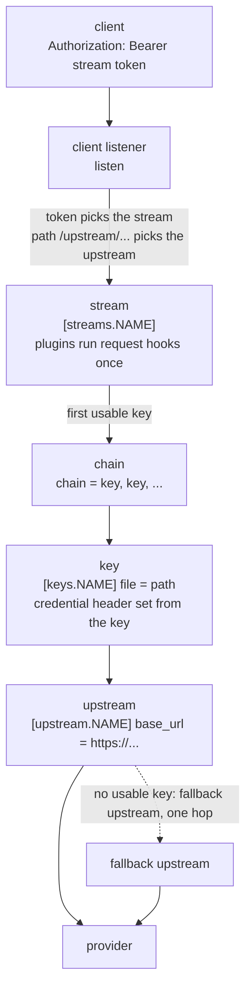

# Overview

Security proxy for agent and LLM traffic: isolates keys, filters what leaves, keeps access reliable.

## What it is

Reiki sits between a client and the LLM providers the client calls. The client can be an agent such as opencode or Claude Code, or an application that would otherwise hold provider API keys. The client holds a stream token. Reiki holds the upstream keys and decides what may leave.

Reiki is one binary. It runs in the foreground, reads one TOML file and logs to stderr. Plugins are compiled in, so Reiki never loads code at runtime.

## The model

Other listeners, each optional and on its own socket:

| Listener | Table | Serves |
| --- | --- | --- |
| admin | `[admin]` | `GET /status`, `GET /failures`, `POST /reload`, `POST /keys/enable`, plugin routes such as `GET /metrics`, and `GET /v1/openapi.json` (routes are also served under `/v1`) |
| peers | `[peers]` | `GET /v1/health` and `GET /v1/health/stream` with a read-only peer token |
| tunnel | `[tunnel]` | CONNECT proxy with a destination allow-list; intercept for chosen hosts |
| hub | `[hub]` | parsed and validated in this release; it does not open a hub listener yet |

- **Client listener.** Serves the API. A request needs a stream token, except on a `passthrough` upstream. The path prefix chooses the upstream, so `/example/chat/completions` goes to the `example` upstream.
- **Stream.** One client with its own token and key chain. The token is stored as a SHA-256 hash. Streams share cooldown state only for keys they both list.
- **Chain.** The keys a stream may use, in order. `sticky` keeps one key until it fails. `round_robin` rotates.
- **Plugins.** Request hooks run once per request, before any key is tried. Attempt hooks run after each try. Response hooks run in reverse order.
- **Upstream.** A provider's base URL. Reiki replaces the client's credential header with the key for each attempt.

Reiki reads `/etc/reiki/reiki.toml` unless `--config` names another file. `--listen` or `REIKI_LISTEN` overrides `listen` from the file, and the flag wins over the variable. `reiki check` validates the file and the key files, and prints the address Reiki will use.

## What each job gives you

### Isolation

Upstream keys stay out of the client. Keys stay in Reiki's files, and the client never receives one.

- Keys live in files on the Reiki host. Keep them mode `0600`; the daemon checks that a key file is readable and long enough, not its mode. The client authenticates with a stream token that you can revoke. See [keys](keys.md#key-files) and [security](security.md#clients-and-keys).
- Reiki removes the client's own credential headers before it sets the upstream header. See [configuration](configuration.md).
- A key that an upstream echoes back in an error is redacted. The cases that are not caught are listed in [security](security.md).
- A `passthrough` upstream is the exception. It forwards the client's own credentials. See [providers](providers.md#passing-the-clients-own-credentials-through).

### Control

Reiki decides what leaves the client's machine and what reaches the provider.

- The `placeholders` plugin swaps credentials and listed terms for stable placeholders before the request leaves, and restores them in the response. See [placeholders](placeholders.md).
- The `phi`, `finance` and `controlled` plugins block or report identifiers in outbound requests. See [phi](phi.md), [finance](finance.md) and [controlled](controlled.md).
- Upstreams come only from the config. The optional CONNECT tunnel opens only listed destinations. Interception applies the same rules to chosen hosts. See [tunnel](tunnel.md).
- Which plugins are compiled in, and their order, is set at build time. See [plugins](plugins.md) and [plugin authoring](plugin-authoring.md).

### Reliability and visibility

Requests keep working when one key fails, and you can see what happened.

- Failover: a stream's chain, and an optional fallback upstream, take over on a rate limit, an exhausted quota or a disabled key. See [failover](failover.md).
- Traffic shaping: outbound budgets per key, so a key is not sent past its limits. See [shaping](shaping.md).
- Request log: what the client sent and what came back, with credentials masked. See [requestlog](requestlog.md).
- Fleet view: `reiki top` shows key health across instances, peers publish that health, and `/metrics` exports it. See [top](top.md), [peers](peers.md) and [monitoring](monitoring.md).

## Where to go next

- [Architecture](architecture.md): request path, key states and source map.
- [Glossary](glossary.md): terms and CLI/status vocabulary.
- [Configuration](configuration.md): every table and field.
- [CLI](cli.md): every subcommand.
- [Keys and streams](keys.md): key files, token hashes, chains and rotation.
- [Providers](providers.md): connect a provider and its client.
- [Failover](failover.md) and [shaping](shaping.md): how keys are chosen, cooled and budgeted.
- [Monitoring](monitoring.md) and [troubleshooting](troubleshooting.md): what to check when something fails.
- [Deploy](deploy.md): install paths, directory layout, listeners and a service unit.
- [Upgrades](upgrades.md): reload and restart rules, state compatibility and rollback.
