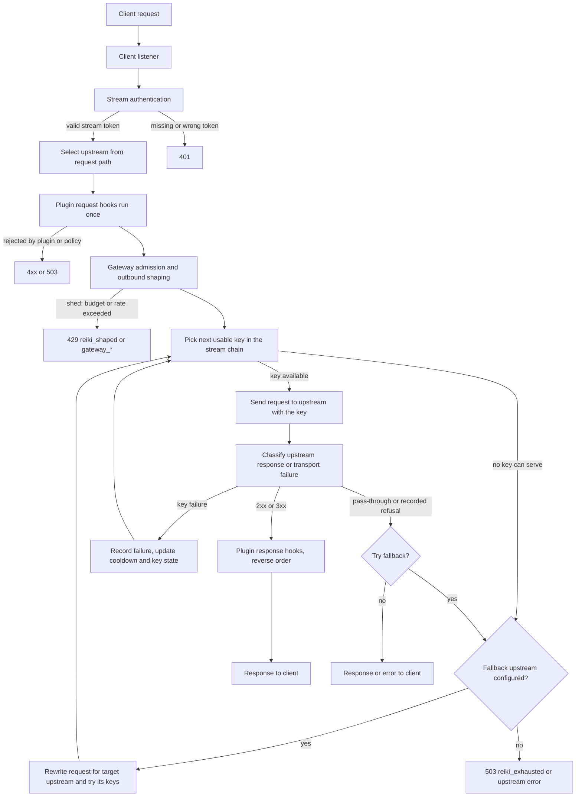
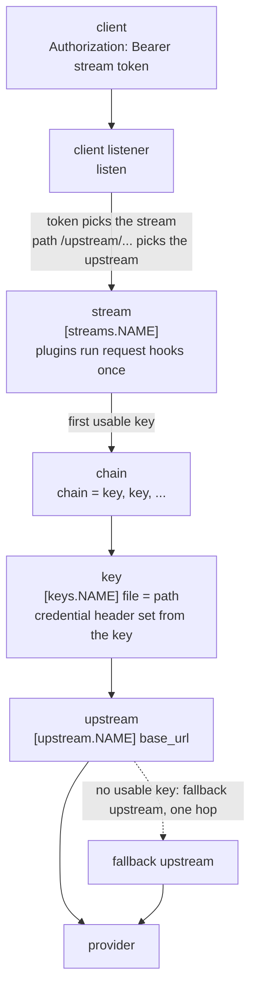

# Overview

Reiki is a security proxy for agent and LLM traffic. The client holds a stream token; Reiki holds the upstream keys and decides what may leave the host.

## What it is

Reiki is one binary. It runs in the foreground, reads one TOML file and logs to stderr. Built-in plugins are compiled in; runtime Wasm components require the optional `plugin-wasm` feature and a hash-pinned file. See [plugins](plugins.md).

Reiki reads `/etc/reiki/reiki.toml` unless `--config` names another file. `--listen` or `REIKI_LISTEN` overrides `listen` from the file, and the flag wins over the variable. `reiki check` validates the file and the key files and prints the address Reiki will use.

## Request path

Request and model rewrites run once before a key is picked; failover replays the same bytes. Request hooks run once before the loop, so every attempt sees the same rewritten request. Response hooks run in reverse plugin order on the chosen response. A decoded 2xx or 3xx response is streamed after its head is chosen; a transport failure after that point is not retried on another key. See [failover](failover.md), [plugins](plugins.md) and [shaping](shaping.md).

## Model

| Object | Meaning |
| --- | --- |
| Stream | One client identity: a token hash, a chain and optional limits and allowlists. Streams share key health only for keys they both list. |
| Chain | The ordered keys a stream may try. `sticky` keeps one key until it cannot serve; `round_robin` rotates. |
| Key | An upstream credential in a mode-`0600` file. The config holds its path, never its value. |
| Upstream | A provider endpoint. The request path prefix selects it; Reiki sets the credential header for each attempt. |
| Plugin | A component with request and response hooks. Hook order is set at build time. |

Other listeners are optional and use their own sockets:

| Listener | Table | Serves |
| --- | --- | --- |
| admin | `[admin]` | `GET /v1/status`, `GET /v1/failures`, `POST /v1/reload`, `POST /v1/keys/enable`, plugin routes such as `GET /v1/metrics`, and `GET /v1/openapi.json` |
| peers | `[peers]` | `GET /v1/health` and `GET /v1/health/stream` with a read-only peer token |
| tunnel | `[tunnel]` | CONNECT proxy with a destination allow-list; optional interception for chosen hosts |

The client listener serves the API. A request needs a stream token except on a `passthrough` upstream. For `/example/chat/completions`, the `example` upstream handles the request. See [providers](providers.md) and [tunnel](tunnel.md).

## Isolation

- Upstream keys stay in files on the Reiki host. Reiki removes the client's credential headers and sets the upstream header itself. See [keys](keys.md) and [security](security.md).
- A key echoed in an error is redacted; the cases outside that scrubber are listed in [security](security.md).
- A `passthrough` upstream is the exception: it forwards the client's own credentials. See [providers](providers.md).
- Upstreams come from the config. Plugins can swap listed terms for placeholders or block identifiers in outbound requests. See [plugins](plugins.md), [requestlog](requestlog.md) and [cost](cost.md).

## Reliability and visibility

- Failover: a chain and an optional fallback upstream take over when a key fails. See [failover](failover.md).
- Shaping: per-stream admission and per-key outbound budgets. See [shaping](shaping.md).
- Visibility: the admin API, metrics, peer health and `reiki top`. See [monitoring](monitoring.md), [provider-health](provider-health.md) and [top](top.md).

## Stage map

| Stage | What happens | Source files | Configuration |
| --- | --- | --- | --- |
| Client listener | Accepts connections, applies caps, serves `/__reiki/healthz`. | `src/main.rs`, `src/serve.rs`, `src/proxy.rs` | `listen`, `[server]`, `[service]` |
| Stream authentication | Matches the client token to a stream and applies failed-login backoff. | `src/auth.rs`, `src/proxy.rs`, `src/serve.rs`, `src/intercept.rs` | `[streams.*].token_sha256`, `[auth]` |
| Path and upstream selection | Maps the path prefix to an upstream and filters chain keys. | `src/proxy.rs`, `src/config.rs`, `src/rewrite.rs` | `[upstream.*]`, `[streams.*].chain` |
| Plugin request hooks | Runs request hooks once, in build order. | `src/plugins.rs`, `src/proxy.rs`, `crates/` | `[plugins.*]`, `streams` on plugin tables |
| Gateway and shaping | Admits one request per stream, then waits for or sheds an outbound key slot. | `src/gateway.rs`, `src/proxy.rs`, `src/shaper/`, `src/pressure.rs`, `src/chain.rs` | `[gateway]`, `[streams.*.limits]`, `[streams.*].allowed_*`, `[streams.*].weight`, `[upstream.*].limits` |
| Key chain selection | Picks the next usable key by strategy, skipping cooling, disabled and shaped-out keys. | `src/chain.rs`, `src/proxy.rs`, `src/state.rs` | `[streams.*].chain`, `[streams.*].strategy`, `[keys.*]` |
| Upstream call | Sends the request through the reverse proxy, forwarder or tunnel path and sets the credential. | `src/proxy.rs`, `src/upstream.rs`, `src/forward.rs`, `src/rewrite.rs`, `src/intercept.rs`, `src/tunnel.rs` | `[upstream.*]`, `[tunnel]`, `[tunnel.intercept]` |
| Response classification and key state | Classifies the outcome, updates cooldowns and records recent failures. | `src/classify.rs`, `src/proxy.rs`, `src/chain.rs`, `src/state.rs`, `src/failures.rs`, `src/quota.rs` | `[keys.*].quota_resets`, `[upstream.*].confirm_quota`, `[upstream.*].scope_escalate_after`, `[upstream.*].hold_unauthorized`, `[upstream.*].pass_errors` |
| Fallback upstream | Rewrites the request for the target and continues on that upstream. | `src/proxy.rs`, `src/config.rs`, `src/rewrite.rs` | `[upstream.*.fallback]` |
| Plugin response hooks | Runs response head and chunk hooks in reverse order. | `src/plugins.rs`, `src/proxy.rs` | `[plugins.*]` |
| Admin, peers and observability | Serves admin routes, publishes peer health, exposes logs, metrics and the live view. | `src/admin.rs`, `src/peers/`, `src/logging.rs`, `src/top.rs`, plugin crates | `[admin]`, `[peers]`, `[log]`, `[plugins.metrics]`, `[plugins.requestlog]` |

## Where to go next

- [Quickstart](quickstart.md): a working instance and its first proofs.
- [Glossary](glossary.md): terms and CLI vocabulary.
- [Configuration](configuration.md) and [command line](cli.md): every setting and command.
- [Keys and streams](keys.md), [providers](providers.md), [failover](failover.md) and [shaping](shaping.md).
- [Deploy](deploy.md), [monitoring](monitoring.md) and [troubleshooting](troubleshooting.md).
