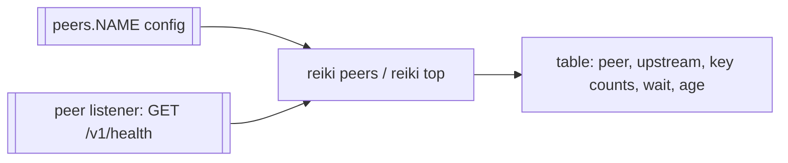

# Peers

Reiki instances can share a coarse, read-only summary of their key health. An operator or monitoring tool uses `reiki peers` and `reiki top` to see which instance has a usable key for an upstream. Requests are routed by local chains alone; the proxy never reads or acts on peer data.

Peer support is the `peers` cargo feature, in the default set like the bundled plugins. Reading and publishing stay idle until `[peers] enabled = true`.



Publish the health document with the listener, tokens and stream names described in [Peers publishing](peers-publishing.md). This page covers the reader side and the document schema.

## Configure a reader

```toml
[peers]
enabled = true
poll_interval_secs = 30

[peers.peer-a]
url = "https://192.0.2.10:4099"
token_file = "/etc/reiki/peers/peer-a.token"   # mode 0600
ca_file = "/etc/reiki/peers/peer-a-ca.pem"     # required for https
```

| Setting | Rule |
| --- | --- |
| `enabled` | Enables the peer feature. With it off, Reiki opens no listener and makes no peer connection. |
| `poll_interval_secs` | Reader poll period, 1 to 86400 seconds; default 30. Data older than three periods is unknown. |
| `[peers.NAME]` | One table per peer. Names use letters, digits, `-`, `_` and `.`. |
| `url` | The publisher's `/v1/health` base URL. Use https, or http only on a loopback address. No credentials, query or fragment. |
| `token_file` | The peer token issued by that publisher, sent as `Authorization: Bearer`. A file readable by group or others is refused. |
| `ca_file` | The only CA trusted for that peer; required for https. Two CAs in the file cover a rotation. |

Each fetch has a 5 s deadline, including connect. Redirects are refused so the token goes only to the configured host. A body over 64 KiB is refused. Built-in and system roots and environment proxies are off for peer clients, so a peer CA cannot vouch for a provider.

## Health document schema

`GET /v1/health` returns this document to a holder of a peer token. The publishing flags that add optional fields are listed in [Peers publishing](peers-publishing.md).

| Field | Type | Meaning |
| --- | --- | --- |
| `instance` | string | Publisher's configured name, or `reiki`. A host or container name stays private unless configured. |
| `reiki_version` | string | Publisher's `CARGO_PKG_VERSION`. |
| `observed_at` | string (RFC3339 UTC) | Publisher clock when the answer was built. |
| `age_seconds` | integer | Age of the figures when sent; `0`, because every figure is read as the answer is built. A reader adds its own time since receipt. |
| `failures` | object: class → integer | Counts from the same bounded ring as `/v1/failures`, newest 64 failures. Classes present in the ring appear with their count; classes with no record are absent. Values are counts only: no bodies, key names or stream names. |
| `upstreams` | array of object | One entry per upstream that uses Reiki's keys, in config order. A passthrough upstream is omitted. |
| `upstreams[].name` | string | Upstream name. |
| `upstreams[].healthy_keys` | integer | Keys in `available` state. |
| `upstreams[].cooling_keys` | integer | Keys in `cooling` state. |
| `upstreams[].disabled_keys` | integer | Keys in `out_of_rotation` state. |
| `upstreams[].cooling_combinations` | integer | Active scoped (route, model) cooldowns across this upstream's keys. A whole-key cooldown adds none, since it clears its scopes. |
| `upstreams[].soonest_cooldown_seconds` | integer or null | Shortest remaining key wait, rounded up to whole seconds and then to a multiple of `cooldown_bucket_secs` (default 300, cap 86400; `0` is exact). `null` when no key is cooling. |
| `upstreams[].last_status_class` | `2xx`, `4xx`, `5xx` or null | Class of the latest attempt on any of this upstream's keys. `null` before an attempt, after a 3xx, or when the attempt got no response. |
| `upstreams[].requests_1h` | integer | Attempts in the last hour. Present with `expose_usage = true` (the default). |
| `upstreams[].limited_1h` | integer | Attempts that were rate-limited or began a cooldown. |
| `upstreams[].request_buckets` | array of 12 integers | Five-minute attempt counts, oldest first. |
| `upstreams[].tokens_1h` | integer | Input plus output tokens reported by the provider in the last hour. A response with no readable `usage` adds none. |
| `upstreams[].token_buckets` | array of 12 integers | Five-minute token counts, oldest first. |
| `upstreams[].request_minutes` | array of 10 integers | One-minute attempt counts, oldest first; the newest is the current minute. Counts saturate at `u32`. |
| `upstreams[].token_minutes` | array of 10 integers | One-minute token counts, oldest first; the newest is the current minute. Counts saturate at `u32`. |
| `upstreams[].keys` | array of object | Per-key states, present with `expose_key_labels = true`. |
| `upstreams[].keys[].name` | string | Key name. |
| `upstreams[].keys[].state` | `available`, `cooling` or `out_of_rotation` | Key state at build time. |
| `upstreams[].keys[].cooldown_seconds` | integer or null | Bucketed remaining wait; `null` outside `cooling`. |
| `upstreams[].keys[].cooldown_class` | string | `rate_limited`, `quota_exhausted` or `transient`, present for a cooling key with a known class. |
| `host` | object | Host figures, present with `expose_host_stats = true`. |
| `host.load_average` | array of 3 floats or null | `/proc/loadavg` 1, 5 and 15 minute values; `null` where unavailable. |
| `host.cores` | integer | Parallelism available to Reiki, at least 1. |
| `host.memory` | object | Values from `/proc/meminfo` in bytes; each field is `null` where unavailable. |
| `host.memory.total_bytes` | integer or null | Total memory. |
| `host.memory.available_bytes` | integer or null | Available memory. |
| `host.memory.swap_total_bytes` | integer or null | Total swap. |
| `host.memory.swap_free_bytes` | integer or null | Free swap. |
| `host.disks` | array of object | One entry per filesystem behind directories Reiki writes to. Figures come from `statvfs` with a 2 s probe budget; an unanswered filesystem keeps its entry with `null` figures. No paths appear. |
| `host.disks[].roles` | array of strings | `config` (config file), `state` (key health file), `log` (`[log] file`) and `requestlog` (request log plugin file) on one filesystem. |
| `host.disks[].total_bytes` | integer or null | Filesystem size. |
| `host.disks[].available_bytes` | integer or null | Available filesystem space. |
| `host.disks[].used_percent` | float or null | Used space as a percentage, to one decimal. |
| `sessions` | object | Client-reported session activity, present with `expose_host_stats = true`. |
| `sessions.window_seconds` | integer | Window configured by `session_window_secs`, 10 to 86400. |
| `sessions.active_sessions` | integer | Distinct `session_header` values seen on authenticated client requests in the window, once per client request. |
| `sessions.streams` | array of object | Per-stream counts, present only with `expose_key_labels = true`. |
| `sessions.streams[].stream` | string | Stream name. |
| `sessions.streams[].active_sessions` | integer | Distinct session ids for that stream in the window. |

The per-hour and per-minute arrays are in-memory counters: a publisher restart starts them at zero. Session ids are kept as salted 64-bit hashes, capped at 4096 per stream and 256 streams, and are never logged or published.

## Read with reiki peers

```bash
reiki peers
reiki peers --json
reiki peers --watch
```

```text
PEER  INSTANCE  UPSTREAM  STATE    HEALTHY  COOLING  DISABLED  WAIT  AGE
peer-a  peer-a      zen       cooling  0        1        0         42s   3s
peer-b  -         -         unknown  -        -        -         -     -
```

`reiki peers` fetches every configured peer and prints one row per upstream. It needs `[peers] enabled = true` and at least one peer table.

| Column | Meaning |
| --- | --- |
| `PEER` | Configured peer name. |
| `INSTANCE` | Publisher's `instance`, or `-` when unknown. |
| `UPSTREAM` | Upstream name, or `-` when unknown. |
| `STATE` | `ok` with a usable key, else `cooling`, `disabled` or `no_keys`; `unknown` when fresh data is unavailable. |
| `HEALTHY`, `COOLING`, `DISABLED` | Key counts from the health document. |
| `WAIT` | `soonest_cooldown_seconds`, shown as seconds. |
| `AGE` | Reported `age_seconds` plus time since receipt on this host. |

A peer is `unknown` when it cannot be reached, fails TLS, refuses the token, answers other than 200, sends a body over 64 KiB or outside the schema, or reports data older than three `poll_interval_secs` (90 s by default). The reason goes to stderr. A report whose `observed_at` is more than three poll intervals ahead of this clock is unknown too. This clock check applies only when the report omits `age_seconds`. The exit status is 0 with at least one fresh peer, 1 with none, and 2 on a config problem.

`--json` prints `{"peers":[{"name","state","error","instance","age_seconds","upstreams"}]}`. `--watch` follows each publisher's `/v1/health/stream`, redrawing the table or printing one JSON document per line on change. Key events update a known upstream or add a new one while the watched document has fewer than 256 upstreams; a key event that would pass that cap is dropped and counted in the log. A stream that cannot open, ends or sends nothing for 40 s falls back to one `/v1/health` poll, waits `poll_interval_secs` and reconnects. Watch age uses the last reported age plus time since the last frame, heartbeats included, and turns `unknown` after three poll intervals. Use `Ctrl+C` to stop.

## Read with reiki top

`reiki top` presents a live fleet view built from peer health documents. It is read-only and uses the same pinned clients and token files. See [reiki top](top.md) for `--once`, `--interval`, `--full` and `--provider`.

## Check the configuration

`reiki check` prints a `peers:` line: `peers: disabled`, or the effective settings, for example `peers: enabled, publishing on 127.0.0.1:4099 (key labels hidden), 1 peer(s)[peer-a], poll every 30s`. With multiple peer tokens it names them as `2 token(s)[default, peer-b]` after the listener.

## Publish a health document

Listener setup, peer tokens, TLS, exposure flags and the SSE stream live in [Peers publishing](peers-publishing.md). Admin endpoints and metrics are in [Monitoring](monitoring.md).
