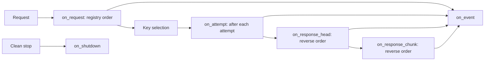

# Plugin authoring

A plugin implements the `Plugin` trait from the `reiki-plugin` crate. Reiki compiles plugins into the binary and never loads code at runtime. Keep plugin code small: it runs inside the proxy process and is as trusted as Reiki. See [plugins](plugins.md) for the user guide.

## Hook lifecycle



| Hook | When | Context | May change | Error path |
| --- | --- | --- | --- | --- |
| `on_request` | Once per request, before key selection | `RequestCtx` | Headers, body, per-request state, findings | Return `Reject(status, message)` or `Skip(message)`. A panic becomes `Skip`. `Skip` follows `on_error`. |
| `on_attempt` | After each selected upstream attempt, including failed attempts | `AttemptCtx` | Per-request state only | No return value. A panic is logged and skipped; the next plugin runs. |
| `on_response_head` | After the upstream status and headers are known | `ResponseHeadCtx` | Status, headers, per-request state | No return value. A panic marks the plugin failed for the request; with `on_error = "reject"` the response is refused with 503. Runs in reverse registry order. |
| `on_response_chunk` | For each body chunk, then once with `is_last = true` | `ChunkCtx` | Chunk, per-request state | No return value. A panic marks the plugin failed for the request; with `on_error = "reject"` the streamed body is cut and the client gets 503. Runs in reverse registry order. |
| `on_shutdown` | After listeners drain on a clean stop, in registry order | none | Anything the plugin owns, synchronously | No return value. A panic is logged and skipped; the other plugins still shut down. |
| `on_event` | On relay facts: request done, failover, cooldown, stream rate limit, plugin rejection, finding | `Event` | Nothing; read-only | No return value. A panic is logged and skipped. |
| `on_admin` | An authenticated `GET` on a path from `admin_paths` | `AdminCtx` | Returns `Option<AdminReply>` | `None` or a panic gives an empty 404. |

`on_request`, `on_attempt` and `on_event` run in registry order. Response hooks run in reverse, so the plugin that changed the request first sees the response last and can undo its change. `on_event` is stream-scoped like request hooks; a `Cooldown` event has no stream and reaches only plugins without `streams`.

The final `on_response_chunk` call with `is_last = true` happens on normal end of body, on an upstream stream error, and when a client disconnects. Make the call safe to repeat. The body is capped at 8 MiB before and after `on_request`; a larger body gets 413 and no upstream call.

## Support methods

| Method | Default | Purpose |
| --- | --- | --- |
| `name(&self) -> &str` | required | Plugin name; must match the catalog `name` and config table. |
| `fails_closed(&self) -> bool` | `false` | Sets the default `on_error` to `reject`. |
| `new_state(&self) -> Box<dyn Any + Send>` | `Box::new(())` | Creates one state value per request. A panic is logged and marks the plugin failed for the request; with `on_error = "reject"` the request is refused with 503. With explicit `pass_through`, the default unit state is used as before. |
| `live_reload(&self) -> bool` | `true` | `false` keeps the running instance when a rebuild is needed and reports `restart_needed`. |
| `watched_files(&self) -> Vec<PathBuf>` | empty | Files whose metadata a reload checks; a change rebuilds the plugin. |
| `needs_response_hooks(&self) -> bool` | `uses_bodies()` | Ask for response hooks without changing bodies. |
| `uses_bodies(&self) -> bool` | `true` | `false` leaves response streaming and `content-length` alone. |
| `admin_paths(&self) -> Vec<&'static str>` | empty | Admin GET paths this plugin serves. |
| `on_admin(&self, &AdminCtx) -> Option<AdminReply>` | `None` | Answer for one of those paths. |
| `status_fragment(&self) -> Option<serde_json::Value>` | `None` | JSON object merged into `GET /v1/status`; a panic or a non-object is skipped. |
| `health_gauge(&self) -> Option<(&'static str, u64)>` | `None` | One monotonic count published in `/v1/health` for peers and `reiki top`. |

`HOST_KEYS` is `["enabled", "on_error", "dry_run", "streams"]`. The host passes the whole config table to `build`, including these keys. A plugin should accept and ignore them; `HOST_KEYS` helps reject only unknown plugin settings. `reiki check` adds `dry_run = true` to every plugin table, so a build should validate settings without opening files, sockets or threads.

One plugin instance serves concurrent requests. Put mutable per-request data in `new_state`, and protect shared data with its own synchronisation.

## Contexts and events

The context types are `#[non_exhaustive]`. Use their constructors in tests; do not use struct literals.

| Type | Fields you use | Constructor for tests |
| --- | --- | --- |
| `RequestCtx` | `id`, `stream`, `upstream`, `method`, `path`, `headers`, `body`, `state`, `reported` | `new(...)` then `.with_id(id)`; `report(kind, count, blocked)` and `report_detail(kind, detail, count, blocked)` add findings |
| `AttemptCtx` | `key`, `status`, `body`, `state` | `new(key, status, body, state)` |
| `ResponseHeadCtx` | `key`, `upstream`, `status`, `headers`, `state` | `new(key, status, headers, state)` then `.with_upstream(name)` |
| `ChunkCtx` | `chunk`, `is_last`, `state` | `new(chunk, is_last, state)` |
| `AdminCtx` | `path`, `keys`, `usage` | `new(path, keys)` then `.with_usage(...)` |
| `AdminReply` | `content_type`, `body` | plain struct |

`RequestCtx::path` has no query string. `AttemptCtx::key` is a config name, never a secret; passthrough uses `-`. `RequestCtx::id` is 32 hex digits shared with the logs. `new_request_id()` creates such an id, but the host normally does it.

`Event` is `#[non_exhaustive]`, so match with a wildcard arm. Its variants are `RequestDone`, `Failover`, `Cooldown`, `RateLimited`, `PluginRejected` and `Finding`. `Finding` carries a sanitised `detail` label from `report_detail`. `FailureKind` is also non-exhaustive; `CooldownScope` is `Key` or `Model`.

Admin paths must start with `/`, must not be `/`, have no trailing slash, `%`, or empty, `.` or `..` segment. A duplicate path, or one Reiki reserves (`/v1/status`, `/v1/failures`, `/v1/reload`, `/v1/keys/enable`, `/v1/openapi.json`), fails plugin chain construction at startup; a bad reload is refused. Reiki authenticates the caller before calling the hook.

## Errors and `on_error`

| Return from `on_request` | Result |
| --- | --- |
| `Ok(())` | Request continues. |
| `PluginError::Reject(status, message)` | Request stops with that status and a JSON error. Always rejects, whatever `on_error` says. Emits `Event::PluginRejected`. |
| `PluginError::Skip(message)` | `on_error = "pass_through"` logs and continues. `on_error = "reject"` answers 503 and emits `Event::PluginRejected`. |
| `Ok(())` after `report(...)` | Emits `Event::Finding`; the stream and plugin names are fixed by the host. |

The default `on_error` is `reject` when `fails_closed()` is true, otherwise `pass_through`. An explicit setting wins. Explicit `pass_through` on a fail-closed plugin is allowed and logs a warning when that plugin is built. `Reject` messages reach the client and the log, so never put request text or secrets in them.

A panic in `on_request` counts as `Skip`. Panics in `new_state` and in the response hooks mark that plugin as failed for the request: with a resolved `on_error = "reject"` the request is blocked with 503, a buffered response is refused, and a streamed body is cut short. With an explicit `on_error = "pass_through"`, a `new_state` panic falls back to the default `()` state, so later hooks may skip when they downcast it. Panics in `on_event`, `on_admin` and `on_shutdown` are only caught and logged. Release builds keep `panic = "unwind"`.

## Crate layout

`reiki-plugin` is not published. Depend on it by path. A minimal in-tree crate has two files:

```text
crates/reiki-tag/
├── Cargo.toml
└── src/lib.rs
```

Its `Cargo.toml` needs the plugin API, `toml` for the builder argument, and the `bytes` and `http` types used below:

```toml
[package]
name = "reiki-tag"
version = "0.1.0"
edition = "2021"
rust-version = "1.99"
license = "MIT"
publish = false

[dependencies]
reiki-plugin = { path = "../reiki-plugin" }
bytes = "1"
http = "1"
toml = "0.8"

[lints.rust]
unsafe_code = "forbid"
```

The crate must export `pub const NAME: &str` and a builder with this exact shape:

```rust
pub fn build(table: &toml::Table) -> Result<Box<dyn Plugin>, String>;
```

`NAME` must equal the catalog `name`. `build.rs` does not check this; a mismatch makes config lookup fail at startup.

## Build-time registration

Add four entries to the root `Cargo.toml`:

```toml
[workspace]
members = ["crates/reiki-tag"]

[dependencies]
reiki-tag = { path = "crates/reiki-tag", optional = true }

[features]
plugin-tag = ["dep:reiki-tag"]

[[package.metadata.reiki.plugin]]
name = "tag"
feature = "plugin-tag"
crate = "reiki_tag"
```

The catalog is a non-empty array of tables with unique names and non-empty `name`, `feature` and `crate` strings. `crate` becomes a Rust identifier in generated code. Duplicate `crate` values are not checked by `build.rs`.

`REIKI_PLUGINS` selects and orders registered plugins at build time:

```sh
REIKI_PLUGINS=placeholders,requestlog cargo build --release --no-default-features \
  --features plugin-placeholders,plugin-requestlog
```

- Unset or blank: register every plugin whose feature is enabled, in catalog order.
- Set: register only the listed names, in the listed order. An unknown name, a repeated name or a disabled feature fails the build.
- `requestlog` before `placeholders` fails the build. The build warns when no masking plugin precedes `requestlog`, or when a detector follows `placeholders`.
- The generated registration is `Registration { name: reiki_tag::NAME, build: reiki_tag::build }`.

## Complete minimal example

This plugin adds one response header, observes a counter in per-request state and rejects unknown settings. The test builds contexts with the API constructors.

```rust
use std::any::Any;

use bytes::Bytes;
use http::{HeaderValue, StatusCode};
use reiki_plugin::{ChunkCtx, Plugin, PluginError, RequestCtx, ResponseHeadCtx, HOST_KEYS};

pub const NAME: &str = "tag";

pub fn build(table: &toml::Table) -> Result<Box<dyn Plugin>, String> {
    if let Some(key) = table.keys().find(|k| !HOST_KEYS.contains(&k.as_str())) {
        return Err(format!("{NAME}: unknown setting `{key}`"));
    }
    Ok(Box::new(Tag))
}

struct Tag;

impl Plugin for Tag {
    fn name(&self) -> &str {
        NAME
    }

    // Observe responses without changing bodies, so content-length can stay.
    fn needs_response_hooks(&self) -> bool {
        true
    }
    fn uses_bodies(&self) -> bool {
        false
    }

    fn new_state(&self) -> Box<dyn Any + Send> {
        Box::new(0usize)
    }

    fn on_request(&self, ctx: &mut RequestCtx<'_>) -> Result<(), PluginError> {
        let _ = ctx.headers.insert("x-tag", HeaderValue::from_static("1"));
        let seen = ctx.state.downcast_mut::<usize>().expect("our own state");
        *seen += 1;
        Ok(())
    }

    fn on_response_head(&self, ctx: &mut ResponseHeadCtx<'_>) {
        let seen = ctx.state.downcast_mut::<usize>().expect("our own state");
        *seen += 1;
    }

    fn on_response_chunk(&self, ctx: &mut ChunkCtx<'_>) {
        if ctx.is_last {
            let seen = ctx.state.downcast_mut::<usize>().expect("our own state");
            *seen += 1;
        }
    }
}

#[cfg(test)]
mod tests {
    use super::*;
    use http::{HeaderMap, Method};

    #[test]
    fn hooks_run_against_constructed_contexts() {
        let plugin = build(&toml::Table::new()).unwrap();
        assert_eq!(plugin.name(), NAME);
        assert!(plugin.needs_response_hooks());
        assert!(!plugin.uses_bodies());

        let mut state = plugin.new_state();
        let method = Method::POST;
        let mut headers = HeaderMap::new();
        let mut body = Bytes::from_static(b"hi");

        {
            let mut ctx = RequestCtx::new(
                "client-a",
                "zen",
                &method,
                "/zen/chat/completions",
                &mut headers,
                &mut body,
                state.as_mut(),
            );
            plugin.on_request(&mut ctx).unwrap();
        }
        assert_eq!(headers.get("x-tag").map(|v| v.to_str().unwrap()), Some("1"));
        assert_eq!(state.downcast_ref::<usize>().copied(), Some(1));

        let mut status = StatusCode::OK;
        plugin.on_response_head(&mut ResponseHeadCtx::new(
            "key-a",
            &mut status,
            &mut headers,
            state.as_mut(),
        ));

        let mut chunk = Bytes::from_static(b"part");
        plugin.on_response_chunk(&mut ChunkCtx::new(&mut chunk, false, state.as_mut()));
        let mut tail = Bytes::new();
        plugin.on_response_chunk(&mut ChunkCtx::new(&mut tail, true, state.as_mut()));

        assert_eq!(state.downcast_ref::<usize>().copied(), Some(3));
        assert_eq!(&chunk[..], b"part");
    }

    #[test]
    fn unknown_settings_are_rejected() {
        let table: toml::Table = "path = \"/x\"".parse().unwrap();
        assert!(build(&table).is_err());
    }
}
```

Run `cargo test -p reiki-tag`, then build Reiki with the feature enabled and confirm with `reiki check`. The check runs the builder with `dry_run = true`. After a config reload, a plugin with `live_reload() == false` keeps running and appears in `restart_needed`. See [upgrades](upgrades.md#reload-vs-restart) and [configuration](configuration.md#pluginsname).
