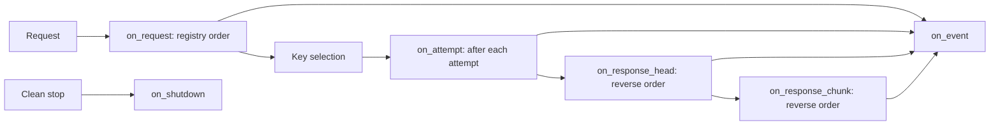

# Plugin authoring

A plugin implements the `Plugin` trait from the `reiki-plugin` crate. Reiki compiles plugins into the binary and never loads native code at runtime; runtime Wasm components are the exception ([runtime Wasm plugins](#runtime-wasm-plugins)). Keep plugin code small: it runs inside the proxy process and is as trusted as Reiki. See [plugins](plugins.md) for the user guide.

## Hook lifecycle



| Hook | When | Context | May change | Error path |
| --- | --- | --- | --- | --- |
| `on_request` | Once per request, before key selection | `RequestCtx` | Headers, body, per-request state, findings | `Reject(status, message)` or `Skip(message)`; a panic becomes `Skip`, which follows `on_error` |
| `on_attempt` | After each selected attempt, including failures | `AttemptCtx` | Per-request state only | No return; a panic is logged and skipped |
| `on_response_head` | After the upstream status and headers are known | `ResponseHeadCtx` | Status, headers, per-request state | No return; a panic marks the plugin failed for the request, with 503 under `on_error = "reject"`; reverse registry order |
| `on_response_chunk` | For each body chunk, then once with `is_last = true` | `ChunkCtx` | Chunk, per-request state | Same failure path; reverse registry order |
| `on_shutdown` | After listeners drain on a clean stop | none | Anything the plugin owns, synchronously | No return; a panic is logged and skipped |
| `on_event` | Relay facts: request done, failover, cooldown, stream rate limit, plugin rejection, finding | `Event` | Nothing; read-only | No return; a panic is logged and skipped |
| `on_admin` | An authenticated `GET` on a path from `admin_paths` | `AdminCtx` | Returns `Option<AdminReply>` | `None` or a panic gives an empty 404 |
| `admission_refusal` | After allowlists, before a request counter is reserved | Stream name and `SystemTime` | Static `AdmissionRefusal` | Host turns it into the same 429 as a stream limit; no request data, prices or secrets |
| `metrics_text` | When `/v1/metrics` is built | none | Prometheus text | Appended by the host; bounded labels, no secrets |
| `usage_cost_fragment` | When a stream reads its own `/v1/usage` | Stream name | Optional JSON object | Inserted only into that stream's row |

`on_request`, `on_attempt` and `on_event` run in registry order; response hooks run in reverse. `on_event` is stream-scoped; a `Cooldown` event has no stream and reaches only plugins without `streams`. `on_request` runs on Tokio's blocking pool, with no timeout; other hooks run on the request task. The final `on_response_chunk` also fires on upstream error and client disconnect, so make it repeat-safe. Bodies are capped at 8 MiB before and after `on_request`; a larger body gets 413 and no upstream call.

## Support methods

| Method | Default | Purpose |
| --- | --- | --- |
| `name(&self) -> &str` | required | Must match the catalog `name` and config table. |
| `fails_closed(&self) -> bool` | `false` | Sets the default `on_error` to `reject`. |
| `new_state(&self) -> Box<dyn Any + Send>` | `Box::new(())` | One state value per request; a panic marks the plugin failed for that request. |
| `live_reload(&self) -> bool` | `true` | `false` keeps the running instance and reports `restart_needed`. |
| `watched_files(&self) -> Vec<PathBuf>` | empty | Metadata changes rebuild the plugin. |
| `needs_response_hooks(&self) -> bool` | `uses_bodies()` | Ask for response hooks without changing bodies. |
| `uses_bodies(&self) -> bool` | `true` | `false` leaves response streaming and `content-length` alone. |
| `admin_paths(&self) -> Vec<&'static str>` | empty | Admin GET paths the plugin serves. |
| `on_admin(&self, &AdminCtx) -> Option<AdminReply>` | `None` | Reply for one of those paths. |
| `status_fragment(&self) -> Option<serde_json::Value>` | `None` | JSON object merged into `GET /v1/status`; a panic or non-object is skipped. |
| `health_gauge(&self) -> Option<(&'static str, u64)>` | `None` | One monotonic count in `/v1/health` for peers and `reiki top`. |
| `configure(&mut self, &PluginHost)` | no-op | Receives a private state-file path; never derive one from a request. |
| `admission_refusal(&self, &str, SystemTime) -> Option<AdmissionRefusal>` | `None` | Static 429 request through the gateway refusal path. |
| `metrics_text(&self) -> String` | empty | Extra Prometheus text appended by the host. |
| `usage_cost_fragment(&self, &str) -> Option<Value>` | `None` | JSON object merged into the caller's own `/v1/usage` row. |

`HOST_KEYS` is `["enabled", "on_error", "dry_run", "streams"]`. The host passes the whole config table to `build`, including these keys; accept and ignore them, and use `HOST_KEYS` to reject only unknown plugin settings. `reiki check` adds `dry_run = true`, so a build should validate settings without opening files, sockets or threads. One plugin instance serves concurrent requests: put mutable per-request data in `new_state` and protect shared data with its own synchronisation.

## Contexts and events

Context types are `#[non_exhaustive]`; use their constructors in tests, not struct literals.

| Type | Fields you use | Constructor for tests |
| --- | --- | --- |
| `RequestCtx` | `id`, `stream`, `upstream`, `method`, `path`, `headers`, `body`, `state`, `reported` | `new(...)` then `.with_id(id)`; `report(kind, count, blocked)` and `report_detail(kind, detail, count, blocked)` |
| `AttemptCtx` | `key`, `status`, `body`, `state` | `new(key, status, body, state)` |
| `ResponseHeadCtx` | `key`, `upstream`, `status`, `headers`, `state` | `new(key, status, headers, state)` then `.with_upstream(name)` |
| `ChunkCtx` | `chunk`, `is_last`, `state` | `new(chunk, is_last, state)` |
| `AdminCtx` | `path`, `query`, `keys`, `usage` | `new(path, keys)` then `.with_query(...)` and `.with_usage(...)` |
| `AdminReply` | `content_type`, `body` | plain struct |

`RequestCtx::path` has no query string. `AdminCtx::query` is the raw admin query without `?`: validate it strictly and never echo values into errors. `AttemptCtx::key` is a config name, never a secret; passthrough uses `-`. `RequestCtx::id` is 32 hex digits shared with logs; `new_request_id()` creates one, though the host normally does it.

`Event` is `#[non_exhaustive]`, so match with a wildcard arm. Variants: `RequestDone`, `Failover`, `Cooldown`, `RateLimited`, `GatewayRejected`, `GatewayStoreError`, `Usage`, `PluginRejected`, `Observed` and `Finding`. `Usage` carries stream, upstream, declared model, operator key name and token counts with a bounded status class, but no credential. `Finding` carries the sanitised `detail` label. `FailureKind` is also non-exhaustive; `CooldownScope` is `Key` or `Model`.

Admin paths must start with `/`, must not be `/`, and have no trailing slash, `%`, or empty, `.` or `..` segment. A duplicate path or one Reiki reserves (`/v1/status`, `/v1/failures`, `/v1/reload`, `/v1/keys/enable`, `/v1/openapi.json`) fails chain construction at startup and is refused on reload. Reiki authenticates the caller before calling the hook.

## Errors and `on_error`

| Return from `on_request` | Result |
| --- | --- |
| `Ok(())` | Request continues. |
| `PluginError::Reject(status, message)` | Request stops with that status and a JSON error, whatever `on_error` says; emits `Event::PluginRejected`. |
| `PluginError::Skip(message)` | `pass_through` logs and continues; `reject` answers 503 and emits `Event::PluginRejected`. |
| `Ok(())` after `report(...)` | Emits `Event::Finding`; stream and plugin names are fixed by the host. |

The default `on_error` is `reject` when `fails_closed()` is true, otherwise `pass_through`; an explicit setting wins. Explicit `pass_through` on a fail-closed plugin is allowed and warns at build time. `Reject` messages reach the client and the log, so never include request text or secrets. A panic in `on_request` counts as `Skip`; panics in `new_state` and response hooks mark the plugin failed for that request. With explicit `pass_through`, a `new_state` panic falls back to the default `()` state. Panics in `on_event`, `on_admin` and `on_shutdown` are only caught and logged. Release builds keep `panic = "unwind"`.

## Crate layout

`reiki-plugin` is not published; depend on it by path. A minimal in-tree crate has `Cargo.toml` and `src/lib.rs`:

```toml
[package]
name = "reiki-tag"
version = "0.1.0"
edition = "2024"
rust-version = "1.99"
license = "MIT"
publish = false

[dependencies]
reiki-plugin = { path = "../reiki-plugin" }
bytes = "1"
http = "1"
toml = "0.8"

[lints.rust]
unsafe_code = "forbid"
```

Export `pub const NAME: &str` and a builder with this exact shape:

```rust
pub fn build(table: &toml::Table) -> Result<Box<dyn Plugin>, String>;
```

`NAME` must equal the catalog `name`; `build.rs` does not check this, and a mismatch makes config lookup fail at startup.

## Build-time registration

Add four entries to the root `Cargo.toml`:

```toml
[workspace]
members = ["crates/reiki-tag"]

[dependencies]
reiki-tag = { path = "crates/reiki-tag", optional = true }

[features]
plugin-tag = ["dep:reiki-tag"]

[[package.metadata.reiki.plugin]]
name = "tag"
feature = "plugin-tag"
crate = "reiki_tag"
```

The catalog is a non-empty array of tables with unique names and non-empty `name`, `feature` and `crate` strings; `crate` becomes a Rust identifier in generated code. `REIKI_PLUGINS` selects and orders registered plugins:

```sh
REIKI_PLUGINS=placeholders,requestlog cargo build --release --no-default-features \
  --features plugin-placeholders,plugin-requestlog
```

- Unset or blank: register every enabled plugin in catalog order.
- Set: register only the listed names in the listed order. An unknown name, a repeated name or a disabled feature fails the build.
- `requestlog` before `placeholders` fails the build; the build warns when no masking plugin precedes `requestlog` or when a detector follows `placeholders`.
- Registration generated for a plugin is `Registration { name: reiki_tag::NAME, build: reiki_tag::build }`.

## Complete minimal example

This plugin adds one response header, observes a counter in per-request state and rejects unknown settings.

```rust
use std::any::Any;

use bytes::Bytes;
use http::{HeaderValue, StatusCode};
use reiki_plugin::{ChunkCtx, Plugin, PluginError, RequestCtx, ResponseHeadCtx, HOST_KEYS};

pub const NAME: &str = "tag";

pub fn build(table: &toml::Table) -> Result<Box<dyn Plugin>, String> {
    if let Some(key) = table.keys().find(|k| !HOST_KEYS.contains(&k.as_str())) {
        return Err(format!("{NAME}: unknown setting `{key}`"));
    }
    Ok(Box::new(Tag))
}

struct Tag;

impl Plugin for Tag {
    fn name(&self) -> &str {
        NAME
    }

    // Observe responses without changing bodies, so content-length can stay.
    fn needs_response_hooks(&self) -> bool {
        true
    }
    fn uses_bodies(&self) -> bool {
        false
    }

    fn new_state(&self) -> Box<dyn Any + Send> {
        Box::new(0usize)
    }

    fn on_request(&self, ctx: &mut RequestCtx<'_>) -> Result<(), PluginError> {
        let _ = ctx.headers.insert("x-tag", HeaderValue::from_static("1"));
        let seen = ctx.state.downcast_mut::<usize>().expect("our own state");
        *seen += 1;
        Ok(())
    }

    fn on_response_head(&self, ctx: &mut ResponseHeadCtx<'_>) {
        let seen = ctx.state.downcast_mut::<usize>().expect("our own state");
        *seen += 1;
    }

    fn on_response_chunk(&self, ctx: &mut ChunkCtx<'_>) {
        if ctx.is_last {
            let seen = ctx.state.downcast_mut::<usize>().expect("our own state");
            *seen += 1;
        }
    }
}

#[cfg(test)]
mod tests {
    use super::*;
    use http::{HeaderMap, Method};

    #[test]
    fn hooks_run_against_constructed_contexts() {
        let plugin = build(&toml::Table::new()).unwrap();
        assert_eq!(plugin.name(), NAME);
        assert!(plugin.needs_response_hooks());
        assert!(!plugin.uses_bodies());

        let mut state = plugin.new_state();
        let method = Method::POST;
        let mut headers = HeaderMap::new();
        let mut body = Bytes::from_static(b"hi");

        {
            let mut ctx = RequestCtx::new(
                "client-a",
                "example",
                &method,
                "/example/chat/completions",
                &mut headers,
                &mut body,
                state.as_mut(),
            );
            plugin.on_request(&mut ctx).unwrap();
        }
        assert_eq!(headers.get("x-tag").map(|v| v.to_str().unwrap()), Some("1"));
        assert_eq!(state.downcast_ref::<usize>().copied(), Some(1));

        let mut status = StatusCode::OK;
        plugin.on_response_head(&mut ResponseHeadCtx::new(
            "key-a",
            &mut status,
            &mut headers,
            state.as_mut(),
        ));

        let mut chunk = Bytes::from_static(b"part");
        plugin.on_response_chunk(&mut ChunkCtx::new(&mut chunk, false, state.as_mut()));
        let mut tail = Bytes::new();
        plugin.on_response_chunk(&mut ChunkCtx::new(&mut tail, true, state.as_mut()));

        assert_eq!(state.downcast_ref::<usize>().copied(), Some(3));
        assert_eq!(&chunk[..], b"part");
    }

    #[test]
    fn unknown_settings_are_rejected() {
        let table: toml::Table = "path = \"/x\"".parse().unwrap();
        assert!(build(&table).is_err());
    }
}
```

Run `cargo test -p reiki-tag`, build Reiki with the feature enabled and confirm with `reiki check`, which runs the builder with `dry_run = true`. A plugin with `live_reload() == false` keeps running after reload and appears in `restart_needed`. See [reload](troubleshooting.md#reload) and [configuration](configuration.md#pluginsname).

## Runtime Wasm plugins

Phase 1 Wasm plugins run behind the `plugin-wasm` feature, off by default. A binary built without it refuses `[plugins.<name>]` tables containing `wasm = ...`. Components run in the fixed D5 slot: after compiled-in request plugins and before compiled-in response observers. They are not selected by `REIKI_PLUGINS`.

### Configure and pin

```toml
[plugins.example]
wasm = "/var/lib/reiki/plugins/example.wasm"
sha256 = "<64 lowercase hex>"
# role = "security"
# on_error = "reject"
# streams = ["agent"]
# grants = ["request-body:read", "finding:detail-vocab"]
# confirm = "I understand this grant"
# tool_allowlist = ["search", "lookup"]
# [plugins.example.limits]
# memory-mib = 16
# fuel-per-call = 10000000
# deadline-ms = 250
# [plugins.example.config]
# plugin-specific = true
```

`wasm` and `sha256` are required: the hash pins the exact component bytes and a mismatch fails load. The embedded `reiki-manifest` custom section must match the configured name and declared capabilities. Unknown keys are errors; `signature` and `files` are reserved and unsupported.

### Grants and capabilities

Capabilities are derived from component imports. Default-allowed capabilities are linked for every plugin: `request-meta`, `finding`, `log`, `reject`, `clock:monotonic`, `random` and `request-state`. Gated capabilities must be both granted in config and declared in the manifest:

| Grant | Risk | Meaning |
| --- | --- | --- |
| `request-body:read` | medium | Read request body bytes. |
| `request-body:edit` | medium | Return host-applied edit ops; the host revalidates JSON. |
| `finding:detail-vocab` | low | Finding details must be in the manifest vocabulary. |

A requested gated capability that is not granted fails load, as does a grant the component does not request; default-allowed capabilities must not be listed in `grants`. Filesystem, network and HTTP access are not capabilities: components importing `wasi:filesystem`, `wasi:sockets` or `wasi:http` are refused at load and no grant enables them. The host pins `wasmtime` and `wasmtime-wasi` to 51.0.0.

### Limits

Effective limits are `min(manifest, operator override, host ceiling)`; an override may only lower a manifest limit.

| Limit | Manifest default | Host ceiling |
| --- | ---: | ---: |
| `memory-mib` | 16 | 128 |
| `fuel-per-call` | 10,000,000 | 2,000,000,000 |
| `fuel-per-kib` | 200,000 | 20,000,000 |
| `deadline-ms` | 250 | 2,000 |
| `wall-budget-ms` | 1,000 | 10,000 |
| `max-body-kib` | 1,024 | 8,192 |

Fuel is charged per call as `fuel-per-call + ceil(body_kib) * fuel-per-kib`. Exceeding fuel, memory or deadline traps the component; `role = "security"` or `on_error = "reject"` fails closed with 503. `deadline-ms` bounds a request including host calls; `wall-budget-ms` bounds load-time instantiation and `init`. Both are checked by host calls and the epoch ticker.

### Reload and restart rules

Reload can only narrow; widening requires a restart.

- Grant removal and stream removal are live. Adding a stream is live for low-only grants; adding one to a plugin with medium or high grants needs a restart.
- Lowering limits is live; raising one, or removing an override that raises it, needs a restart.
- `pass_through -> reject` and adding `role = "security"` are live; the reverse needs a restart.
- Tightening `tool_allowlist` is live; removing it or adding tools needs a restart.
- New Wasm bytes are live when every grant has low risk; any new medium- or high-risk grant needs a restart. `confirm` only forces a restart when a previously present value changes or is removed.

### Request-side tool allowlist

`tool_allowlist = [...]` is host-enforced. For recognized request formats the host reuses `reiki-toolpolicy` request parsing to extract declared tools; a tool outside the list is rejected with 403. Unrecognized paths are unaffected; an unparseable recognized request fails closed.

### Inspect

```sh
reiki plugin inspect ./plugin.wasm
reiki plugin inspect ./plugin.wasm --json
```

Inspect reports the embedded manifest, derived capabilities, default-allowed and requested gated capabilities, manifest limits and pin metadata.

### Plugin author guide

Components target WIT world `reiki:plugin/plugin@1.0.0` from `crates/reiki-wasm/wit/reiki.wit`. Exports:

- `init: func(config: list<u8>) -> result<_, string>` receives `[plugins.<name>.config]` as TOML bytes.
- `on-request: func(req: borrow<request>) -> result<tuple<verdict, option<request-edit>>, string>`.

Request edits are host-applied: the plugin returns `edit-op` values with JSON pointers and manifest literal ids; the host validates pointers, resolves literals from the embedded manifest, applies edits and revalidates JSON. Arbitrary rewrites are not supported in Phase 1. The `reiki-manifest` custom section is TOML declaring metadata, hooks, requested gated capabilities, literal and detail vocabularies, log and reject templates, and limits. Reference components live in `examples/wasm-no-grant`, `examples/wasm-body-edit`, `examples/wasm-fs-probe` and `examples/wasm-wasi-imports`, each with source, manifest, README and `rebuild.sh`. Conformance tests run with `cargo test -p reiki-wasm --test conformance` and skip the rebuild comparison when the toolchain is absent.

## Building without cargo component

The reference examples are plain Rust crates that call `wit-bindgen` at compile time, then use `wasm-tools` to wrap the core module as a component. You need:

- the `wasm32-wasip1` Rust target (`rustup target add wasm32-wasip1`);
- `wasm-tools` on `PATH` (the scripts use the 1.263 command set);
- `perl`, used only to inject the manifest as a top-level custom section.

From an example directory, run `./rebuild.sh [OUTPUT]`. With no argument the script writes `no-grant.wasm` or `body-edit.wasm` there. The steps are:

```sh
cargo build --release --target wasm32-wasip1
wasm-tools strip -a "$core" -o "$stripped"
wasm-tools component embed ../../crates/reiki-wasm/wit "$stripped" \
  -w plugin -o "$embedded"
wasm-tools parse "$adapter_wat" -o "$adapter"
wasm-tools component new "$embedded" \
  --adapt "wasi_snapshot_preview1=$adapter" -o "$component"
wasm-tools print "$component" -o "$component_wat"
# inject (@custom "reiki-manifest" "...") at the component top level
wasm-tools parse "$component_wat" -o "$out"
wasm-tools validate "$out"
wasm-tools component wit "$out"
```

The inline WASI preview1 adapter supplies `environ_get`, `environ_sizes_get`, `fd_write` and `proc_exit` only; it gives the plugin no filesystem or socket access. Current `wasm-tools` has no metadata subcommand, so the manifest is injected through the text format at component top level, where the inspector reads it. `rebuild.sh` accepts `REIKI_WASM_OUT`, `REIKI_WASM_WORK` and `CARGO_TARGET_DIR` for reproducible builds in a temporary directory.
