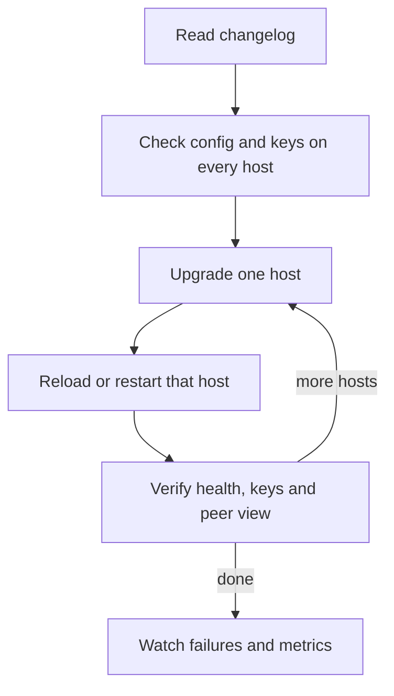

# Upgrades

Upgrade the binary, apply config, and verify health. Read [CHANGELOG.md](../CHANGELOG.md) first for behaviour changes and new keys.

Reiki does not load new binary code on reload. `SIGHUP`, `reiki reload`, `POST /v1/reload` and `[reload] watch` re-read the config and restart nothing. A reload builds the whole new state, including key files, plugin settings, tunnel policy, TLS material and the log level, before it swaps anything. A bad reload keeps the running state. Requests and tunnels already open keep the state they started with.

```bash
reiki --config /etc/reiki/reiki.toml reload --dry-run \
  --token-file /etc/reiki/admin.token
```

The JSON answer has `changed` and `restart_needed`. Preview with `?dry_run=true` on `POST /v1/reload`; see [monitoring](monitoring.md#post-v1reload).

## Reload vs restart

This is the complete map for every config table and key. "Live" means the change applies on reload without a restart. "Check only" means the new value is validated but has no running state to swap. "Restart" means the reload keeps the running value and reports a `restart_needed` label where the code defines one.

| Config | Reload | Restart | Notes |
| --- | --- | --- | --- |
| Top level: `listen` | — | Yes | Label `listen`. `--listen` and `REIKI_LISTEN` also bind only at start. |
| Top level: `strict_key_permissions` | Live | — | Applies to key files read on the next reload; already-loaded keys keep running. |
| `[admin]`: `token_sha256` | Live | — | New bearer hash applies on reload. |
| `[admin]`: `listen` | — | Yes | Label `admin.listen`. Adding or removing `[admin]` also needs a restart. |
| `[stream_admin]`: all keys | — | Yes | The management settings are read when the manager is created. Adding or removing `[stream_admin]` also needs a restart; its routes appear only when configured. A reload re-reads the dynamic state file and re-applies dynamic streams. |
| `[auth]`: `backoff`, `max_failures`, `window_secs` | Live | — | Failed-token throttle settings. |
| `[server]`: `max_connections`, `max_connections_per_addr`, `admin_max_connections`, `admin_max_connections_per_addr` | — | Yes | Labels `server.*`. Client and admin caps are bound at start; loopback is exempt from the per-address caps. |
| `[service]`: `shutdown_timeout_secs` | — | Yes | Label `service.shutdown_timeout_secs`. |
| `[reload]`: `watch`, `interval_secs` | Live | — | Apply to the watcher on the next reload. |
| `[log]`: `level` | Live | — | `RUST_LOG`, when set at startup, keeps overriding `level` after reload. The log file is reopened. |
| `[log]`: `file`, `format`, `stderr`, `file_max_bytes`, `file_keep` | — | Yes | Labels `log.file`, `log.format`, `log.stderr`, `log.file_max_bytes`, `log.file_keep`. |
| `[upstream.NAME]`: `base_url`, `auth_header`, `auth_format`, `model_aliases`, `drop_params`, `http2`, `forward_accept_encoding`, `max_decoded_bytes`, `response_idle_timeout_secs`, `response_timeout_secs`, `title_case_headers`, `send_keep_alive`, `pass_errors`, `confirm_quota`, `scope_escalate_after`, `hold_unauthorized`, `passthrough`, `capacity_group` | Live | — | The upstream is rebuilt for new requests. In-flight requests keep the old route. |
| `[upstream.NAME.fallback]`: `upstream`, `model_aliases` | Live | — | Applied with the upstream. |
| `[upstream.NAME.forward]`: `command`, `args`, `pass_env`, `socket`, `expect_uid`, `max_concurrent`, `streaming`, `max_stream_bytes`, `stream_timeout_secs` | Live | — | Applied with the upstream. Existing forwarder links keep their starting config. |
| `[upstream.NAME.limits]`: `preset`, `rpm`, `tpm`, `concurrent`, `daily_requests`, `daily_tokens`, `min_rpm`, `max_wait_secs` | Live | — | Applied with the upstream. Saved shaping state is tied to the key digest and upstream. |
| `[keys.NAME]`: `file`, `quota_resets` | Live | — | Key files are re-read. A changed file digest starts that key healthy. |
| `[keys.NAME]`: `upstream` | Live | — | A re-pointed key also starts healthy. |
| `[gateway]`: `on_store_error`, `usage_rpm` | Live | — | Applies to new admissions and usage-route requests. |
| `[streams.NAME]`: `token_sha256`, `chain`, `strategy`, `weight`, `allowed_upstreams`, `allowed_models` | Live | — | A changed `token_sha256` starts that stream's gateway counters fresh; unchanged tokens keep them. In-flight requests keep the old chain. |
| `[streams.NAME.limits]`: all fields | Live | — | Counters for unchanged streams are kept; limits are read from the new config. |
| `[tunnel]`: `listen` | — | Yes | Label `tunnel.listen`. |
| `[tunnel]`: `allow`, `connect_timeout_secs`, `allow_loopback`, `deny_private`, `close_idle_on_stop` | Live | — | Open tunnels keep their starting policy; new tunnels use the reloaded one. |
| Adding or removing `[tunnel]` | — | Yes | No tunnel listener exists until restart. |
| `[tunnel.intercept]`: `ca_cert`, `ca_key`, `leaf_ttl_hours`, `require_auth` | Live | — | Reiki validates the new CA before swap. Open connections keep their old certificate; clients must trust the new CA. |
| `[tunnel.intercept]`: `ca_key_permissions` | Check only | — | The CA key mode check runs on each reload. The policy has no running state to swap. |
| `[tunnel.intercept]`: `hosts` | Live | — | Rebuilds the intercept host table. |
| Adding or removing `[tunnel.intercept]` | — | Yes | Interception is bound at start. |
| `[[tunnel.intercept.hosts]]`: `host`, `upstream`, `stream`, `paths` | Live | — | Applied with the intercept host table to new CONNECTs; an open CONNECT keeps the host it was authorised with. |
| `[peers]`: `enabled`, `publish`, `listen` | — | Yes | Label `peers.listen` when the publishing listener appears, moves or goes away. |
| `[peers]`: `instance`, `expose_key_labels`, `expose_host_stats`, `expose_usage`, `session_header`, `session_window_secs`, `stream_interval_secs`, `cooldown_bucket_secs` | Live | — | Publisher payload and stream events. |
| `[peers]`: `max_subscribers`, `max_subscribers_per_peer`, `max_subscribers_per_token` | Live | — | Apply to new streams. Open streams keep their limits, and the listener's accepted-connection capacity is fixed at start. |
| `[peers]`: `max_connections_per_addr` | — | Needed, not reported | Read when the peer listener starts. No `restart_needed` label exists for it. |
| `[peers]`: `poll_interval_secs` | Live | — | Reader setting for `reiki peers` and `reiki top`; the proxy does not poll peers. |
| `[peers]`: `peer_token_sha256`, `tokens` | Live | — | Publisher token hashes apply without restart. |
| `[peers]`: `tls_cert`, `tls_key` | Live | Yes, for HTTP↔HTTPS only | File contents and paths swap while the publishing listener stays HTTPS. Open connections keep the old certificate. Adding or removing TLS needs a restart with label `peers.tls`. |
| `[peers]`: `tls_key_permissions` | Check only | — | The key mode check runs on each TLS reload. The policy has no running state to swap. |
| `[[peers.tokens]]`: `name`, `token_sha256` | Live | — | Token names and hashes apply on reload. |
| `[peers.NAME]`: `url`, `token_file`, `ca_file` | Live | — | Reader settings for `reiki peers` and `reiki top`, read on the next command. |
| `[plugins.NAME]`: `enabled`, `streams` | Live | — | `streams` alone never rebuilds the plugin. Enabling a disabled plugin builds it. |
| `[plugins.NAME]`: `on_error` | Live | Maybe | `requestlog` and `metrics` keep the running instance and report `plugins.<name>` instead. |
| Plugin-specific settings | Rebuild | Maybe | A rebuilt plugin with `live_reload() == false` keeps the running instance and reports `plugins.<name>`. `requestlog` and `metrics` do this for any setting change. `watched_files` changes rebuild too. |
| `dry_run` | Live | — | Injected by `reiki check` and reload previews; not a config key. |
| `[hubs.NAME]`, `[hub]`, `[hub.edges.NAME]`, `[accounts.LABEL]`, `[accounts.LABEL.limits]` | No effect | — | Parsed and validated only in this release. No listener is bound. The `hub` feature is not in release builds. |

Reload error cases keep the old state: an unknown plugin, an invalid setting, a key file that is missing or too short, and a failed interception CA check. See [configuration](configuration.md#validation), [plugins](plugins.md) and [troubleshooting](troubleshooting.md#reload).

## State file

Key health lives in `<config>.state`, beside the config. The state file is TOML with `keys` and an optional `shaper` table. Unknown fields are errors: a file that is not in the current shape is ignored with a warning and rebuilt.

| Fact | Effect |
| --- | --- |
| Missing, unreadable or unsupported file | Logged as a warning; Reiki starts fresh. |
| Key SHA-256 and saved upstream | A rotated key file or re-pointed key starts healthy. The recorded digest is the only rotation check. |
| Disabled flag, key cooldown, transient failures | Restored at start when the key name, upstream and file digest still match. |
| Scoped `(route, model)` cooldowns, last status and the failure ring | Not saved; they start empty. |
| Shaper snapshot | Saved with the same digest and upstream; durations are rounded up to whole seconds. |
| Write path | A sibling temporary file with mode `0600`, `sync_all`, rename, then parent directory sync. |
| Config path | State path follows the config path. Copy `<config>.state` when moving the config if health must survive the move. |

A reload does not read the state file again. It prunes keys removed from the config and starts new or changed keys healthy. `reiki keys --enable NAME` clears health and persists it. See [keys](keys.md) and [troubleshooting](troubleshooting.md#key-health).

### Dynamic stream state

With `[stream_admin]`, dynamic streams live in `stream-admin.json` (or the configured `state_file`) in the same state directory. Reiki writes it atomically with mode `0600`; it holds token hashes, not token values. Startup, reload and restart re-read the file and restore dynamic streams. An unreadable, oversized, invalid or unsupported-version file drops dynamic access while static streams from the config keep working. Check the condition with `GET /v1/status` (`stream_admin.state_error`) and repair it before relying on dynamic streams again. See [configuration](configuration.md#stream_admin).

Reiki does not rotate either file. Copy the state file only when the instance is stopped or immediately after a successful write; renaming it under a running instance can leave no usable restore point for the next reload or restart. The audit log (`audit_log`, required) is append-only JSONL created with mode `0600`, with a sibling `audit.head` sidecar holding the last sequence number and hash: do not truncate or edit either file, because a missing or changed record breaks verification. If you archive it, keep the old JSONL and sidecar together for offline verification with `reiki streams audit verify FILE`; a fresh file starts a new chain at record 1. Any change that adds, removes or edits `[stream_admin]` needs a restart; a reload reports `stream_admin` in `restart_needed`. See [keys](keys.md#dynamic-stream-credentials) and [monitoring](monitoring.md#stream-administration-routes).

## Single-machine upgrade

1. Read the target release in [CHANGELOG.md](../CHANGELOG.md). Check for new required config or changed defaults.
2. Put the new binary on disk without replacing the running process. Install mode `0755`.
3. Validate the new config and key files with the new binary:

   ```bash
   reiki --config /etc/reiki/reiki.toml check
   reiki --config /etc/reiki/reiki.toml keys --check
   ```

4. Preview the reload. If `restart_needed` is empty, apply it:

   ```bash
   reiki --config /etc/reiki/reiki.toml reload --dry-run \
     --token-file /etc/reiki/admin.token
   reiki --config /etc/reiki/reiki.toml reload \
     --token-file /etc/reiki/admin.token
   ```

5. If `restart_needed` is not empty, stop and start under the service manager. The drain gives requests `[service] shutdown_timeout_secs` to finish; keep `TimeoutStopSec` above it. See [deploy](deploy.md#signals-and-lifecycle).

   ```bash
   systemctl restart reiki
   ```

6. Verify health, status and keys:

   ```bash
   curl -s http://127.0.0.1:4097/__reiki/healthz
   reiki --config /etc/reiki/reiki.toml keys --token-file /etc/reiki/admin.token
   systemctl status reiki
   journalctl -u reiki -n 100 --no-pager
   ```

A binary-only upgrade still needs a restart. Reload applies config, not code.

## Fleet upgrade



1. Prepare the same binary and config on every host. Check each config with the new binary.
2. Upgrade one instance at a time. Peers do not route traffic, so a brief `unknown` peer view is acceptable. Data older than three poll intervals is treated as unknown.
3. Reload hosts with live-only changes. Restart hosts with listener, server-cap, shutdown-drain or log-file changes. Coordinate listener moves with clients and TLS proxies.
4. After each host, check `/__reiki/healthz`, `/v1/status`, `reiki keys`, and the fleet view in `reiki peers` or `reiki top`.
5. Watch `/v1/metrics` and `GET /v1/failures` after the last host. The failure ring is in memory and starts empty after each restart. See [monitoring](monitoring.md) and [top](top.md).

## Rollback

Keep the previous binary and config until verification passes. Restore both together: a new config can need a new binary, and an old binary can reject new config keys.

- For a config-only change, put the old config back and reload. The running binary keeps its state file.
- For a binary change, restart with the old binary and old config. `<config>.state` is tied to the shape that wrote it, so do not carry it across versions.
- Roll a fleet back in the reverse order; verify each host before moving to the next.

If the state file was written after a key rotation, the config and key files decide which saved health entries match. A key whose file or upstream changed starts healthy.

The dynamic stream state file has its own format version: an unsupported version leaves static streams running but drops dynamic access. Roll back with the config that matches it, or restore a compatible file before relying on dynamic streams. Audit logs are append-only per config; keep the log from the version you are verifying.
